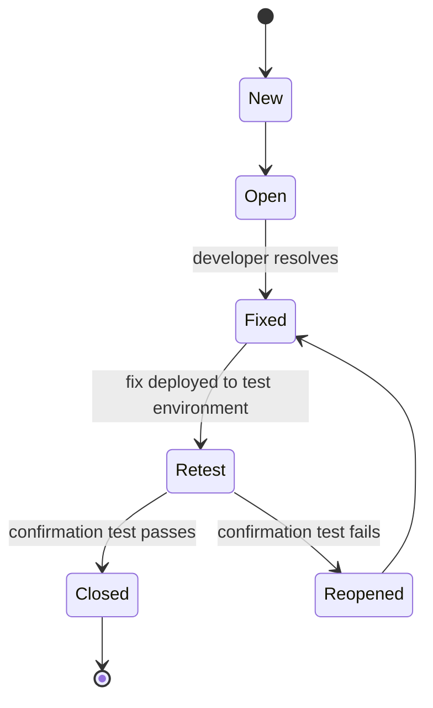

## Beginner-friendly explanation

You take your car to a garage because it makes a squealing noise when you brake. When you collect it, the mechanic says "Fixed!". What do you do? You drive around the block and brake, the same way you did when it squealed. Maybe you also brake a little harder, or on a downhill stretch, just to be sure.

That is **retesting**, which ISTQB calls **confirmation testing**: repeating the exact situation that showed the problem to confirm it is really gone. It sounds simple, and it is, but doing it carelessly is one of the most common reasons defects come back after release.

## Technical explanation

ISTQB CTFL v4.0 groups two kinds of **change-related testing**:

| | Confirmation testing (retesting) | Regression testing |
|---|---|---|
| Question | Is this specific defect fixed? | Did the change break anything else? |
| Scope | Narrow: the failed tests and the defect's scenario | Broad: areas affected by the change |
| Selection | Driven by the defect report | Driven by impact analysis and risk |
| Timing | First, as soon as the fix is deployed | After, or alongside, confirmation |

According to the syllabus, confirmation testing confirms that an original defect has been successfully fixed. Depending on risk, the fixed version can be tested by executing **all test cases that previously failed due to the defect**, or by adding new tests to cover changes needed to fix it. When time or money is short, confirmation testing may be restricted to exercising the steps that reproduce the failure and checking that it no longer occurs.

### Where it sits in the defect lifecycle

Exact state names vary between tools and teams; see [defect lifecycle](/learn/manual-testing/defect-lifecycle) for the full picture.

### Why variations matter

A fix often addresses the **exact symptom** reported rather than the underlying cause. If a report says "quantity 0 is accepted", a developer might block `0` but not negative numbers. Good retesting repeats the original scenario **and** tries a few close variations: neighbouring values, another entry point (UI versus API), another browser or user role.

## Real-world example

A banking app had a defect: "Transfer confirmation screen shows the wrong currency symbol for EUR accounts." The fix was marked done. A tester retested with the original EUR account and the symbol was now correct.

Because the defect's root cause was a currency lookup, the tester also tried a GBP account and a transfer from the mobile app instead of the web. Both still showed the wrong symbol: the fix had added a special case for EUR only, in the web front end only. The defect was reopened with three screenshots and the build number, and the second fix corrected the shared lookup instead.

## Step-by-step walkthrough

1. **Read the defect report fully**: steps, data, environment, expected and actual results, and any developer notes on the fix.
2. **Verify the build.** Check the build or version number in the test environment contains the fix. This one step prevents many false reopenings.
3. **Restore the original conditions**: same data state, user role, configuration and environment type.
4. **Execute the original reproduction steps** exactly and record the result.
5. **Try close variations** suggested by the defect's nature: boundaries, other inputs, other entry points, other platforms.
6. **Decide and document.** If it passes, close it with build number, environment and evidence. If it fails, reopen it with new evidence and what you observed.
7. **Hand over to regression testing** for the areas the fix might affect.

### Worked example: retest record

| Field | Value |
|---|---|
| Defect | Quantity of 0 accepted at checkout |
| Build verified | 2.14.3 (contains fix commit referenced in ticket) |
| Original steps | Add item, set quantity 0, check out |
| Result | Rejected with "Quantity must be at least 1", which is correct |
| Variations | Quantity -1 via API was **accepted**, which is wrong |
| Decision | Reopened with API request and response attached |

## Common mistakes

- **Not checking the build** and reopening a defect whose fix was never deployed.
- **Retesting with different data** and drawing conclusions about the original scenario.
- **Only repeating the exact steps** and missing an incomplete fix.
- **Closing without evidence**, so nobody can tell later what was verified and where.
- **Skipping regression testing** because "the retest passed".
- **Reopening an old defect for a new problem.** If the original failure is fixed but you found something different, log a new defect and link them.

## Troubleshooting

- **You cannot reproduce the original failure on the old build either.** The report may be missing a condition; ask the reporter or check logs before retesting the fix.
- **The fix passes in test but the reporter still sees it.** Compare environments, caches, feature flags and data; the fix may not be released to their environment yet.
- **A defect has been reopened many times.** Suggest a [root cause analysis](/learn/manual-testing/root-cause-analysis) instead of another symptom fix.

## Key takeaways summary

Confirmation testing is narrow but must be precise: verify the build, reproduce the original conditions, try a few close variations, and record the result with evidence. Then follow with regression testing, because a fix that works can still break something else.
