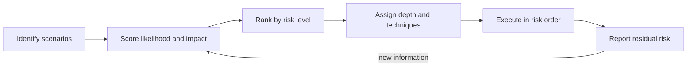

## Beginner-friendly explanation

Imagine you have ten minutes before guests arrive and the house is a mess. You do not clean evenly. You clear the living room and the bathroom, the places guests will definitely see, and leave the spare room door shut. You chose based on two questions: *how likely is it a guest goes there?* and *how bad would it be if it were messy?*

Testing works the same way. There is never enough time to test everything, so you ask, for each scenario, **how likely is it to break?** and **how bad would it be if it did?** Then you spend your time where both answers are biggest.

## Technical explanation

ISTQB CTFL v4.0 (section 5.2) defines a **risk** as a potential event, hazard, threat or situation whose occurrence causes an adverse effect. A risk is characterised by:

- **Risk likelihood**: the probability of the risk occurring.
- **Risk impact (harm)**: the consequences if it occurs.

Together they determine the **risk level**. Risk management consists of **risk analysis** (identification and assessment) and **risk control** (mitigation and monitoring). Assessment can be **quantitative** (for example, risk level = likelihood × impact) or **qualitative** (a risk matrix).

**Product risk analysis** shapes testing: scope and thoroughness, test levels and types, techniques and coverage, effort, the **prioritisation of tests** so critical defects are found as early as possible, and whether non-testing activities are also needed. This lesson applies that at the level of **scenarios**: deciding which ones to test, in what order and how deeply. For the broader approach, see [risk-based testing](/learn/manual-testing/risk-based-testing).

| Factor | Raises **likelihood** | Raises **impact** |
|---|---|---|
| Examples | Complex logic, heavy change, new technology or third-party integration, defect history, tight deadlines, unclear requirements | Money, many users affected, legal or regulatory exposure, safety, data loss, reputation, no workaround |

### Worked example: a food-delivery release

Scale: 1 low, 2 medium, 3 high. Risk score = likelihood × impact (1 to 9). Levels: **High 6–9**, **Medium 3–4**, **Low 1–2**.

| ID | Scenario | L | Why | I | Why | Score | Level |
|---|---|---|---|---|---|---|---|
| S1 | Pay by card and place order | 3 | Payment SDK upgraded this release | 3 | Revenue, every order | 9 | High |
| S2 | Apply promo code | 3 | New coupon-stacking logic | 2 | Wrong totals, support load | 6 | High |
| S3 | Refund for a cancelled order | 2 | Shares code with the SDK upgrade | 3 | Money, regulatory complaints | 6 | High |
| S4 | Live delivery tracking | 2 | Map library minor update | 2 | Annoyance, support calls | 4 | Medium |
| S5 | Search restaurants by cuisine | 2 | Index changes | 2 | Fewer orders | 4 | Medium |
| S6 | Log in with OTP | 1 | Unchanged, stable | 3 | No one can order | 3 | Medium |
| S7 | Rate a restaurant | 2 | Reworked rating widget | 1 | Cosmetic | 2 | Low |
| S8 | Change profile photo | 1 | Unchanged | 1 | Cosmetic | 1 | Low |

**Depth by level**

| Level | Test depth |
|---|---|
| High | Full positive and negative tests; EP, BVA and decision tables; state transitions for order status; exploratory charter; add to automated regression |
| Medium | Main and key alternate flows; main negative cases; existing regression |
| Low | Smoke check or consciously deferred, with the deferral reported |

Note S6. Its score is only 3, but its impact is maximum, because if login fails nobody can order. A sensible rule is that **every impact-3 scenario gets at least a smoke test**, however unlikely it seems.



## Real-world example

A team building an insurance portal had three days of testing time for a release that would normally need eight. Instead of starting at the top of the regression suite, the test lead ran a 45-minute risk workshop with a developer, the product owner and a support lead. Support pointed out that the premium-renewal page generated the most complaints, which nobody else had flagged. It went to the top of the list, testing found a rounding defect there, and the lead's release report listed exactly which low-risk scenarios were deferred. The product owner accepted that residual risk in writing.

## Step-by-step walkthrough

1. **List scenarios** from requirements, user journeys and the regression suite.
2. **Run a short risk workshop** with development, product and support to collect likelihood and impact evidence.
3. **Score each scenario** on an agreed scale and write a one-line reason for each score.
4. **Rank** by risk level and apply override rules (for example, every maximum-impact scenario gets a smoke test).
5. **Assign depth and techniques** per level.
6. **Estimate effort** and draw the line at what fits the available time.
7. **Execute in risk order**, so stopping early still leaves the highest risks covered.
8. **Report residual risk**: what was not tested and why. Re-score when new information arrives, such as defects found or late changes.

## Code examples

A small script keeps scores, reasons and ranking in version control instead of in someone's head:

```python
scenarios = [
    ("S1", "Pay by card and place order", 3, 3),
    ("S2", "Apply promo code", 3, 2),
    ("S3", "Refund for a cancelled order", 2, 3),
    ("S4", "Live delivery tracking", 2, 2),
    ("S5", "Search restaurants by cuisine", 2, 2),
    ("S6", "Log in with OTP", 1, 3),
    ("S7", "Rate a restaurant", 2, 1),
    ("S8", "Change profile photo", 1, 1),
]

def level(score: int) -> str:
    return "High" if score >= 6 else "Medium" if score >= 3 else "Low"

ranked = sorted(scenarios, key=lambda s: (s[2] * s[3], s[3]), reverse=True)
for sid, name, likelihood, impact in ranked:
    score = likelihood * impact
    flag = " (smoke test mandatory)" if impact == 3 and score < 6 else ""
    print(f"{sid} {score} {level(score):6} {name}{flag}")
```

## Expected output

```text
S1 9 High   Pay by card and place order
S3 6 High   Refund for a cancelled order
S2 6 High   Apply promo code
S4 4 Medium Live delivery tracking
S5 4 Medium Search restaurants by cuisine
S6 3 Medium Log in with OTP (smoke test mandatory)
S7 2 Low    Rate a restaurant
S8 1 Low    Change profile photo
```

S3 now ranks above S2 although both score 6, because the sort key uses impact as a tiebreaker: when scores are equal, the scenario with the bigger consequence is tested first. S4 and S5 tie on both values, and Python's sort is stable, so they keep their original order. Agree a tiebreak rule with your team rather than leaving it to chance.

## Common mistakes

- **Scoring alone.** One tester cannot see all likelihood and impact factors.
- **Scores without reasons**, which makes them impossible to challenge or update.
- **Trusting the multiplication blindly**, so catastrophic but unlikely failures are under-tested.
- **Silently dropping low-risk tests** instead of reporting residual risk.
- **Never re-scoring.** A cluster of defects found mid-cycle raises likelihood for that area.
- **Confusing impact with likelihood**, for example rating payments "likely to fail" just because they matter.

## Troubleshooting

- **Everything is rated High.** Force a distribution (for example, at most a third of scenarios can be High) or compare pairs: "Is A riskier than B?"
- **Stakeholders disagree on impact.** Escalate to the product owner, who owns business impact; record the decision.
- **No defect history exists.** Use change size and complexity as likelihood proxies, and update scores after the first test cycle.

## Key takeaways summary

Risk-based scenario selection spends limited time where failure is most likely and most harmful. Score likelihood and impact with reasons, rank, match depth to risk, protect maximum-impact scenarios, execute in risk order and report what was left untested.
