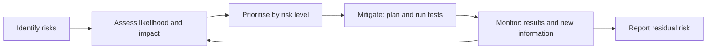

## Beginner-friendly explanation

Imagine packing for a two-week trip with only ten minutes left before the taxi arrives. You cannot check everything, so you think: what would be a **disaster** to forget, and what am I **likely** to forget? Passport, tickets and medication are high on both counts, so you check them first and twice. A spare pair of socks is low on both, so you grab some if there is time.

**Risk-based testing** is that same thinking applied to software. There is never time to test everything equally, so we ask two questions about each area: **how likely is it to go wrong**, and **how bad would it be if it did**? The answers decide what we test first, how thoroughly and with which techniques.

## Technical explanation

### Key terms (ISTQB CTFL v4.0)

- **Risk**: a potential event, hazard, threat or situation whose occurrence causes an adverse effect.
- **Risk likelihood**: the probability of the risk occurring.
- **Risk impact**: the harm, or consequences, if it occurs.
- **Risk level**: determined by likelihood and impact together.
- **Product risk**: related to the quality of the product, such as missing or wrong functionality, incorrect calculations, poor performance, security vulnerabilities or poor usability.
- **Project risk**: related to managing and controlling the project, such as delays, staff shortages, environment or tool problems, and supplier issues.

**Risk-based testing** is an approach in which test activities are selected, prioritised and managed based on risk analysis and risk control.

### Product risk analysis and control

| Activity | Part | What happens |
|---|---|---|
| Risk analysis | Identification | Build a list of risks through brainstorming, workshops, interviews, checklists, defect history and cause-effect diagrams |
| Risk analysis | Assessment | Categorise, estimate likelihood and impact, determine the risk level and prioritise |
| Risk control | Mitigation | Implement actions to reduce the risk level, often by testing |
| Risk control | Monitoring | Check that mitigation works, gather information to improve the analysis and identify new risks |

Risk assessment can be **quantitative** (risk level = likelihood × impact, using numbers) or **qualitative** (using a risk matrix of words such as low, medium and high).

### How risk shapes testing

The syllabus states that product risk analysis can influence the thoroughness and scope of testing. Results are used to determine the scope, the particular test levels and test types, the test techniques and coverage, the effort for each task, the prioritisation of testing and other activities besides testing that could reduce risk.

Responses to an analysed product risk include **mitigation by testing**, **risk acceptance**, **risk transfer** and a **contingency plan**.

## Real-world example

A team was rebuilding the checkout of an online pharmacy with four weeks of testing time. In a risk workshop with pharmacists, support staff, developers and the product owner, they identified risks and rated them on 1 to 3 scales:

| Risk | Likelihood | Impact | Level (L × I) | Response |
|---|---|---|---|---|
| Prescription items sold without a valid prescription check | 2 | 3 | 6 | Decision tables, three-value BVA on dates, exploratory sessions, early start |
| Wrong total when discounts and delivery fees combine | 3 | 2 | 6 | Decision tables, automated regression |
| Payment provider timeout leaves order in unknown state | 2 | 3 | 6 | Integration tests with fault injection |
| Slow search with full catalogue | 2 | 2 | 4 | Performance test on production-sized data |
| Address autocomplete misses rural addresses | 2 | 1 | 2 | Light functional checks |
| Typos in footer pages | 1 | 1 | 1 | Accept; review if time allows |

The highest-risk items started first and received the most rigorous techniques. When the payment-timeout tests revealed orders stuck in a "pending" state, there were still two weeks to fix it, because the riskiest area had not been left until the end.

## Step-by-step walkthrough

1. **Gather stakeholders** from business, development, operations and support. Risk is a shared judgement, not a tester's guess.
2. **Identify product risks** per feature or quality characteristic, using defect history, complexity, change size, usage and regulations.
3. **Agree scales** with concrete descriptions, such as what "high impact" means in money, customers or compliance.
4. **Assess likelihood and impact separately** and compute or look up the risk level.
5. **Decide responses**: test extent, levels, types, techniques and order for each risk; record accepted risks explicitly.
6. **Trace tests to risks** so you can show coverage per risk.
7. **Execute highest risks first.**
8. **Monitor and re-assess** as defects are found, scope changes or new information arrives.
9. **Report residual risk**: which risks are mitigated, partially mitigated or untested, so release decisions are informed.

## Common mistakes

- **Rating everything high.** Without differentiation, risk analysis cannot guide anything.
- **Confusing product and project risks.** More testing does not fix a late environment.
- **A one-time analysis** filed away and never updated.
- **Testers assessing impact alone**, without the business people who understand consequences.
- **Reporting only pass percentages.** "95% passed" hides whether the 5% that failed are the highest risks.
- **Dropping low-risk areas silently.** Accepted risks should be documented and agreed.

## Troubleshooting

- **Stakeholders disagree on ratings.** Discuss the evidence and the concrete scale definitions; if still split, record the higher rating and the reason.
- **The risk list is enormous.** Group related risks by feature or quality characteristic and assess the groups first.
- **There is no time even for high risks.** Escalate with the risk list as evidence; the decision to accept untested high risks belongs to stakeholders, not to the tester alone.

## Key takeaways summary

Risk-based testing turns limited time into the most valuable information. Identify and assess product risks with stakeholders, let risk levels drive scope, depth, techniques and order, keep the analysis alive as the project changes, and report residual risk so the release decision is made with open eyes. See [risk-based scenario selection](/learn/manual-testing/risk-based-scenario-selection) for applying it to individual test scenarios.
