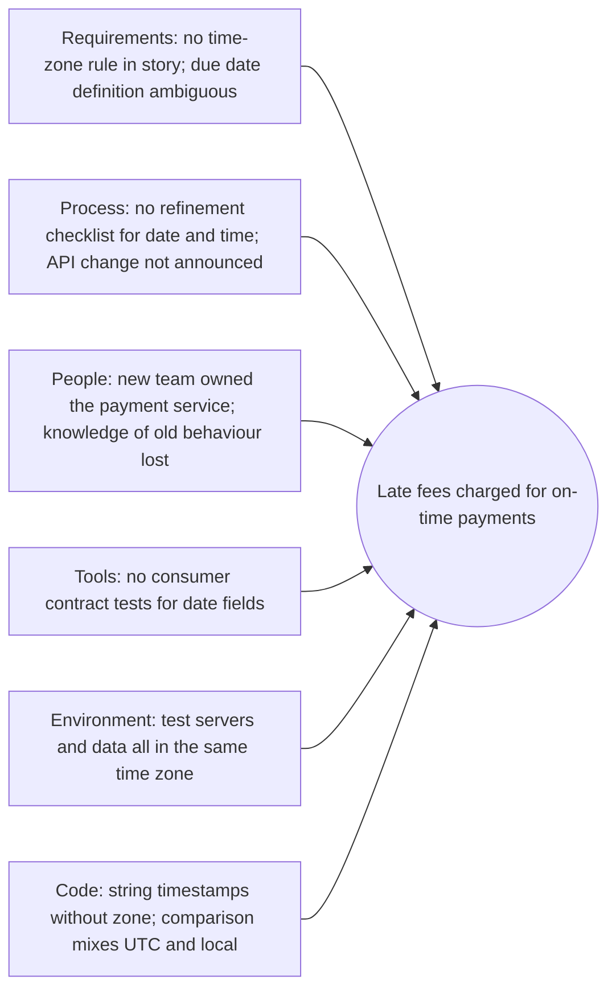

## Beginner-friendly explanation

If your kitchen floor is wet, you can mop it. Tomorrow it is wet again. You can mop every day, or you can find out **why** it is wet: a leaking pipe under the sink, which leaks because a washer is worn, which wore out because the water pressure is too high.

Fixing a defect is mopping. **Root cause analysis (RCA)** is finding the leak, and then the reason for the leak, so the floor stops getting wet.

## Technical explanation

ISTQB distinguishes errors (human mistakes), defects (flaws in a work product) and failures (observed deviations). A **root cause** is a source of a defect such that, if it is removed, the occurrence of that type of defect is decreased or removed. **Root cause analysis** is the technique for finding it.

Two questions matter for every significant defect:

1. **Why was it introduced?** (requirements, design, coding, configuration)
2. **Why did it escape?** (reviews, tests, environments, monitoring)

### 5 Whys

Start with the problem statement and ask "why?" repeatedly, using evidence for each answer, until you reach a cause you can act on. Five is a guideline.

### Fishbone (Ishikawa) diagram

Write the problem at the "head" and draw "bones" for categories of cause. Common software categories: **Requirements, Process, People/Skills, Tools, Environment, Code/Design**. Brainstorm candidate causes under each, then use evidence to confirm or discard them.

### Blameless approach

Practices described in the Google SRE books emphasise blameless postmortems: look at the systems and conditions that allowed a mistake, not at punishing the person who made it. People share facts only when it is safe to do so.

## Real-world example

**Incident:** after a release, customers of a utilities billing portal in one region were charged a late fee even though they paid on the due date. The defect was fixed by a hotfix within a day. The team then ran an RCA.

### 5 Whys (introduction chain)

| Why? | Answer (with evidence) |
|---|---|
| 1. Why were customers charged late fees? | The late-fee job treated payments made on the due date as late (job logs) |
| 2. Why were due-date payments treated as late? | The comparison used `paymentDate > dueDate` with timestamps in UTC, while due dates are in local time (code review) |
| 3. Why was UTC compared with local time? | The new payment service returns UTC; the old one returned local time. The change was not noticed (API diff) |
| 4. Why was the change not noticed? | The API contract did not specify time zone, and no consumer test covered it (contract file) |
| 5. Why was there no requirement or test for time zone? | Refinement has no checklist step for date/time rules and the story's acceptance criteria were silent on it |

**Escape chain:** test data used payments at midday local time, so the UTC offset never crossed a day boundary. No boundary test existed for "paid on the due date, late evening". (Compare [boundary value analysis](/learn/manual-testing/boundary-value-analysis) applied to time.)

### Fishbone

### Actions agreed

| Action | Owner | Due |
|---|---|---|
| Add "date, time and time zone rules" to the refinement checklist | Product owner | Next sprint |
| Specify time zone (ISO 8601 with offset) in the payment API contract | Payments tech lead | 2 weeks |
| Add consumer contract tests for date fields | Billing developers | 2 weeks |
| Add boundary test cases for due-date payments at 23:59 local and 00:00 next day | QA | Next sprint |
| Run one test environment in a different time zone | Platform team | 1 month |

Notice what is **not** an action: "developers must be more careful". It is not specific, not measurable and does not change the conditions.

## Step-by-step walkthrough

1. **Choose what deserves RCA**: escaped high-severity defects, incidents, recurring problems.
2. **Write a precise problem statement** with impact and timeline.
3. **Collect evidence**: logs, commits, test cases, requirements, timeline of events.
4. **Run 5 Whys** for both "introduced" and "escaped", checking each answer against evidence.
5. **Build a fishbone** to look for contributing causes beyond the single chain.
6. **Agree actions** that are specific, owned and dated.
7. **Track actions** to completion and check later whether similar defects decreased (see [defect metrics](/learn/manual-testing/defect-metrics)).

## Common mistakes

- **Stopping at a person** ("tester missed it") instead of asking why the system made it easy to miss.
- **Only one chain.** Real incidents usually have several contributing causes.
- **Answers without evidence**, which turn RCA into guesswork.
- **Vague actions** like "test more" that nobody can complete.
- **No follow-up**, so actions are forgotten.
- **RCA for everything**, which burns time and makes people resent the practice.

## Troubleshooting

- **The discussion turns into blame.** Restate the blameless rule and redirect to "what made this possible?".
- **The team cannot agree on the root cause.** Record the contributing causes and act on the ones with the best evidence and cheapest prevention.
- **Actions keep slipping.** Put them in the backlog with the same visibility as features.

## Key takeaways summary

RCA looks past the fix to the conditions that created the defect and let it escape. Use 5 Whys for depth, a fishbone for breadth, evidence for every claim, and finish with specific, owned actions that change the process, in a blameless setting.
