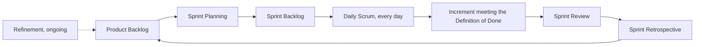

## Beginner-friendly explanation

Imagine a small restaurant kitchen that plans one menu every two weeks. One person decides what dishes are worth cooking for the guests (that is the **Product Owner**). One person makes sure the kitchen works well together and removes obstacles, like a broken oven (that is the **Scrum Master**). Everyone who actually cooks, plates and tastes the food is a **Developer**, and that includes the person who tastes every dish.

Every two weeks they meet to choose dishes, huddle briefly every morning, show the finished dishes to guests for feedback, and then talk honestly about how to work better. Those meetings are the Scrum **events**. People often call them "ceremonies", but the Scrum Guide's word is *events*.

## Technical explanation

Scrum is a lightweight framework defined by the [Scrum Guide](https://www.scrumguides.org/scrum-guide.html), most recently updated in 2020. It rests on three pillars, **transparency, inspection and adaptation**, and five values: commitment, focus, openness, respect and courage.

### Accountabilities

| Accountability | Accountable for | Tester's relationship |
|---|---|---|
| Product Owner | Maximising the value of the product; effective Product Backlog management, including the Product Goal and ordering of items | Clarify rules and acceptance criteria with them; flag risk that affects value |
| Scrum Master | Establishing Scrum as defined in the Guide; the Scrum Team's effectiveness | Raise impediments, such as unstable environments, that block quality work |
| Developers | Creating any aspect of a usable Increment each Sprint; the Sprint Backlog; instilling quality by adhering to the Definition of Done | A tester **is** a Developer and shares this accountability |

A Scrum Team is typically 10 or fewer people, with no sub-teams or hierarchies.

### Events and maximum timeboxes

| Event | Purpose | Max timebox (one-month Sprint) |
|---|---|---|
| Sprint | Container for all other events; fixed length of one month or less | One month |
| Sprint Planning | Answer why this Sprint is valuable (Sprint Goal), what can be Done, and how the work will get done | 8 hours |
| Daily Scrum | Developers inspect progress toward the Sprint Goal and adapt the plan | 15 minutes |
| Sprint Review | Inspect the outcome of the Sprint with stakeholders and determine future adaptations | 4 hours |
| Sprint Retrospective | Plan ways to increase quality and effectiveness | 3 hours |

For shorter Sprints the events are usually shorter. **Product Backlog refinement** is an *ongoing activity*, not an event: breaking items down and adding detail such as description, order and size.

### Artifacts and commitments

| Artifact | Commitment |
|---|---|
| Product Backlog | Product Goal |
| Sprint Backlog | Sprint Goal |
| Increment | Definition of Done |

The Definition of Done is a formal description of the state of the Increment when it meets the quality measures required for the product. If an item does not meet it, it cannot be released or presented at the Sprint Review.

## Real-world example

A team building an appointment-booking app runs two-week Sprints. Here is how the team's tester spends one Sprint:

- **Refinement (ongoing):** asks what happens when two people book the same slot at the same moment, and whether cancellations within one hour are allowed. Both answers become acceptance criteria.
- **Sprint Planning:** points out that the reminder-SMS story needs a test phone number in the staging environment; the team adds a task for it to the Sprint Backlog.
- **Daily Scrum:** "Booking story is tested and meets the acceptance criteria. Cancellation is blocked because staging has no test data; I'm pairing with the developer this morning to seed it."
- **Sprint Review:** demonstrates the double-booking prevention. A stakeholder asks about time zones for remote clinics, which becomes a new backlog item.
- **Retrospective:** shows that three defects this Sprint came from missing time-zone handling and proposes adding a time-zone check to the team's test checklist.

## Step-by-step walkthrough

1. **Know the Sprint Goal.** Test effort should protect the goal first.
2. **Bring test considerations to planning**: environments, data, devices, integrations, and work that should be automated.
3. **Make testing visible** in the Sprint Backlog as tasks or as part of each item's workflow, so progress at the Daily Scrum is honest.
4. **Test continuously**, story by story, rather than in a block at the end.
5. **Check every item against the Definition of Done** before calling it done.
6. **Feed learning back** at the Sprint Review (new risks from stakeholders) and the Retrospective (process improvements).

## Common mistakes

- **Inventing a "QA" accountability.** Testers are Developers; separating them recreates hand-offs.
- **Treating the Daily Scrum as a status report to a manager.** It is for the Developers to adapt their plan.
- **Calling refinement an event.** It is an ongoing activity; teams schedule it however suits them.
- **Presenting undone work at the Sprint Review.** Undone work returns to the Product Backlog.
- **Claiming the Definition of Ready is part of Scrum.** It is an optional team practice.
- **Extending the Sprint to finish testing.** The Sprint length is fixed; a recurring overrun is a retrospective topic.

## Troubleshooting

- **Testing always finishes after the Sprint.** Slice stories smaller, limit work in progress, and make testing part of the Definition of Done.
- **Stakeholders skip the Sprint Review.** Show working software on real scenarios rather than slides, so the session is worth attending.
- **Retrospectives produce no change.** Pick one improvement, put it in the next Sprint Backlog, and check it next time.

## Key takeaways summary

Learn the Scrum Guide's own words: three accountabilities, five events, three artifacts with their commitments. A tester is a Developer who brings risk thinking to every event and holds the team to its Definition of Done.
