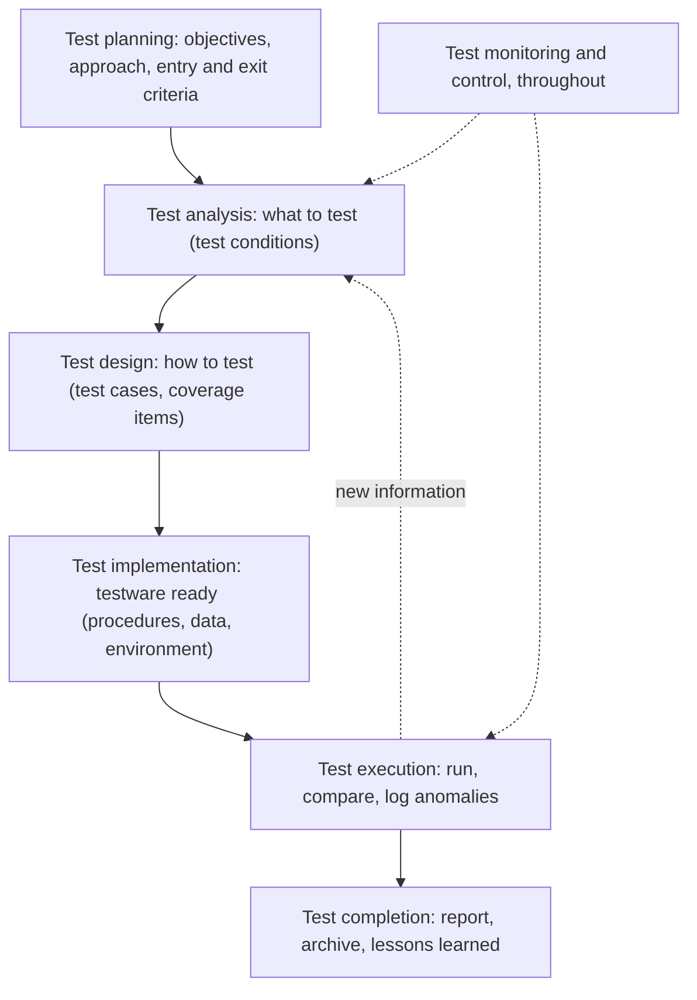

## Beginner-friendly explanation

Think about building a house. The **building lifecycle** covers everything: deciding what the family needs, drawing plans, laying foundations, building walls, wiring, plumbing, decorating and finally handing over the keys. That is like the **SDLC** (software development lifecycle).

Running through that whole process is a separate set of checking work: an inspector reviews the plans, checks the foundations before walls go up, tests the wiring before the plaster covers it, and does a final walk-through with the family. That checking has its own steps, from planning which inspections are needed to writing the final report. That is like the **STLC** (software testing lifecycle).

The checking is not something that starts after the house is finished. It happens alongside the building, at every stage. And how it is organised depends on how the house is built: all at once from a fixed plan, or room by room with the family moving in early.

## Technical explanation

### The SDLC

A **software development lifecycle model** describes the types of activity performed at each stage of a project and how they relate. ISTQB groups common models into:

| Category | Examples | Testing characteristics |
|---|---|---|
| Sequential | Waterfall, V-model | Phases follow each other; dynamic testing tends to come later; testers review documents early |
| Iterative | Spiral, prototyping | Repeated cycles refine the product; early feedback on prototypes |
| Incremental | Unified Process | The product grows in increments; each increment needs testing plus regression |
| Agile | Scrum, Kanban, Extreme Programming | Short iterations, whole-team quality, lightweight documentation, heavy regression automation |

ISTQB notes that agile approaches are iterative and incremental, and that development practices such as test-driven development (TDD), acceptance test-driven development (ATDD) and behaviour-driven development (BDD) support testing in them.

### The STLC, or ISTQB test process

"STLC" is a widely used industry term. ISTQB does not use it; it describes a **test process** made up of **test activities**:

| Activity | Typical outputs |
|---|---|
| Test planning | Test plan, entry and exit criteria, schedule |
| Test monitoring and control | Progress reports, control directives |
| Test analysis | Prioritised test conditions, defects found in the test basis |
| Test design | Test cases, test data requirements, environment requirements |
| Test implementation | Test procedures, test suites, test data, environment set-up |
| Test execution | Test logs, defect reports |
| Test completion | Test completion report, archived testware, improvement actions |

These activities are often **iterative or parallel**, not a strict waterfall. How formal each one is depends on the context: the SDLC, risks, domain, regulation and team.

### Good practices in any SDLC

The syllabus lists practices that apply whatever model you use:

1. For every development activity, there is a corresponding test activity, so all development work is subject to quality control.
2. Different test levels have specific and different test objectives, which avoids redundant testing.
3. Test analysis and design for a given test level begin during the corresponding development phase, so testing follows the early-testing principle.
4. Testers are involved in reviewing work products as soon as drafts are available.

## Real-world example

A generic scenario: the same feature, "customers can save a card for future payments", built by two teams.

**Team A (V-model):** a business analyst writes a requirements specification. Testers review it in week one and raise questions about card expiry. Test analysis and design for system testing start while developers design the architecture. After implementation and integration, a formal system test phase executes the prepared cases; a separate acceptance phase follows with business users. A test completion report closes the project.

**Team B (Scrum):** the story is refined with the product owner, a developer and a tester, who agree acceptance criteria, including expired-card behaviour. During the sprint, the developer writes unit tests and the tester designs and runs tests as soon as each slice is ready, automating the regression checks. The increment is demonstrated at the sprint review, and the retrospective covers what slowed testing down.

Both teams performed planning, analysis, design, implementation, execution and completion. The difference was timing, formality and how the work was shared.

## Common mistakes

- **Treating testing as a phase after development.** In every model, test activities start with the first work product.
- **Using "STLC" in an ISTQB exam answer.** Refer to the test process and its activities.
- **Assuming agile means no planning or documentation.** Agile testing still plans, analyses and reports; it does so lightly and continuously.
- **Copying one model's test process into another.** A heavyweight formal sign-off every two weeks will not fit a Scrum team, and a lightweight approach may not satisfy a regulated sequential project.
- **Forgetting test completion.** Lessons learned and archived testware are what make the next release faster.

## Key takeaways summary

The SDLC describes how software is built; the test process, often called the STLC, describes how testing is organised within it. The test activities are the same in every model, but their timing, formality and ownership change with the lifecycle. Whatever the model, match every development activity with a test activity and get involved as early as possible.
