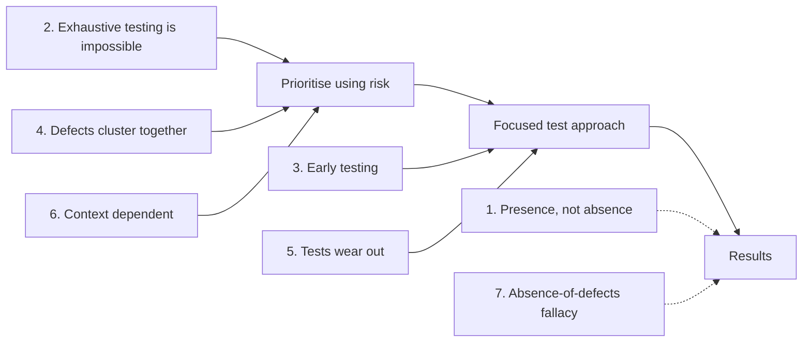

## Beginner-friendly explanation

Think of a doctor doing a health check-up. Some common sense applies to every check-up:

- A clean check-up shows no problems were *found*; it does not prove you are perfectly healthy.
- The doctor cannot run every possible test on every part of your body.
- Catching a problem early is much easier to treat than catching it late.
- Problems often cluster: if your blood pressure is high, the doctor will look harder at your heart.
- If the doctor runs exactly the same three tests every year, new problems may slip past.
- A check-up for an athlete looks different from one for a newborn.
- And being free of disease is not the same as feeling well and living the life you want.

Software testing has seven similar principles. They are not rules for one technique; they are the common sense behind every good testing decision.

## Technical explanation

The ISTQB CTFL v4.0 syllabus (section 1.3) lists seven principles that offer general guidelines applicable to all testing.

| # | Principle | What it means |
|---|---|---|
| 1 | Testing shows the presence, not the absence of defects | Testing can show defects exist, but cannot prove there are none. It reduces the probability of undiscovered defects. |
| 2 | Exhaustive testing is impossible | Testing every combination of inputs and preconditions is not feasible except in trivial cases. Use test techniques, prioritisation and risk-based testing instead. |
| 3 | Early testing saves time and money | Defects removed early do not cause later defects in derived work products. Start static and dynamic testing as early as possible. |
| 4 | Defects cluster together | A small number of components usually contain most of the defects found (an instance of the Pareto principle). Predicted and observed clusters are an important input to risk-based testing. |
| 5 | Tests wear out | Repeating the same tests makes them less effective at detecting new defects. Tests and test data may need modifying, and new tests writing. Repetition is useful for automated regression testing. |
| 6 | Testing is context dependent | There is no single universally applicable approach. Testing is done differently in different contexts. |
| 7 | Absence-of-defects fallacy | It is a fallacy to expect that verification alone ensures success. Validation is needed too, because a system can be defect-free and still not meet users' needs. |

### How the principles connect

Principles 2, 4 and 6 tell you that you must choose what to test. Principles 3 and 5 shape when and how. Principles 1 and 7 tell you how to interpret the results honestly.

### Applying the principles

- **Principle 1** shapes reporting: say "no defects were found in the tested scope", never "the software has no bugs".
- **Principle 2** is the reason for test techniques such as [boundary value analysis](/learn/manual-testing/boundary-value-analysis): they select a small, effective subset of an impossibly large input space.
- **Principle 3** is the basis of shift-left practices such as reviewing user stories.
- **Principle 4** supports [risk-based testing](/learn/manual-testing/risk-based-testing): spend more effort where defects have been, and where complexity and change are highest.
- **Principle 5** is the reason to review regression suites and complement them with exploratory testing.
- **Principle 6** means a safety-critical system and a short-lived marketing site get very different approaches.
- **Principle 7** links to [verification versus validation](/learn/manual-testing/verification-vs-validation).

## Real-world example

A generic scenario: a retail team's mobile app has a large manual regression checklist that has been run unchanged for every release.

- Releases pass the checklist, yet customers report defects in the new loyalty-points feature. **Tests wear out**: the checklist was written before loyalty points existed.
- The test lead reviews defect reports from the last few releases and finds most are in the loyalty and checkout modules. **Defects cluster together**, so those modules get deeper testing and exploratory sessions.
- Testers start joining story refinement and spot an unclear rule about points expiry before it is built. **Early testing saves time and money.**
- The team can no longer run every test on every device, so they choose a device set based on their user analytics. **Exhaustive testing is impossible**, and **context** decides the selection.
- A release goes out with no known defects, but users complain that redeeming points takes too many steps. The **absence-of-defects fallacy**: verification passed, validation did not.

## Common mistakes

- **Quoting the principles without applying them.** Use them to justify concrete decisions such as scope and priorities.
- **Using old wording.** Earlier syllabi said "pesticide paradox"; v4.0 says "tests wear out". Know both, but use the current name in the exam.
- **Reading "tests wear out" as "never repeat tests".** Regression testing deliberately repeats tests to detect unintended changes.
- **Treating defect clusters as permanent.** Clusters move as code changes; review the data regularly.
- **Promising "bug-free" releases.** That contradicts principle 1 and sets false expectations.

## Key takeaways summary

The seven principles are the reasoning behind every testing decision: you cannot test everything or prove the absence of defects, so you test early, focus where defects cluster, refresh your tests, adapt to context and remember that a defect-free product can still fail its users. Use them to explain your choices, not just to pass the exam.
