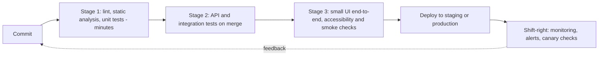

## Beginner-friendly explanation

Picture building a house. If an inspector checks the plans and spots that a doorway is too narrow for a wheelchair, fixing it costs a pencil and an eraser. If the same problem is found after the walls are plastered, it means demolition. Shift-left is the idea of **moving checks to the left of the timeline**, closer to the plans, so problems are cheaper to fix.

Continuous testing is like having a smoke alarm that tests the air every few seconds instead of a fire inspector who visits once a year. Every change to the software triggers quick, automatic checks, so the team hears about problems while the change is still fresh in everyone's mind.

## Technical explanation

### Shift-left

If you draw the software lifecycle from left (idea) to right (production), traditional testing sits near the right. **Shift-left** means performing testing activities earlier. The ISTQB Foundation syllabus lists shift-left practices such as reviewing specifications from a tester's perspective, writing test cases before code, using continuous integration, completing static analysis before dynamic testing, and performing non-functional testing at component level where possible.

The underlying reasoning is simple: a defect introduced in a requirement and found in production has been built on, tested around and shipped. The later it is found, the more work it takes to fix.

Shift-left activities for a tester:

| Lifecycle point | Activity | Typical defects prevented |
|---|---|---|
| Refinement | Question stories; add examples and edge cases | Missing rules, ambiguity, contradictions |
| Design | Review wireframes and API contracts | Missing error states, inconsistent fields |
| Before coding | Agree acceptance tests (Given/When/Then) | Misunderstood behaviour |
| During coding | Pair on unit/API tests; review pull requests | Untested branches, weak assertions |
| Feature branch | Test early builds or preview environments | Integration surprises found late |

Many of these are **static testing**: examining work products without executing code (see [static vs dynamic testing](/learn/manual-testing/static-vs-dynamic-testing)).

### Continuous testing

Continuous testing is running automated tests throughout the delivery pipeline so every change is evaluated for risk quickly. A typical layering:

Design rules for a healthy pipeline:

- **Fast first.** The commit stage should finish in minutes so developers wait for it.
- **Push checks down** the [test pyramid](/learn/sdet/test-pyramid-and-strategy): most logic tested at unit and API level, few UI journeys.
- **Fail the build on real failures** and treat flaky tests as defects to fix, not noise to ignore.
- **Own every failure.** Someone investigates each red build promptly.

### Shift-right

Shift-right covers testing and learning in or near production: monitoring, alerting, feature flags, canary or staged rollouts, and analysing real user errors. It complements shift-left; findings in production should become new early checks.

### Where manual testing fits

Continuous testing does not remove manual testing. It removes **repetitive regression checking** from people, freeing them for exploratory testing, usability judgement, and the early analysis described above.

## Real-world example

A subscription team kept finding pricing defects during end-of-Sprint testing. The tester proposed three shift-left changes: a 20-minute "three amigos" conversation (Product Owner, developer, tester) for every pricing story; a decision table of plan, region and discount agreed before coding; and API-level automated checks for every row of that table running on each merge.

Pricing defects found late dropped noticeably over the next few Sprints, and the tester's time moved from re-checking prices by hand to exploring upgrade and downgrade journeys, where the remaining risk was.

## Step-by-step walkthrough

1. **Map where defects are currently found** (refinement, development, testing, production).
2. **Pick the costliest category** and ask which earlier activity would have caught it.
3. **Introduce one practice**, for example example-mapping in refinement or tester review of pull requests.
4. **Agree a pipeline layering** with developers and keep the first stage fast.
5. **Automate stable, repetitive checks**; keep humans on exploration and judgement.
6. **Close the loop**: every escaped defect gets a question, "where could we have caught this earlier?"

## Common mistakes

- **Equating shift-left with "automate everything".** The biggest wins often come from conversations and reviews.
- **Slow pipelines** that developers learn to bypass.
- **Tolerating flaky tests**, which trains everyone to ignore red builds.
- **Too many UI end-to-end tests** instead of faster API and unit checks.
- **Ignoring shift-right**, so production lessons never feed back.
- **Shifting the work without the skills**: asking testers to review code or contracts without giving them time to learn.

## Troubleshooting

- **Developers resist tester involvement in pull requests.** Start by reviewing only test code and acceptance coverage, not style.
- **No environment until late in the Sprint.** Advocate for preview environments per branch or contract-level tests that run without a full stack.
- **The pipeline is red too often to be useful.** Track the reasons for a week; separate product failures from test or environment failures and fix the largest category.
- **Nobody knows which tests cover a requirement.** Tag automated checks with the story or requirement identifier so a failing check points straight to the affected behaviour, and so gaps are visible during refinement.
- **Manual regression still dominates each Sprint.** List the manual checks you repeat every release, rank them by how stable and repetitive they are, and agree with developers which move to API-level automation first.

## Key takeaways summary

Shift-left brings testing thinking to requirements, design and code; continuous testing gives every change fast, layered automated feedback; shift-right learns from production. Together they turn testing from a late gate into a constant source of information.
