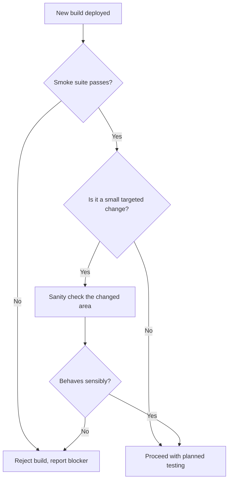

## Beginner-friendly explanation

The term is often traced to hardware: when an engineer powered up a new circuit board, the first test was simply whether it started smoking. If it did, there was no point measuring anything else.

In software, a **smoke test** asks the same blunt question about a new build: **does it basically work?** Does it start, can you log in, does the main thing it is for work at all? If not, the build goes straight back and nobody wastes a day running detailed tests on it.

A **sanity test**, in the way many teams use the word, is a quick, focused check after a small change: "they fixed the discount code, let me make sure discount codes behave sensibly before I go further."

## Technical explanation

### Smoke testing

The ISTQB glossary defines a smoke test as a test suite that covers the main functionality of a component or system to determine whether it works properly before planned testing begins. In practice it is also called a **build verification test** (BVT). Its characteristics:

- **Broad and shallow**: touches the most important functions without going deep.
- **Fast**: minutes, so it can run on every build.
- **Gatekeeping**: failure means the build is rejected; this is often written into [entry criteria](/learn/manual-testing/entry-and-exit-criteria) for a test phase.
- **Stable**: a flaky smoke test is worse than none, because people learn to ignore it.

### Sanity testing

The ISTQB glossary treats **sanity test** as a synonym of smoke test. In common industry usage, though, many teams distinguish the two:

| | Smoke testing | Sanity testing (common usage) |
|---|---|---|
| Scope | Whole build, main functions | One area affected by a recent change |
| Depth | Shallow | Narrow, slightly deeper |
| When | Every new build or deployment | After a small fix or change, before deeper testing |
| Typical form | Scripted, often automated | Often unscripted, quick manual checks |
| Question | Is this build testable at all? | Does this changed area behave rationally? |

Neither replaces [regression testing](/learn/manual-testing/regression-testing) or [confirmation testing](/learn/manual-testing/retesting-and-confirmation-testing). A sanity check after a fix is lighter than a full confirmation test with variations.



## Real-world example

A team releasing a hotel booking site ran an automated smoke suite of six checks after every deployment to the test environment: health endpoint, home page, search returns results, hotel page loads, a test user can log in, and a booking can be made with a sandbox card.

One morning the booking check failed: the payment page showed a configuration error because a new environment variable had not been set in the test environment. The smoke run took four minutes and the team fixed the configuration within the hour. Without the gate, five testers would have started their planned work and logged a stream of duplicate "cannot book" defects.

## Step-by-step walkthrough

1. **List critical paths**: what must work for the product to be usable at all, such as availability, login, the core transaction and critical integrations.
2. **Write one check per path**, with a clear pass/fail result and no dependence on other tests.
3. **Keep it short**: if the suite grows past a few minutes, move checks into regression.
4. **Automate it where practical** and wire it into the pipeline right after deployment.
5. **Agree the rule**: a failed smoke check rejects the build; say who is notified and what evidence is attached.
6. **For small changes, add a sanity check** of the affected area before planned testing continues.
7. **Review the suite** each release: remove checks that no longer reflect critical paths, add new ones.

## Code examples

A GitHub Actions job that runs a tagged smoke suite after deployment and fails the pipeline if any check fails:

```yaml
smoke:
  runs-on: ubuntu-latest
  needs: deploy-test
  steps:
    - uses: actions/checkout@v4
    - uses: actions/setup-node@v4
      with:
        node-version: 20
    - run: npm ci
    - run: npx playwright test --grep @smoke
      env:
        BASE_URL: ${{ vars.TEST_ENV_URL }}
```

## Expected output

When every check passes, the job is green and later jobs, such as the full regression run, start. When one fails, the job is red, later jobs are skipped, and the failing check's name and trace show what blocked the build.

## Common mistakes

- **Letting the smoke suite grow** into a mini regression suite that takes an hour.
- **Including flaky checks**, which trains the team to ignore failures.
- **Running deeper tests after a smoke failure** and flooding the tracker with duplicates.
- **Arguing over definitions** instead of agreeing the team's meaning of "sanity".
- **Treating a sanity check as full confirmation testing** of a defect fix.

## Troubleshooting

- **Smoke passes but testers still hit blockers.** The suite misses a critical path; add a check for each blocker that slipped through.
- **Smoke fails intermittently.** Separate environment problems from product problems; add a health check before the suite starts.
- **Developers dispute smoke rejections.** Make the gate rule explicit in entry criteria so the decision is not personal.

## Key takeaways summary

Smoke testing is a fast, broad gate that protects the team from testing a broken build. Sanity testing, as many teams use it, is a quick, focused check of a changed area. Keep both short and stable, agree what each word means in your team, and never let them replace regression or confirmation testing.
