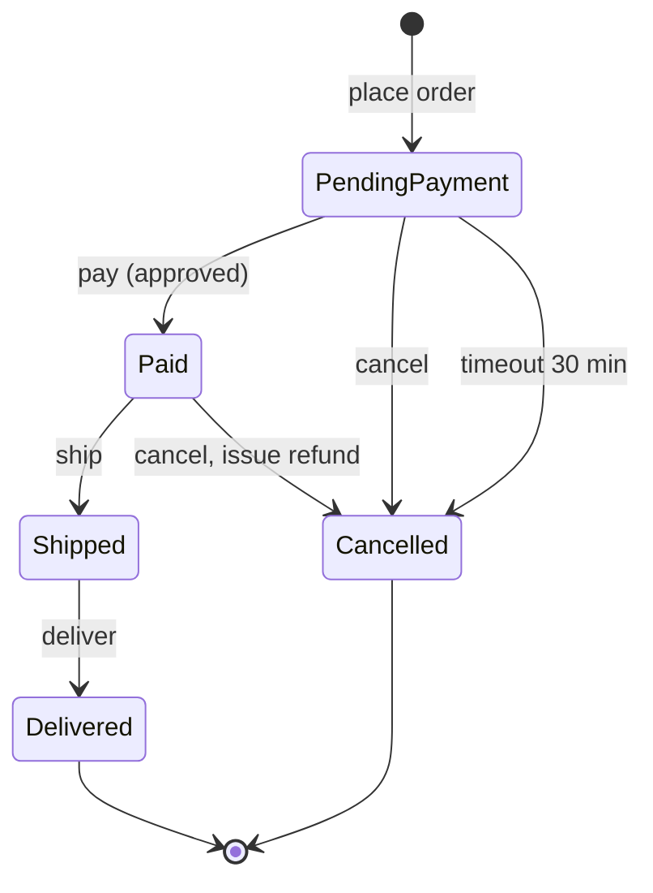

## Beginner-friendly explanation

Think of a washing machine. Pressing **Start** does something different depending on what the machine is doing: if it is idle it starts a wash, if it is already washing it does nothing, and if the door is open it beeps. The machine **remembers** where it is, and the same button has different effects.

That memory is called **state**. State transition testing is a way of drawing every state a system can be in, the events that move it between states, and then testing each move, including the moves that should *not* be allowed, such as opening the door in the middle of a spin.

## Technical explanation

ISTQB CTFL v4.0 describes a state transition model in terms of:

- **State**: a condition the system is in, such as *Paid*.
- **Event**: something that triggers a change, such as *ship*.
- **Transition**: a change from one state to another caused by an event. It may stay in the same state.
- **Guard condition**: a condition that must be true for the transition to fire, such as *payment approved*.
- **Action**: what the system does during the transition, such as *issue refund*.

A **state transition diagram** shows the valid transitions. A **state table** lists every state against every event; filled cells are valid transitions and **empty cells are invalid transitions**.

Coverage criteria in CTFL v4.0:

| Criterion | Requirement |
|---|---|
| All states coverage | Every state is visited at least once |
| Valid transitions coverage (0-switch) | Every valid transition is exercised at least once |
| All transitions coverage | Every valid transition is exercised and every invalid transition is attempted |

Valid transitions coverage guarantees all states coverage, and all transitions coverage guarantees valid transitions coverage. Invalid transitions should be tested **one per test case** to avoid fault masking. **N-switch** coverage extends the idea to sequences: 1-switch covers every valid pair of consecutive transitions.

### Worked example: an online order

Requirement: *"A placed order waits for payment. Approved payment makes it Paid. An unpaid order can be cancelled by the customer or is cancelled automatically after 30 minutes. A paid order can be cancelled (with a refund) until it ships. Shipped orders are then delivered."*



**State table** (5 states × 5 events = 25 cells, 6 valid, 19 invalid):

| Current state | pay | cancel | timeout | ship | deliver |
|---|---|---|---|---|---|
| Pending payment | Paid | Cancelled | Cancelled | invalid | invalid |
| Paid | invalid | Cancelled (refund) | invalid | Shipped | invalid |
| Shipped | invalid | invalid | invalid | invalid | Delivered |
| Delivered | invalid | invalid | invalid | invalid | invalid |
| Cancelled | invalid | invalid | invalid | invalid | invalid |

**0-switch (valid transitions) coverage test list.** The six valid transitions are numbered VT1–VT6:

| Test | Start | Event sequence | Transitions covered | Expected end state |
|---|---|---|---|---|
| ST-01 | Pending payment | pay → ship → deliver | VT1 pay, VT4 ship, VT6 deliver | Delivered |
| ST-02 | Pending payment | cancel | VT2 cancel unpaid | Cancelled, no refund |
| ST-03 | Pending payment | wait 30 min (timeout) | VT3 timeout | Cancelled, no refund |
| ST-04 | Pending payment | pay → cancel | VT1, VT5 cancel paid | Cancelled, refund issued |

Four tests cover all six valid transitions (100% 0-switch coverage) and all five states. For **all transitions coverage**, add one test per invalid cell, for example:

| Test | Start state | Invalid event | Expected |
|---|---|---|---|
| ST-INV-01 | Shipped | cancel | Rejected with a message; state stays Shipped; no refund |
| ST-INV-02 | Pending payment | ship | Rejected; state stays Pending payment |
| ST-INV-03 | Paid | pay | Rejected; customer not charged twice |
| ST-INV-04 | Cancelled | pay | Rejected; no charge |

## Real-world example

A ticketing team let customers cancel bookings and receive refunds. Every functional test cancelled a *confirmed* booking. Nobody tried cancelling a booking that had already been **refunded once**. The state table showed that cell as invalid, so a tester tried it through the API. The system accepted the second cancellation and issued a second refund. A single invalid-transition test exposed a defect that the happy-path tests could never reach.

## Step-by-step walkthrough

1. **List the states** from the requirement, along with status fields, badges and enum values in the UI or API.
2. **List the events**: user actions, timers, messages from other systems.
3. **Draw the diagram** with guards and actions on the arrows.
4. **Build the state table** with every state × every event. Mark each cell as a target state or invalid.
5. **Confirm questionable cells** with the product owner. "Can a delivered order be cancelled?" is a requirement question.
6. **Design valid-transition tests** as event sequences from the initial state, chaining transitions to reduce test count.
7. **Add invalid-transition tests**, one per test, each starting from a known state.
8. **Check the end state**, not only the message. Query the order status through the UI, API or database.

## Code examples

The state table can drive an automated check that every invalid cell is rejected and leaves the state unchanged:

```python
import pytest
from orders import OrderService, InvalidTransition

EVENTS = ["pay", "cancel", "timeout", "ship", "deliver"]
VALID = {
    ("PendingPayment", "pay"): "Paid",
    ("PendingPayment", "cancel"): "Cancelled",
    ("PendingPayment", "timeout"): "Cancelled",
    ("Paid", "cancel"): "Cancelled",
    ("Paid", "ship"): "Shipped",
    ("Shipped", "deliver"): "Delivered",
}
STATES = ["PendingPayment", "Paid", "Shipped", "Delivered", "Cancelled"]
INVALID = [(s, e) for s in STATES for e in EVENTS if (s, e) not in VALID]

@pytest.mark.parametrize("state, event", INVALID)
def test_invalid_transition_is_rejected(state, event):
    order = OrderService.create_in_state(state)
    with pytest.raises(InvalidTransition):
        order.apply(event)
    assert order.state == state
```

## Expected output

`INVALID` contains 19 pairs, so pytest reports `19 passed` on a correct implementation. If shipped orders could be cancelled, the run would show `test_invalid_transition_is_rejected[Shipped-cancel] FAILED`.

## Common mistakes

- **Testing only the happy path** (place, pay, ship, deliver) and calling the workflow tested.
- **Never building the state table**, so invalid transitions stay invisible.
- **Chaining several invalid events in one test**, which masks defects once the system enters an unexpected state.
- **Forgetting timer and system events** such as timeouts, expiry and scheduled jobs.
- **Checking only the UI message** and not the actual stored state.
- **Ignoring guards.** "pay" with a declined card is a different transition (or none) from "pay" with an approved card.

## Troubleshooting

- **The state count is exploding.** You may be mixing data values into states. Keep states as distinct behaviours and use EP for the data.
- **You cannot reach a state through the UI quickly.** Ask for a test hook or API to create entities in a given state, and document it.
- **Timers make tests slow.** Ask for a configurable timeout in test environments rather than waiting 30 minutes.

## Key takeaways summary

Model the states and events, turn the diagram into a table, then test every valid transition (0-switch coverage) and, where risk demands, every invalid one. Always start from a known state and verify the end state. Related techniques: [decision table testing](/learn/manual-testing/decision-table-testing) for the rules inside a transition, and [use-case testing](/learn/manual-testing/use-case-testing) for end-to-end flows.
