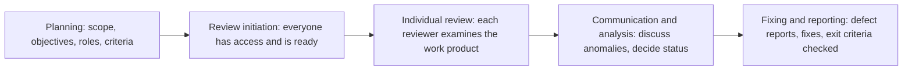

## Beginner-friendly explanation

Suppose you are preparing a speech for a wedding.

- You **read through your notes** and spot that you have got the couple's anniversary date wrong and that one joke might offend a grandparent. You have not given the speech; you just read it carefully. That is **static testing**.
- Then you **practise it out loud** in front of a friend. You discover it runs ten minutes too long and you stumble over one sentence. You only found those by performing it. That is **dynamic testing**.

Both are valuable, and they catch different problems. Reading catches wrong facts before you ever stand up. Performing catches problems that only show up when the speech actually "runs".

## Technical explanation

| | Static testing | Dynamic testing |
|---|---|---|
| Executes the software? | No | Yes |
| How | Manual reviews, tool-based static analysis | Running test cases, exploratory sessions, automated checks |
| What it finds | Defects, directly | Failures, which are analysed to find defects |
| When it can start | As soon as a work product exists, even a draft | When there is something executable |
| Typical targets | Requirements, user stories, designs, code, test cases, contracts, plans, models | Components, integrated systems, the full system |

### What static testing finds best

The ISTQB syllabus (chapter 3) notes that static testing can find defects that are hard or impossible to find dynamically, and finds them earlier. Typical examples:

- requirement defects: ambiguity, contradictions, omissions, inaccuracies, duplication,
- design defects: inefficient structures, poor modularisation,
- coding defects: unused or undefined variables, unreachable or duplicated code, excessive complexity,
- deviations from standards such as coding or naming conventions,
- incorrect interface specifications, for example mismatched units or parameter order,
- security vulnerabilities visible in code, such as buffer overflow patterns,
- gaps or inaccuracies in test basis coverage or traceability.

Some work products cannot be executed at all, so only static testing can evaluate them. Static analysis is also commonly run automatically in CI pipelines.

### What dynamic testing finds best

Dynamic testing reveals behaviour that only exists at run time: wrong outputs, performance under load, timing and concurrency problems, integration and configuration issues, and how the system behaves with real data and environments.

### Review types

ISTQB describes four commonly used review types, from least to most formal:

| Type | Key characteristics |
|---|---|
| Informal review | No defined process, no formal documented output; main objective is detecting anomalies |
| Walkthrough | Led by the author; can serve to educate, build consensus, generate ideas and detect anomalies |
| Technical review | Performed by technically qualified reviewers and led by a moderator; aims at consensus and decisions on technical problems, plus detecting anomalies |
| Inspection | Most formal; follows the complete generic process; main objective is finding the maximum number of anomalies; metrics are collected to improve the SDLC and the inspection process; the author cannot be the review leader or scribe |

### The review process

Roles include the manager, author, moderator (facilitator), scribe (recorder), reviewers and review leader.

## Real-world example

A generic scenario: a team is adding a "split the bill" feature to a restaurant payments app.

**Static testing, before code:** in a technical review of the user story, a tester asks how the remainder is handled when a total of 100.00 is split three ways. The story is silent. The team agrees one person pays 33.34. A developer also notices the API specification gives amounts as floating-point numbers; they change it to integer minor units to avoid rounding errors. Two defects were removed before any code existed.

**Static analysis, during coding:** the CI pipeline's linter flags an unused parameter and an unreachable branch in the split function. The developer removes them.

**Dynamic testing, after coding:** the tester runs boundary tests and an exploratory session on a real device. They find that when one diner's card is declined, the other diners are still charged and the bill is left partly paid. That behaviour only appeared when the system ran with a real payment-provider sandbox. A failure was observed, and debugging found the defect.

Each kind of testing found something the other would have missed.

## Common mistakes

- **Thinking static testing is only code review.** Requirements, designs, test cases and plans all benefit from review.
- **Skipping reviews because "testing will catch it".** Some defects, such as missing requirements, never cause a failure a test can see, and late fixes cost more.
- **Using reviews to judge people.** Reviews must focus on the work product; blame destroys participation.
- **Reviewing without preparation or clear objectives.** Individual review before the meeting is what finds most anomalies.
- **Ignoring static analysis warnings.** Teams that let warnings pile up stop noticing the important ones.

## Key takeaways summary

Static testing examines work products without running them and finds defects directly, often early and cheaply. Dynamic testing executes the software and reveals failures that only exist at run time. Reviews, from informal to inspection, and static analysis tools are the main static techniques. Use both together: they catch different defects at different times.
