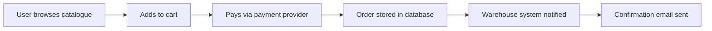

## Beginner-friendly explanation

Picture a new car coming off the assembly line. The engine, brakes and electronics were each tested, and the parts were tested together as they were fitted. Now someone takes the **finished car** onto a test track: starts it, drives in the rain, brakes hard, parks, uses the radio while the indicators are on.

**System testing** is the test track. It looks at the complete product, as one thing, and asks whether it behaves as specified. **End-to-end testing** is one particular kind of drive: a full trip from home to destination, the way a real driver would use the car, touching every part along the way.

## Technical explanation

### System testing (a test level)

ISTQB CTFL v4.0 describes system testing as focusing on the overall behaviour and capabilities of an entire system or product, often including functional testing of end-to-end tasks and non-functional testing of quality characteristics.

| Aspect | System testing |
|---|---|
| Test objects | The complete integrated system, its configuration and data |
| Test basis | System and software requirements, use cases, user stories, epics, risk analysis, models, user manuals |
| Typical defects | Incorrect calculations or workflows, wrong behaviour against requirements, failure of end-to-end tasks, environment and configuration problems, unmet non-functional requirements |
| Who | Usually an independent test team |
| Environment | As close to production as practical |

System testing covers functional and **non-functional** characteristics such as performance efficiency, usability, security and compatibility. Some non-functional tests can only be meaningful against the full system.

### End-to-end testing (a test scope)

**End-to-end (E2E) testing** follows a complete flow through every layer and dependency: the UI, APIs, services, databases, queues and external systems. It is not a separate ISTQB level; E2E scenarios are run during system testing and again during acceptance testing.



Each arrow is a place where data can be lost or transformed incorrectly, so a good E2E test checks the outcome at several points, not just the "Thank you" page.

### Position in the test pyramid

E2E tests give the highest confidence that a journey works, but they are the slowest, most expensive and most brittle tests. Most teams keep them few and push detailed checks down to the API and component levels, as described in [test pyramid and strategy](/learn/sdet/test-pyramid-and-strategy).

## Real-world example

A team building a clinic appointment system had strong component and API tests. During system testing a tester ran an E2E scenario: a patient books an appointment online, the receptionist reschedules it, and the patient receives an SMS reminder.

Every screen worked, but the reminder arrived with the **original** time. The reminder service read the appointment from a cache that was not refreshed after rescheduling. No component test covered it, because no single component was wrong; only a journey through booking, rescheduling and notification revealed it.

## Step-by-step walkthrough

1. **Collect the test basis**: requirements, user stories, use cases and the risk list.
2. **Identify critical journeys**: the flows that earn money, carry legal obligations or would hurt most if broken.
3. **Check the environment.** Versions, configuration, integrations and data should resemble production. Record each difference.
4. **Prepare realistic test data**, including existing customers, edge-case accounts and enough volume to be meaningful.
5. **Design scenarios with checkpoints** at each system the journey touches: UI, database, partner logs, notifications.
6. **Execute and record evidence**: screenshots, ids, timestamps and log references.
7. **Report results against requirements and risks**, so stakeholders see what is covered and what is not.

### Worked example: E2E checkpoints for an online order

| Step | Action | Checkpoint |
|---|---|---|
| 1 | Add item and check out | Cart total matches price list and tax rules |
| 2 | Pay with a sandbox card | Payment provider dashboard shows authorised amount |
| 3 | Confirm order | Order row stored with status `PAID` |
| 4 | Warehouse picks up order | Warehouse queue contains the order id |
| 5 | Confirmation | Email received with correct items and total |

## Code examples

A minimal Playwright E2E check in TypeScript for the first steps of that journey:

```typescript
import { test, expect } from "@playwright/test";

test("guest can place an order", async ({ page }) => {
  await page.goto("/products/blue-mug");
  await page.getByRole("button", { name: "Add to cart" }).click();
  await page.getByRole("link", { name: "Checkout" }).click();
  await page.getByLabel("Email").fill("guest@example.test");
  await page.getByRole("button", { name: "Place order" }).click();
  await expect(page.getByRole("heading", { name: "Order confirmed" })).toBeVisible();
});
```

## Expected output

```text
Running 1 test using 1 worker
  ✓  guest can place an order
  1 passed
```

A pass here proves only that the UI flow completed. Steps 3 to 5 in the checkpoint table still need checks against the database, the warehouse queue and the mailbox.

## Common mistakes

- **Treating system testing as only functional.** Performance, security, usability and compatibility belong here too.
- **Writing hundreds of E2E tests.** They become slow and flaky; push detail down to lower levels.
- **Checking only the final screen.** Data can be wrong in a downstream system even when the UI says "Success".
- **Ignoring environment differences.** A stubbed partner or a tiny database hides real defects.
- **Testing without clear expected results.** Every scenario needs traceable expected outcomes from the test basis.

## Troubleshooting

- **E2E tests fail randomly.** Look for shared test data, timing assumptions and unstable dependencies before blaming the product.
- **A defect cannot be reproduced.** Collect correlation ids and timestamps so developers can trace the exact request across systems.
- **The environment is never ready.** Escalate it as a project risk with impact, and start with the parts that are available.

## Key takeaways summary

System testing checks the whole product against its requirements, functional and non-functional, in a production-like environment. End-to-end scenarios are its most realistic tests: use them for critical journeys, verify every system touched, and keep the bulk of detailed checks at lower levels.
