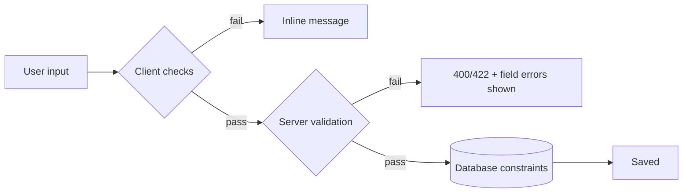

## Beginner-friendly explanation

Think of a bank teller accepting a cheque. They check the date is valid, the amount in words matches the amount in numbers, the signature is present, and the account number has the right number of digits. If something is wrong, a good teller tells you exactly what to fix: "You haven't signed it" — not just "Rejected".

**Data validation** is software doing the teller's job: checking every value a user (or another system) sends before accepting it. Testing validation means trying both good and bad values, and checking the system accepts the good ones, rejects the bad ones, and explains clearly why.

## Technical explanation

A field usually has several kinds of rules:

| Rule type | Example |
|---|---|
| Required | Email is mandatory |
| Data type | Quantity must be a whole number |
| Format | Email pattern; IFSC code is 11 characters, 4 letters + 0 + 6 alphanumerics |
| Length | Username 3 to 20 characters |
| Range | Age 18 to 100; amount greater than 0 |
| Allowed values | Country from a list |
| Uniqueness | Email not already registered |
| Cross-field | End date on or after start date; confirm password matches |
| Normalisation | Leading/trailing spaces trimmed; email compared case-insensitively |

Validation happens in layers. **Client-side** (HTML attributes such as `required`, `maxlength`, `pattern`, and JavaScript) gives quick feedback. **Server-side** validation is the real gate; the OWASP Input Validation Cheat Sheet recommends allow-list validation on the server for all input. The **database** may add constraints (NOT NULL, unique keys, column length) as a last line of defence — if a database error reaches the user, server validation is missing.

For each rule, use [equivalence partitioning](/learn/manual-testing/equivalence-partitioning) for classes and [boundary value analysis](/learn/manual-testing/boundary-value-analysis) for ordered limits. For cross-field rules, use a [decision table](/learn/manual-testing/decision-table-testing).

## Real-world example

A travel site's passenger form accepted names up to 100 characters. The airline's booking system it sends data to accepted 50. Short names passed every test. A passenger with a long full name booked successfully on the website, but the ticket was never issued because the downstream system rejected it — and the website showed "Booking confirmed".

Tests at the field's length boundary, plus asking "what limit does the next system have?", would have caught the mismatch.

## Step-by-step walkthrough

1. **List every field** and write down its rules. Where requirements are silent, ask — and record the answer.
2. **Partition each rule** into valid and invalid classes.
3. **Add boundaries** for length and range.
4. **Add special inputs:** empty, only spaces, leading/trailing spaces, Unicode and accents, emoji, apostrophes and hyphens in names, very long pasted text, copy-pasted values with hidden line breaks.
5. **Cross-field rules** via a decision table.
6. **Check messages:** specific, next to the field, keep other input, accessible (focus moves to or announces the error).
7. **Bypass the UI:** send invalid values through the API or by editing the request, confirm a 400 or 422 with field-level errors and nothing saved.
8. **Check stored data:** what was saved is exactly what was entered (or normalised as specified).

### Worked example: username, 3 to 20 characters, letters, digits and underscore

| ID | Input | Expected |
|---|---|---|
| VAL-01 | `ab` (2) | "Username must be 3 to 20 characters" |
| VAL-02 | `abc` (3) | Accepted |
| VAL-03 | `a` × 20 | Accepted |
| VAL-04 | `a` × 21 | Rejected, length message |
| VAL-05 | `john doe` | "Only letters, digits and underscore" |
| VAL-06 | `  john_1  ` | Trimmed to `john_1` or rejected, per spec |
| VAL-07 | empty | "Username is required" |
| VAL-08 | existing `john_1` | "Username already taken" |
| VAL-09 | `JOHN_1` when `john_1` exists | Per spec: case-insensitive uniqueness? |
| VAL-10 | `ab` via API | 400/422, not saved |

## Common mistakes

- **Only testing one invalid value per field.** Each rule needs its own negative test.
- **Changing several things at once**, so you cannot tell which rule triggered.
- **Rejecting real names** — apostrophes, hyphens, accents and single-word names are valid in many places.
- **Ignoring trimming and case**, which create duplicate accounts.
- **Accepting generic messages** like "Invalid data" as passing.
- **Not testing the server** directly.

## Key takeaways summary

Turn each field into a list of rules, then test every rule with valid, invalid and boundary values, one change at a time. Judge error messages as part of the test, and always confirm the server enforces the same rules as the browser.
