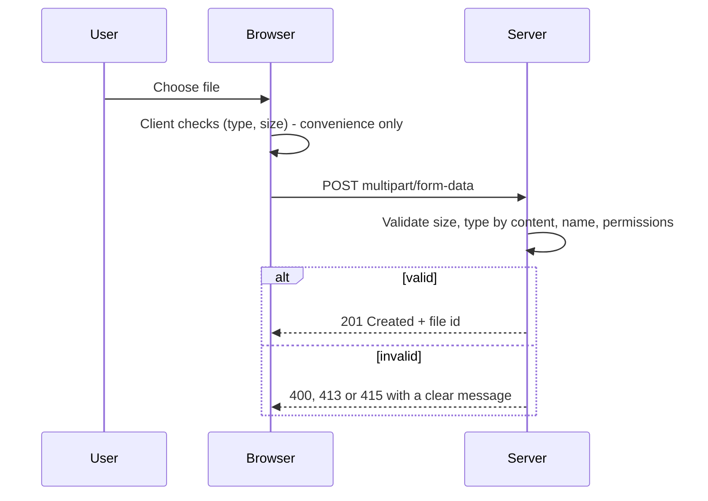

## Beginner-friendly explanation

Think of a post office counter. It accepts letters and parcels, but only up to a certain weight, only certain shapes, and nothing dangerous. A good counter clerk weighs the parcel, checks what is inside, writes a tracking label, and gives it back only to the right person.

A file upload is that counter. The "parcel" is the file, and it has a weight (size), a label (file name and extension), contents (the actual bytes), and an owner. Testing uploads means sending all sorts of parcels — tiny, huge, mislabelled, broken — and checking the counter handles each correctly. Testing downloads means checking you get the right parcel back, undamaged, and that nobody else can collect it.

## Technical explanation

In a browser, an upload uses `input type="file"` and is usually sent as a `multipart/form-data` HTTP request. The `accept` attribute only filters the file picker; it does not stop other files being sent. Real validation must happen on the server.

Treat one upload as several independent inputs and apply [equivalence partitioning](/learn/manual-testing/equivalence-partitioning) and [boundary value analysis](/learn/manual-testing/boundary-value-analysis) to each:

| Dimension | Valid partitions | Invalid / edge partitions |
|---|---|---|
| Size | 1 byte to limit | 0 bytes, limit + 1 byte, very large |
| Type | Allowed extensions and content | Disallowed type, renamed file, uppercase extension `.PNG`, double extension `invoice.pdf.exe` |
| Name | Normal names | Spaces, Unicode, very long names, `../` path characters, same name as an existing file |
| Count | 1 to max | 0 files, max + 1 |
| Content | Well-formed file | Corrupt, password-protected, empty spreadsheet, image with huge dimensions |

**Watch the unit.** "5 MB" may mean 5,000,000 bytes or 5 × 1,024 × 1,024 = 5,242,880 bytes. Ask, and test both edges if unclear.

Server-side behaviour to verify (from the OWASP File Upload Cheat Sheet): allow-list of types, content-type validation beyond the extension, size limits, renaming stored files, storing outside the web root, and malware scanning where required.

For downloads, the server sets `Content-Type` and usually `Content-Disposition: attachment; filename="report.csv"`. Check name, extension, encoding (for example UTF-8 in CSV opened in a spreadsheet), and content accuracy.

## Real-world example

An insurance claims portal accepts photos of damage. Testing in Chrome on a laptop goes well. A tester then uploads photos straight from an iPhone, which saves photos in HEIC format by default in many configurations. The upload succeeds but the claims handler sees a broken image. A second defect appears with a 9.8 MB photo: the limit was 10 MB on the page but 8 MB on the server, so the user saw a generic "Something went wrong".

Both were found by thinking about real users' files, not just neat test files on a laptop, and by testing exactly around the limit.

## Step-by-step walkthrough

1. **Read the rules:** allowed types, size limit and unit, max count, where files are shown and who can see them.
2. **Prepare a test-file kit:** 0-byte file, files at limit − 1, limit and limit + 1 bytes, each allowed type, a disallowed type, a renamed file, a corrupt file, long and Unicode names.
3. **Positive tests:** each allowed type uploads, displays and downloads correctly.
4. **Boundary tests:** size and count edges.
5. **Negative tests:** each invalid file shows a clear, specific error and nothing is stored.
6. **Interruption tests:** cancel mid-upload, lose network (DevTools offline), refresh during upload, double-click Upload.
7. **Download tests:** name, type, content matches source, large exports, special characters.
8. **Access tests:** open another user's file URL, log out and reuse a download link, check expiry of signed links.

### Sample test cases

| ID | Input | Expected |
|---|---|---|
| UP-01 | `photo.jpg`, 2 MB | Uploaded, thumbnail shown |
| UP-02 | Exactly at limit | Uploaded |
| UP-03 | Limit + 1 byte | Rejected: "File must be 5 MB or smaller" |
| UP-04 | 0-byte `.png` | Rejected with clear message |
| UP-05 | `notes.txt` renamed to `notes.png` | Rejected as invalid image |
| UP-06 | `résumé final (2).PDF` | Uploaded, name shown correctly |
| UP-07 | Network off at 50% | Clear failure, retry possible, no partial file stored |
| DL-01 | Export 10,000 rows to CSV | Row count matches; accents display correctly |
| DL-02 | Other user opens DL link | 403 or 404 |

## Common mistakes

- **Using only small, perfect test files.** Real users upload phone photos, scanned PDFs and huge spreadsheets.
- **Ignoring the MB versus MiB difference** at the limit.
- **Trusting the browser's file picker filter** as the validation.
- **Not checking what was stored** after a rejected upload (orphan or partial files).
- **Forgetting downloads entirely**, or opening the file without checking the content.
- **Uploading real malware to test scanning.** Use the standard, harmless EICAR test file, and only on systems you are authorised to test.

## Key takeaways summary

A file is several inputs at once. Partition and boundary-test size, type, name, count and content; prove the server validates independently of the browser; and verify downloads for correctness and access control.
