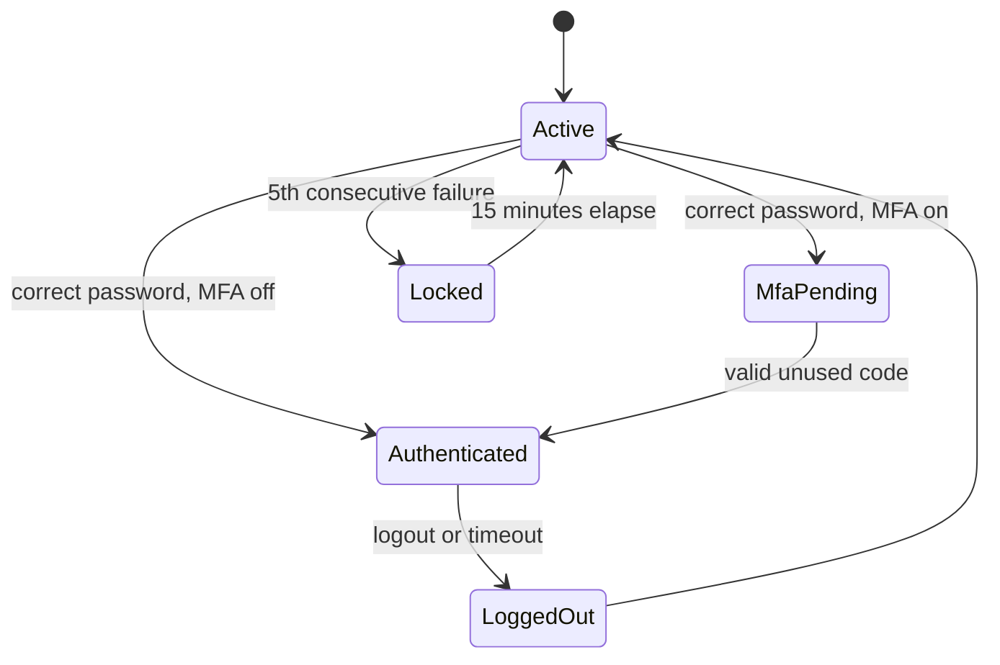

## Beginner-friendly explanation

A login page is the front door of an application. Testing it is not only checking that the right key opens the door. You also check that wrong keys are refused, that the door locks after too many attempts, that it doesn't tell a stranger "you have the right house, wrong key", and that when someone leaves, the door really locks behind them.

## Technical explanation

**Authentication** proves who a user is; **authorisation** decides what they may do (see [testing user permissions](/learn/manual-testing/testing-user-permissions)). After a successful login the server usually issues a **session**, often a cookie holding a random identifier. Most serious login defects are not about wrong passwords being accepted; they are about information leaks, weak lockout and poor session handling.

Security checks in this lesson are for applications you own or are explicitly authorised to test.

## Requirements

Sample specification for a web login:

1. Users sign in with email and password. Email is case-insensitive; leading and trailing spaces are trimmed.
2. On failure the page shows one message: "Email or password is incorrect."
3. After **5 consecutive failed attempts** for an account, the account is locked for **15 minutes**. A successful login resets the counter.
4. Users with MFA enabled must enter a 6-digit time-based code after the password. A code can be used only once.
5. "Remember me" keeps the user signed in for 30 days; otherwise the session ends after 30 minutes of inactivity.
6. After login, the user returns to the page they originally requested, but only for paths on the same site.
7. Logout ends the session on the server.
8. Session cookies are set with `Secure`, `HttpOnly` and `SameSite=Lax`.

## Assumptions

- The lockout counter is per account, not per browser or IP address (confirm with the Product Owner).
- The same rules apply to the login API used by the mobile app.
- The test environment uses test accounts only and allows clock or configuration changes for timeouts.
- We are authorised to perform the security checks below on this environment.

## Test design

| Technique | Applied to | Why |
|---|---|---|
| Equivalence partitioning | Credentials: valid, wrong password, unknown email, empty, malformed | One representative per behaviour class |
| Boundary value analysis | Failed-attempt counter (4, 5, 6), lockout time (just under, just over 15 min), inactivity timeout | Off-by-one errors in counters and timers |
| State transition | Active, MFA pending, Authenticated, Locked, Logged out | Login is a state machine; invalid transitions hide defects |
| Error guessing and security heuristics | Enumeration, session fixation, open redirect, credential leakage | Known high-impact failure patterns |

## Sample test cases

| ID | Scenario | Type | Test data | Steps summary | Expected result |
|---|---|---|---|---|---|
| LG-01 | Valid login | Positive | active.user@example.test / valid password | Enter credentials, submit | Dashboard shown; session cookie set with Secure, HttpOnly, SameSite=Lax |
| LG-02 | Email case and spaces | Positive | " Active.User@Example.test " | Submit with valid password | Login succeeds |
| LG-03 | Wrong password vs unknown email | Security | Existing email + wrong password; unknown@example.test | Submit each; compare in DevTools | Same message, same status code, same redirect, no meaningful timing gap |
| LG-04 | Counter just below lockout | Boundary | 4 wrong, then correct | Submit 5 times | 5th attempt succeeds; counter resets |
| LG-05 | Lockout at 5th failure | Boundary | 5 wrong, then correct | Submit 6 times | Account locked; correct password refused during lockout |
| LG-06 | Lockout expiry | Boundary | Locked account | Try at 14:59 and 15:01 after lock | Refused, then allowed |
| LG-07 | MFA code reuse | Negative | Valid code already used | Log in, log out, reuse code | Code rejected |
| LG-08 | Session ID renewal | Security | Any valid account | Note cookie before and after login | Session identifier changes |
| LG-09 | Server-side logout | Security | Copied session cookie | Log out, replay request with old cookie | Server rejects; login required |
| LG-10 | Open redirect | Security | returnUrl=https://attacker.example/ | Log in via crafted link | Redirect to default page, not the external site |
| LG-11 | Lockout via API | Negative | 5 wrong attempts via API | Send to login endpoint | Same lockout applies as in UI |
| LG-12 | Empty fields | Negative | Blank email and password | Submit | Field-level required messages; no server error |

## Test data

- Accounts in each state: active without MFA, active with MFA, locked, disabled, never-verified.
- Emails with mixed case, surrounding spaces and plus addressing (user+tag@example.test).
- Passwords at the minimum and maximum allowed lengths, with Unicode and special characters.
- A crafted external return URL and a same-site path for redirect tests.
- Use reserved domains such as `example.test` so no real person receives email.

## Defects to look for

- **User enumeration** through different messages, status codes, redirects, response times or lockout messages shown only for real accounts.
- **Lockout counted per session**, so clearing cookies resets it, or lockout enforced in the UI but not the API.
- **Lockout as denial of service**: anyone can lock any user. Report the trade-off so the team chooses consciously (for example, progressive delays or CAPTCHA).
- **Session fixation**: identifier not renewed at login.
- **Client-only logout**: the cookie is deleted but the server session stays valid.
- **Open redirect** through return URL parameters.
- **Credentials in URLs or logs**, for example a form submitted with GET.
- **Missing cookie flags** (`Secure`, `HttpOnly`) on the session cookie.
- **Remember-me tokens not revoked** after password change or logout from all devices.

## Real-world example

A team testing a customer portal found that login responses were identical in text, but the developer tools showed unknown emails returned noticeably faster because the password hash was only computed for real accounts. Combined with the absence of rate limiting, this allowed account discovery at scale. The fix was to perform equivalent work for unknown accounts and add rate limiting, and the tester added a response comparison to the regression checklist.

## Common mistakes

- **Testing only valid and wrong passwords** and skipping states such as locked, disabled and MFA pending.
- **Checking the message but not the full response**: status code, headers and timing can leak too.
- **Ignoring the API**: the mobile app or scripts may bypass UI-only checks.
- **Treating logout as a UI action** without replaying the old session.
- **Running security checks against systems without authorisation.** Always test your own or approved environments.

## Key takeaways summary

Login testing combines classic techniques with a security mindset: partition credentials, test lockout and timeout boundaries, model the account states, then hunt for enumeration, session and redirect defects in an authorised environment.
