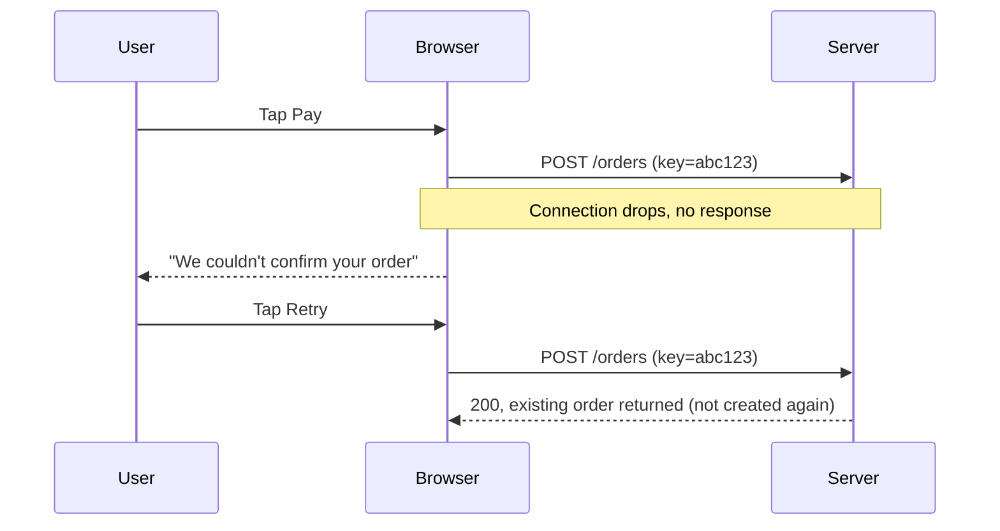

## Beginner-friendly explanation

Imagine you write a letter and send copies through three different postal services. One delivers next day, one takes a week, one sometimes loses letters. And each household reads it differently — some in large print, some on a small card. You would want to know your message survives all of that.

Websites face the same thing. Users open your site in **different browsers** (Chrome, Safari, Firefox, Edge) on **different devices**, over **different networks** — fast office Wi-Fi, a crowded train's mobile data, or a lift where the signal disappears. This lesson teaches you to test that the site works for all of them, and fails gracefully when the network does not cooperate.

## Technical explanation

### Browsers and engines

A browser's **engine** decides how HTML, CSS and JavaScript behave. The main engines today:

| Engine | Browsers |
|---|---|
| Blink (Chromium) | Chrome, Edge, Opera, Samsung Internet, Brave |
| Gecko | Firefox |
| WebKit | Safari on macOS and iOS; historically all iOS browsers |

So testing Chrome and Edge alone mostly tests one engine. Typical cross-browser defects:

- Layout differences (flexbox/grid edge cases, fonts, scrollbars)
- Date and time inputs, file pickers and select boxes that look and behave differently
- Autofill and password manager behaviour
- Storage and cookie rules (for example stricter third-party cookie handling)
- Newer JavaScript or CSS features not yet supported (check caniuse.com)
- Touch versus mouse, and mobile on-screen keyboards covering inputs

A **browser matrix** lists the browser, version range, OS and device to test. Build it from analytics and risk; see also [compatibility and installation testing](/learn/manual-testing/compatibility-and-installation-testing).

### Networks

Real networks have **latency** (delay per request), limited **bandwidth**, **packet loss** and complete **disconnection**. Browser developer tools can simulate these. In Chrome DevTools, the Network panel has throttling presets and an Offline option; you can also add custom profiles. Firefox has similar throttling.

What to observe when a request is slow or fails:

| Situation | Expected behaviour |
|---|---|
| Slow response | Loading indicator; button disabled; no layout jumps |
| Timeout | Clear message; data kept; retry available |
| Offline before submit | Warning; submission blocked or queued |
| Offline after submit, before response | On reconnect, the true status is shown; no duplicate |
| Repeated request (double tap, retry) | Server treats it idempotently; one record |

## Real-world example

A ticket-booking site worked flawlessly in Chrome on office Wi-Fi. Two issues were found by a tester on a throttled connection and an iPhone:

1. On a slow network the "Book" button stayed clickable for several seconds without feedback. Impatient users clicked repeatedly and were charged for multiple bookings.
2. In Safari on iOS, a custom date picker did not open because it relied on an event behaviour that differed in WebKit. Desktop Chrome emulation of an iPhone did not show the problem — only real Safari did.

## Step-by-step walkthrough

1. **Build the matrix** from analytics: top browsers by share, each engine, mobile and desktop, plus any contractually required browsers.
2. **Rank flows by risk.** Login, checkout and payments get the full matrix; low-risk pages get spot checks.
3. **Run cross-browser checks:** layout at common widths, forms and native inputs, file upload/download, autofill, keyboard navigation, and console errors.
4. **Network tests in DevTools:**
   - Throttle to a slow preset and walk through key flows, noting missing loading states.
   - Go offline before submitting, right after submitting, and mid-upload.
   - Reconnect and check the real state in the backend or admin screen.
5. **Double submission:** double-click and rapidly tap submit buttons under throttling.
6. **Record the environment** precisely in any [defect report](/learn/manual-testing/writing-a-great-defect-report): browser and version, OS, device, network profile.

### Sample test cases

| ID | Environment | Action | Expected |
|---|---|---|---|
| NET-01 | Chrome, slow preset | Submit login | Spinner, button disabled, success within agreed time |
| NET-02 | Chrome, offline after Pay | Reconnect, open orders | Exactly one order; status accurate |
| NET-03 | Firefox, offline | Submit contact form | "You're offline" message; text kept |
| XB-01 | Safari iOS | Pick a date | Native or custom picker opens and saves |
| XB-02 | Edge, 1366 px wide | Open checkout | No overlapping or cut-off elements |

## Common mistakes

- **Treating Chrome and Edge as two engines.** They share Chromium.
- **Relying only on device emulation** for mobile Safari behaviour.
- **Testing only on fast office networks.**
- **Not checking the backend** after a network failure; the UI may say "failed" while the order exists.
- **Writing defects without the network profile**, so they cannot be reproduced.

## Troubleshooting

- **Throttling seems to have no effect?** Ensure DevTools is open on the right tab and disable cache when reloading.
- **Offline mode doesn't stop a request?** Service workers can serve cached responses; check the Application panel.

## Key takeaways summary

Cover each browser engine on the platforms your users really use, and make network trouble part of normal testing: throttle, go offline at key moments, retry, and verify the backend state so nothing is lost or duplicated.
