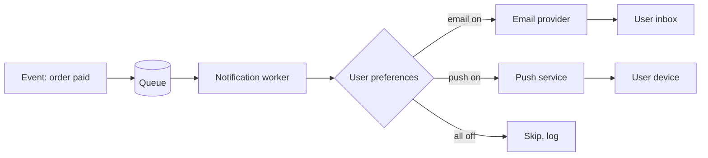

## Beginner-friendly explanation

Imagine a restaurant with a buzzer system. When your food is ready, the kitchen presses a button and your buzzer lights up. For that to work: the kitchen must press the button at the right moment (not when the food is still cooking), press it once (not five times), buzz the right table, and the buzzer must work even if the restaurant is busy.

Notifications are the buzzers of software. An **event** (order placed, password reset requested, payment failed) triggers a **message** sent through a **channel** (email, SMS, push notification, in-app bell) to a **recipient**. Testing notifications checks every link in that chain.

## Technical explanation

Most systems send notifications **asynchronously**: the main action (placing an order) finishes, publishes an event to a queue, and a background worker builds the message from a template and hands it to a provider (an email service, SMS gateway, or Firebase Cloud Messaging / Apple Push Notification service for mobile push). That design means:

- Delivery can be **delayed**, arrive **out of order**, or be **duplicated** if a job retries.
- Failures (provider down, invalid address) are handled away from the user's screen.
- You often need to **wait or poll** to observe the result.

Notification categories matter:

| Category | Example | Opt-out allowed? |
|---|---|---|
| Transactional | Order receipt, password reset, OTP | Usually no; user-initiated or essential |
| Service | Delivery delay, account security alert | Depends on policy |
| Marketing | Offers, newsletters | Yes; must respect preferences and local law |

### What to test for each notification

| Aspect | Questions |
|---|---|
| Trigger | Fires on the right event only? Once? Not on failed or cancelled actions? |
| Recipient | Right user? Right address/number/device? Multiple recipients? |
| Content | Correct data, template variables, language, links, branding |
| Rendering | Mobile and desktop mail clients, dark mode, plain-text fallback |
| Timing | Immediate vs scheduled, time zones, quiet hours, expiry of OTPs |
| Preferences | Channel toggles, opt-out, unsubscribe link works |
| Failure | Invalid address, provider error, retries without duplicates |
| In-app | Unread count, mark as read, deep link opens the right screen |

## Real-world example

A ride-booking app sends "Your driver has arrived" push notifications. Testing on a single phone passed. A tester then logged in with the same account on two phones, logged out of one, and booked a ride. The logged-out phone still received the notification — the device token was never removed on logout. A second scenario found that a user in a different time zone received a "Your scheduled ride is tomorrow" reminder at 3 a.m. local time, because the quiet-hours rule used server time.

## Step-by-step walkthrough

1. **Inventory notifications:** list each event, channel, category and recipient. This is often missing from requirements — build it.
2. **Set up safe sinks:** email capture, test SMS numbers, test devices. Confirm no real customer data is present.
3. **Trigger tests:** perform each event, then also perform the near-miss events (failed payment, cancelled order) and confirm nothing is sent.
4. **Content tests:** compare each field against the source data; use empty, long and Unicode names; click every link.
5. **Preference tests:** build a decision table of preference settings and expected sends.
6. **Timing tests:** time zones, quiet hours, OTP expiry, scheduled reminders.
7. **Failure tests:** invalid email, unregistered device, provider error (if a stub allows it); confirm retries do not duplicate.
8. **In-app tests:** badge counts, read/unread state, deep links when the app is closed, in background and in foreground.

### Preference decision table (example)

| Rule | Email opt-in | SMS opt-in | Quiet hours now | Expected for "delivery delayed" |
|---|---|---|---|---|
| R1 | Yes | Yes | No | Email + SMS now |
| R2 | Yes | Yes | Yes | Email now, SMS after quiet hours |
| R3 | No | Yes | No | SMS only |
| R4 | No | No | Any | In-app only |

## Common mistakes

- **Only testing the happy trigger** and never checking that failed or cancelled actions send nothing.
- **Checking the subject line but not the links**, which may point to the wrong environment.
- **Not testing with logged-out or multiple devices** for push.
- **Ignoring time zones and quiet hours.**
- **Using real or production-copied contact data** in test environments.
- **Treating a slow message as missing** — define and test the expected delivery time instead.

## Key takeaways summary

Test the whole chain: the right event, once, to the right person, through the right channel, with correct content, at the right time, respecting preferences, and failing safely — always with test sinks rather than real recipients.
