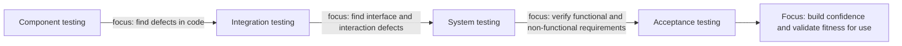

## Beginner-friendly explanation

Imagine a car's annual safety inspection. What is it *for*? It finds faults, yes, but also:

- it checks the car meets the legal rules for being on the road,
- it gives the owner confidence the car is safe for a long trip,
- it tells the owner what needs attention soon, so they can plan and budget.

And there are things it cannot do. The inspector does not drive the car for a thousand kilometres in every kind of weather. A pass today does not mean the brakes will never fail. A good inspector says exactly what was checked and what was not.

Software testing is the same. It has several **objectives**, which change with the situation, and it has **limitations** that honest testers always make clear.

## Technical explanation

### Test objectives

The ISTQB CTFL v4.0 syllabus (section 1.1.1) lists typical test objectives:

| Objective | Example in practice |
|---|---|
| Evaluating work products such as requirements, user stories, designs and code | Reviewing a user story for ambiguity |
| Triggering failures and finding defects | Running boundary tests on a pricing rule |
| Ensuring required coverage of a test object | Covering every acceptance criterion, or every branch of a critical function |
| Reducing the level of risk of inadequate software quality | Testing the riskiest payment paths first and deepest |
| Verifying whether specified requirements have been fulfilled | Checking each requirement against test results |
| Verifying that a test object complies with contractual, legal and regulatory requirements | Checking accessibility or data-retention obligations |
| Providing information to stakeholders to allow them to make informed decisions | A test summary used in a release meeting |
| Building confidence in the quality of the test object | A clean acceptance run on realistic scenarios |
| Validating whether the test object is complete and works as expected by stakeholders | A pilot with real users |

The syllabus stresses that objectives **vary with context**: the work product being tested, the test level, risks, the SDLC, business factors such as structure, competition or time to market, and regulation.

### Making objectives measurable

Objectives are only useful if you can tell when they are met. They feed into the **test plan** and become measurable through **coverage targets** and **exit criteria**, for example "all high-risk test conditions executed" or "no open critical defects". See [entry and exit criteria](/learn/manual-testing/entry-and-exit-criteria).

### Limitations of testing

| Limitation | Cause |
|---|---|
| Cannot prove absence of defects | Testing samples behaviour; principle 1 |
| Cannot test everything | Exhaustive testing is impossible; principle 2 |
| Finite resources | Time, budget, people and tools are limited |
| Environment differences | Test environments rarely match production exactly in data, scale or integrations |
| Imperfect test oracles | Requirements may be incomplete or wrong, so "expected result" may be uncertain |
| Unknown unknowns | Tests check what people anticipated; unanticipated risks can be missed |
| Changing products | Each change can invalidate earlier results; regression is needed |

None of these make testing less valuable. They make it essential to **prioritise by risk** and to **report residual risk** honestly.

## Real-world example

A generic scenario: a university is launching an online exam platform before term starts.

The test lead agrees objectives with stakeholders:

1. **Reduce risk** of students losing answers mid-exam (highest impact).
2. **Verify compliance** with accessibility obligations for students using screen readers.
3. **Provide information** for a go/no-go decision two weeks before exams.

Limitations are recorded in the plan: the test environment cannot simulate the full number of simultaneous students; only two screen readers are available; the integration with the student records system uses a stub.

The test summary says: "All high-risk save-and-resume scenarios passed on three browsers. Accessibility testing covered two screen readers; others are untested. Peak load was not tested at full scale. One medium-severity defect is open in timer display." The stakeholders decide to run a scaled rehearsal exam before go-live, a decision they could only make because limits were stated clearly.

## Step-by-step walkthrough

1. **Identify stakeholders** and ask what decisions they need to make.
2. **Select objectives** from the typical list that support those decisions.
3. **Weight them by context**: test level, risk, regulation, deadlines.
4. **Make them measurable** with coverage targets and exit criteria.
5. **Record known limitations** in the test plan before testing starts.
6. **Report against the objectives**, including gaps and residual risk.

## Common mistakes

- **Having only one objective, "find bugs".** Stakeholders also need confidence, coverage and compliance evidence.
- **Using the same objectives at every level.** Acceptance testing that is mostly finding basic defects signals a problem earlier.
- **Hiding limitations.** Unstated gaps become surprises in production.
- **Claiming certainty.** "Fully tested" and "bug-free" are claims testing cannot support.
- **Leaving objectives vague.** Without coverage targets or exit criteria, nobody can say when testing is done.

## Key takeaways summary

Testing serves many objectives: finding defects, evaluating work products, verifying requirements and compliance, reducing risk, building confidence, validating fitness for use and informing decisions. Context decides which ones matter most. Testing also has firm limits, so good testers prioritise by risk and report exactly what was and was not covered.
