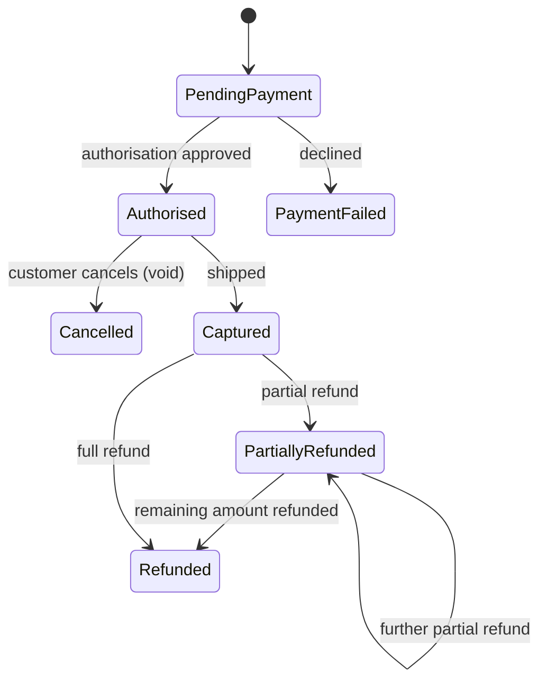

## Beginner-friendly explanation

Paying for something online is like a shop putting a hold on your money, taking it when your parcel ships, and giving some back if you return an item. Testing payments means checking that money moves exactly once, in the right amount, at the right time, and that every return and cancellation leaves both the shop's records and your bank statement agreeing.

## Technical explanation

Payment flows depend on an external **payment provider**. The application sends requests (authorise, capture, refund, void) and receives results both synchronously and through asynchronous **webhooks**. Because networks fail, any request might succeed at the provider while the response is lost. Robust systems use **idempotency keys**, a unique key per intended operation, so a repeated request returns the original result instead of repeating the operation (see [idempotency, retries and rate limiting](/learn/api-testing/idempotency-retries-rate-limiting)).

Terminology and features vary by provider; always confirm against the provider's documentation. Use only sandbox environments and published test cards; never real card data.

## Requirements

1. Card payment is authorised at order placement and captured when the order ships.
2. Customers can cancel within **30 minutes** of placing an order. Orders are never shipped inside that window, so a cancellation always happens before capture and voids the authorisation. After 30 minutes, customers must contact support.
3. After capture, staff can issue full or partial refunds. Total refunds cannot exceed the captured amount.
4. Refunds go to the original payment method only.
5. Order statuses: Pending payment, Authorised, Captured, Partially refunded, Refunded, Cancelled, Payment failed.
6. Each payment and refund request carries an idempotency key; repeated requests must not repeat the operation.
7. Webhooks may arrive late, twice or out of order; the system must handle all three.
8. Customers receive an email for payment, cancellation and each refund.

## Assumptions

- A single currency with two decimal places for this release.
- The provider sandbox can simulate success, decline, timeout and delayed webhooks.
- Only users with the Refunds permission can issue refunds.

## Test design

| Technique | Applied to | Why |
|---|---|---|
| State transition | Order and payment statuses | Most payment defects are invalid or missing transitions |
| Boundary value analysis | Refund amounts (single and cumulative), cancellation window, precision | Money errors are off-by-one-cent errors |
| Error guessing and fault injection | Timeouts, retries, duplicate and out-of-order webhooks | Real networks fail in these ways |
| Decision table | Cancel request × payment state × shipment state | Decides void vs refund vs refuse |

Any transition not on the diagram, such as refunding an Authorised order or capturing a Cancelled one, must be refused.

## Sample test cases

| ID | Scenario | Type | Test data | Steps summary | Expected result |
|---|---|---|---|---|---|
| PY-01 | Successful pay and capture | Positive | Sandbox success card, 100.00 | Place order, ship | One authorisation, one capture of 100.00; status Captured; email sent |
| PY-02 | Declined card | Negative | Sandbox decline card | Pay | Status Payment failed; clear message; no order fulfilment |
| PY-03 | Double click on Pay | Negative | Success card | Click Pay twice rapidly | Exactly one charge in sandbox; one order |
| PY-04 | Timeout then retry | Negative | Simulated provider timeout | Pay, retry after error | One charge; order resolves to Authorised after reconciliation |
| PY-05 | Duplicate webhook | Negative | Same capture event sent twice | Replay event in sandbox | Processed once; one email; no double stock change |
| PY-06 | Cancel before capture | Positive | Authorised order, 10 minutes old | Cancel | Authorisation voided; status Cancelled; no refund created |
| PY-07 | Cancel window boundary | Boundary | Unshipped orders aged 29:59 and 30:01 | Attempt cancel | First allowed and voided; second refused with a contact-support message |
| PY-08 | Partial refund boundaries | Boundary | Captured 100.00 | Refund 0.00, 0.01, 100.00, 100.01 | 0.00 and 100.01 refused; 0.01 and 100.00 allowed |
| PY-09 | Cumulative refund | Boundary | Refunded 70.00 already | Refund 30.00 then 0.01 | 30.00 succeeds, status Refunded; 0.01 refused |
| PY-10 | Refund retry | Negative | Same refund submitted twice with same key | Submit, resubmit | One refund created |
| PY-11 | Refund without permission | Security | Support user without Refunds permission | Call refund via UI and API | Refused with 403; no refund created |
| PY-12 | Out-of-order webhooks | Negative | Refund event before capture event | Replay in that order | Final state correct (Partially refunded or Refunded), no error |

## Test data

- Provider sandbox test cards for success, decline, insufficient funds, authentication required and timeout (from the provider's documentation).
- Orders in every status from the diagram, ready to use.
- Amounts at precision boundaries: 0.01, 99.99, 100.00, 100.01.
- Staff accounts with and without the Refunds permission.
- A way to replay or delay webhook events in the sandbox.

## Defects to look for

- **Double charge** on double click, refresh, Back button or retry after a timeout.
- **Duplicate processing of webhooks**: two emails, double stock changes, or two ledger entries.
- **Over-refund**: cumulative refunds exceeding the captured amount, often when two staff refund at once.
- **Refund instead of void** for uncaptured orders, or capture of a cancelled order.
- **Timeout treated as failure**, cancelling an order the customer has actually paid for.
- **Status drift**: order says Refunded but the provider shows a partial refund.
- **Refund to a different payment method** than the original.
- **Missing authorisation checks** on refund endpoints.
- **Card data in logs**, screenshots or defect reports.

## Real-world example

A team testing a ticketing site ran all positive payment tests successfully. The tester then simulated a provider timeout in the sandbox. The application showed "Payment failed", released the seats and let the customer retry, while the sandbox showed the first authorisation as successful. The customer could end up charged twice, or charged once with no ticket. The fix introduced a pending state, idempotency keys and webhook reconciliation, and the timeout case joined the regression suite.

## Common mistakes

- **Testing only the happy path** with a success card.
- **Checking the application but not the provider dashboard**, so mismatches go unseen.
- **Ignoring asynchronous events**, which is where many payment defects live.
- **Testing refunds one at a time** and never concurrently.
- **Using real cards** or copying card numbers into defect reports.

## Key takeaways summary

Payments are a state machine wrapped around an unreliable network. Model the states, test invalid transitions, push every retry path, apply boundaries to refund amounts, and always reconcile your application against the provider's sandbox records.
