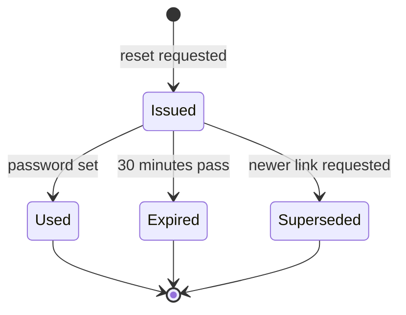

## Beginner-friendly explanation

Registration is like opening a membership at a gym, and password reset is like asking for a replacement key card. The gym should check you are who you say you are, not give two people the same membership, and never hand a replacement card to someone who just walks in and names a member. It also should not shout across the lobby "yes, that person is a member here!"

## Technical explanation

These flows rely on **email ownership**: a link with a secret token is sent to the address, and possession of the link proves control of the mailbox. That makes the **token** the key artefact. A reset token is effectively a temporary password, so it needs the same care: unpredictable, short-lived, single use, sent only to the registered address, and pointing only at the real site.

Security checks here are for your own or explicitly authorised test environments.

## Requirements

1. Registration fields: email (required, max 254 characters), display name (2–50 characters), password (12–64 characters), terms checkbox (required).
2. Emails are trimmed and compared case-insensitively; one account per email.
3. After sign-up the account is **unverified** until the user clicks a verification link valid for 24 hours.
4. Sign-up and reset requests always show: "If this email can be used, we've sent you a message." An existing account holder receives a "someone tried to register" email.
5. Reset links are valid for **30 minutes**, single use, and invalidated if a newer link is requested.
6. After a successful reset, all other sessions are signed out and a confirmation email is sent.
7. Max 5 reset requests per email per hour.

## Assumptions

- Passwords are checked against a list of commonly used or breached passwords (a practice recommended in NIST SP 800-63B); confirm which list and message.
- The test environment routes all email to a test mailbox; no real users are contacted.
- Time can be advanced or token expiry configured for testing.

## Test design

| Technique | Applied to | Why |
|---|---|---|
| Equivalence partitioning | Email formats, display names, password classes | Cover each validity class with one representative |
| Boundary value analysis | Field lengths, 24-hour and 30-minute expiries, 5-requests limit | Off-by-one errors in lengths and timers |
| State transition | Account (Unverified, Verified) and token (Issued, Used, Expired, Superseded) | Most reset defects are invalid transitions that succeed |
| Error guessing | Enumeration, race conditions, header manipulation | Known failure patterns for these flows |

Only the Issued state may lead to a password change. Every other state must reject the link.

## Sample test cases

| ID | Scenario | Type | Test data | Steps summary | Expected result |
|---|---|---|---|---|---|
| RG-01 | Successful sign-up and verification | Positive | new.user@example.test, valid fields | Register, open email, click link | Account becomes verified; can log in |
| RG-02 | Duplicate email with different case | Negative | Existing Asha@Example.test, register asha@example.test | Submit | Neutral message shown; no second account; owner gets notice email |
| RG-03 | Password length boundaries | Boundary | Lengths 11, 12, 64, 65 | Submit each with otherwise valid data | 11 and 65 rejected with clear message; 12 and 64 accepted; no truncation |
| RG-04 | Verification link expiry | Boundary | Link aged 23:59 and 24:01 | Open link | First verifies; second shows expired with resend option |
| RG-05 | Reset for unregistered email | Security | nobody@example.test | Request reset | Same message, status and timing as for a registered email |
| RG-06 | Reset link single use | Negative | Valid link | Reset password, open link again | Second use rejected |
| RG-07 | Superseded link | Negative | Two links requested in order | Use the first link | Rejected; only newest works |
| RG-08 | Reset link expiry | Boundary | Link aged 29 and 31 minutes | Open and submit | First works; second rejected |
| RG-09 | Host header manipulation | Security | Request with altered Host header (authorised env) | Request reset, inspect email | Link still points to the real site domain |
| RG-10 | Sessions after reset | Positive | User logged in on two browsers | Reset in one | Other session signed out; confirmation email sent |
| RG-11 | Rate limit | Boundary | 5 then 6 requests in an hour | Request repeatedly | 6th throttled with the same neutral message |
| RG-12 | Concurrent sign-up | Negative | Same email, two simultaneous submits | Submit from two windows | Exactly one account exists |

## Test data

- Emails: mixed case, surrounding spaces, plus addressing, a 254-character address, internationalised domain, and invalid forms (missing @, double dots).
- Display names: 1, 2, 50 and 51 characters; names with apostrophes and accents (O'Brien, Zoë).
- Passwords: boundary lengths, multi-byte characters, a known commonly used password, a passphrase with spaces.
- Accounts: unverified, verified, disabled, with an outstanding reset token.
- A test mailbox that captures all outbound email.

## Defects to look for

- **User enumeration** in sign-up, reset or resend-verification responses, status codes or timing.
- **Reusable or long-lived reset tokens**, or tokens not invalidated by a newer request or password change.
- **Predictable tokens**, such as sequential numbers or timestamps.
- **Reset link built from the request Host header**, which can send a valid token to another domain.
- **Token leakage** to third parties, for example a reset page that loads external scripts while the token is in the URL.
- **Duplicate accounts** from case differences or race conditions.
- **Silent truncation** of passwords or names.
- **Login allowed before verification** when the spec requires verification.
- **Old sessions surviving a reset**, leaving a compromised session active.

## Real-world example

A team testing a community forum found that the reset flow showed a neutral message, but the "resend verification email" endpoint returned "Account already verified" for existing users. The enumeration hole was in the flow nobody thought was security-related. The tester added every email-driven endpoint (sign-up, reset, resend verification, change email) to a single comparison checklist.

## Common mistakes

- **Testing only the happy path** of one link click.
- **Not reading the emails**: wrong domain, missing expiry wording, or personal data in the subject line.
- **Using real email domains** in test data, which can contact real people.
- **Forgetting the change-email flow**, which has the same token risks.
- **Assuming the UI limits are the server limits.** Confirm length and format rules through the API too.

## Key takeaways summary

Treat registration and reset as token-driven state machines. Test every state of the token, keep responses neutral, normalise identifiers, and probe concurrency and header handling in an authorised environment.
