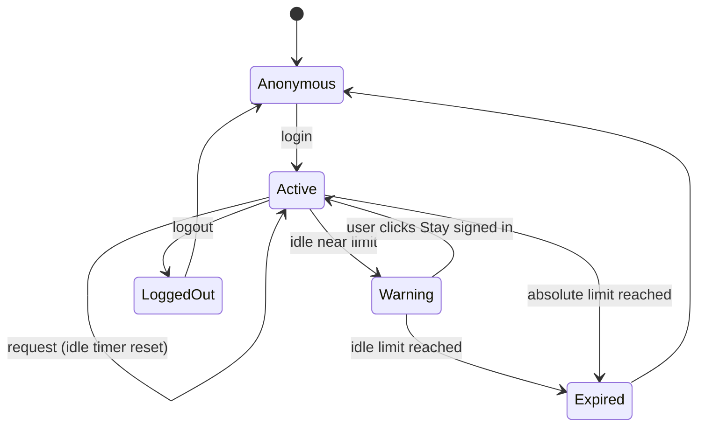

## Beginner-friendly explanation

**Sessions.** When you check into a hotel you get a key card. It works until checkout, but some hotels also deactivate cards if you have not been seen for a while. When you check out, the card must stop working — even if you keep it in your pocket. A web **session** is that key card: after login, the server gives your browser a token (usually in a cookie) that proves who you are on every request.

**Concurrency.** Now imagine two people editing the same shared shopping list on paper copies. Both cross things out and add items, then each copies their version onto the master list. Whoever copies last wipes out the other person's changes. Software has the same problem when two users edit the same record at the same time.

## Technical explanation

### Session timeouts

| Term | Meaning |
|---|---|
| Idle (inactivity) timeout | Session ends after N minutes with no requests; activity resets the timer |
| Absolute timeout | Session ends N hours after login regardless of activity |
| Invalidation | Server deletes or revokes the session on logout, password change or admin action |
| Renewal | Some apps issue a new session ID after login or privilege change to prevent fixation |

The OWASP Session Management Cheat Sheet recommends both idle and absolute timeouts, and server-side invalidation on logout. A session can be server-side (a session ID mapped to data on the server) or a self-contained token such as a JWT, which is harder to revoke before it expires — worth asking about.

### Concurrent updates

- **Lost update:** two clients read version 1, both write; the second write overwrites the first without warning.
- **Optimistic locking:** each record has a version number or ETag. A save says "update only if the version is still 5". If someone else saved first, the server rejects it (HTTP 412 Precondition Failed with `If-Match`, or 409 Conflict in many APIs) and the UI shows a conflict message.
- **Pessimistic locking:** the first editor locks the record; others see "being edited by A".
- **Last write wins** is acceptable only when the product explicitly chooses it.

Double submission (clicking Pay twice, or two tabs submitting the same form) is a related concurrency issue — see [idempotency, retries and rate limiting](/learn/api-testing/idempotency-retries-rate-limiting).

## Real-world example

A clinic's appointment system lets receptionists book slots. Two receptionists at different desks both see 10:30 with Dr. Rao as free, and both book it for different patients within a few seconds. Both get "Booked". Two patients arrive at 10:30.

The test that would have caught it: two browsers, same slot, click Book at nearly the same moment. The fix was a database constraint on doctor + slot, plus a friendly "This slot was just taken" message for the second receptionist.

## Step-by-step walkthrough

**Session tests**

1. Ask for the idle and absolute timeouts; request shortened values in test (for example 2 and 10 minutes).
2. Stay idle just under the idle limit, act, and confirm you are still logged in.
3. Stay idle past the limit, act, and confirm redirection to login with a clear message.
4. Stay active past the absolute limit and confirm the session ends.
5. Start filling a long form, let the session expire, submit — check what happens to the data.
6. Log out, press Back, refresh, and replay the old cookie via an API client.
7. Log in on two browsers; log out in one; check the other matches the requirement.
8. Change the password in one session; check other sessions are ended if required.

**Concurrency tests**

| ID | Setup | Action | Expected |
|---|---|---|---|
| CON-01 | Users A and B open record 42 | A saves priority; B saves description | B sees conflict message or fields merge; no silent loss |
| CON-02 | Two browsers on same slot | Both click Book together | Exactly one booking; other sees "slot taken" |
| CON-03 | Same user, two tabs | Submit same order form in both | One order, or a clear duplicate warning |
| CON-04 | A deletes record | B saves edit to it | B sees "record no longer exists" |
| CON-05 | Slow network | Double-click Submit | One record created |

## Common mistakes

- **Waiting the full production timeout** instead of asking for a configurable test value.
- **Testing only the idle timeout** and forgetting the absolute one.
- **Believing the logout screen** instead of checking the server rejects the old session.
- **Testing concurrency alone in one browser tab.** You need two sessions, ideally two users.
- **Calling a lost update "random"** and closing it as not reproducible. Concurrency defects need precise timing; describe the order of actions exactly.

## Troubleshooting

- **Hard to hit the exact same moment?** Open both forms, prepare both edits, then save one immediately after the other — most lost updates do not need millisecond timing.
- **Session never seems to expire?** Background polling may count as activity; check the network tab for periodic requests.

## Key takeaways summary

Sessions must expire on idle and absolute limits and be invalidated on the server. Concurrent edits must never lose data silently. Test both with multiple tabs, browsers and users, and record the exact order of actions.
