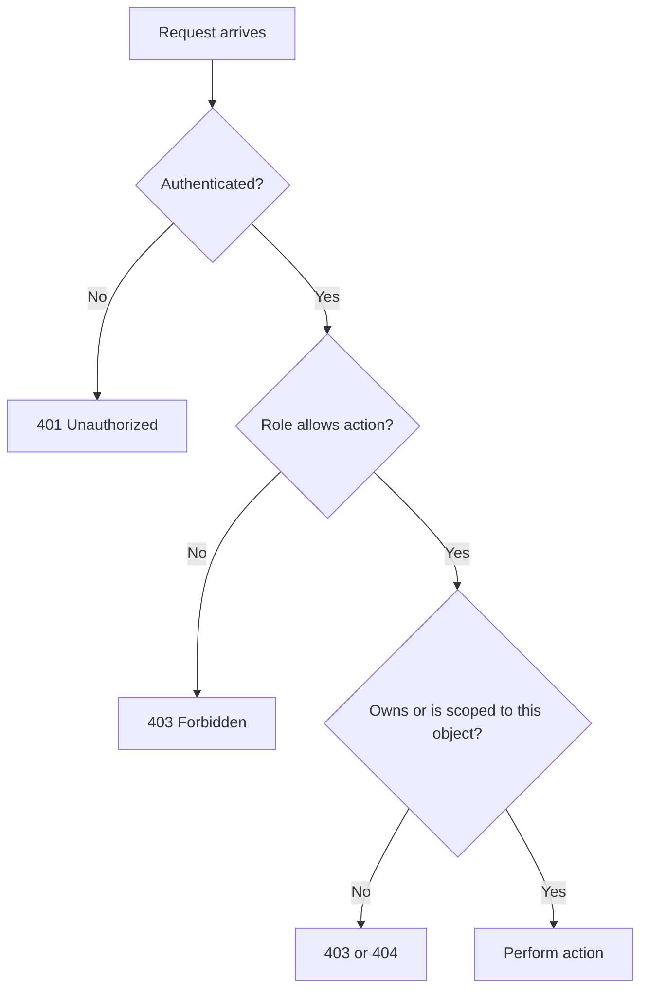

## Beginner-friendly explanation

Think of an office building with key cards. A visitor's card opens the lobby. An employee's card opens their floor. A manager's card opens the meeting rooms, and the security chief's card opens everything. Testing permissions is walking around with each card and checking two things: every door you **should** open does open, and every door you **should not** open stays shut — even if you try the back entrance.

In software, the "cards" are **roles** (Admin, Manager, Viewer, Customer) and the "doors" are **actions** (view, create, edit, delete, approve, export). The back entrance is anything other than the normal screen: typing a URL directly, or calling the API.

## Technical explanation

**Authentication** answers "who are you?" **Authorization** answers "what are you allowed to do?" Permission testing is authorization testing. Most business apps use **role-based access control (RBAC)**: permissions are attached to roles, and users get roles. Some add **attribute-based** rules, such as "a manager can approve expenses only for their own team" or "under ₹50,000".

Access control can fail in two directions:

- **Vertical:** a lower role performs a higher role's action (Viewer deletes a record).
- **Horizontal:** a user reaches another user's data at the same level (Customer A reads Customer B's invoice). In APIs this is called broken object-level authorization (BOLA).

Broken access control is the number one category in the OWASP Top 10 (2021), so this is not a niche concern.

Two layers must both be tested:

| Layer | What to check |
|---|---|
| UI | Denied actions are hidden or disabled; menus and pages match the role |
| Server | Every denied request is rejected (usually 403, or 404 to hide existence) regardless of how it is sent |

### The permission matrix

A matrix is a [decision table](/learn/manual-testing/decision-table-testing) of roles against actions. Example for an expense app:

| Action | Employee | Manager | Finance | Admin |
|---|---|---|---|---|
| Submit own expense | Yes | Yes | Yes | Yes |
| View own expenses | Yes | Yes | Yes | Yes |
| View team's expenses | No | Own team only | All | All |
| Approve expense | No | Own team, under ₹50,000 | Any | No |
| Export to payroll | No | No | Yes | No |
| Manage users | No | No | No | Yes |

Note the conditional cells and the fact that Admin cannot approve — that kind of separation-of-duties rule is easy to miss and must be confirmed.

## Real-world example

An HR portal lets managers view leave requests for their team. Testing in the UI looks perfect: a manager only sees their own team in the list. A tester opens one request, notes the URL `/leave/5531`, then logs in as a manager of a different team and pastes the same URL. The full leave request, including a medical note, is displayed.

The list was filtered, but the detail endpoint only checked "is this user a manager?" and never "is this request in their team?". The fix added an ownership check on the server, and the tester added "open another team's record by URL" to every permission test set.

## Step-by-step walkthrough

1. **Collect roles and actions** from stories, the admin screens and existing documentation.
2. **Build the matrix** and get the product owner to confirm every cell, especially conditional ones.
3. **Create a test user per role** (and two users per role, for horizontal tests).
4. **Positive tests:** each role performs each allowed action successfully.
5. **Negative UI tests:** denied actions are hidden or disabled, and pages show a friendly "no access" message.
6. **Negative server tests:** while logged in as the low role, request the restricted URL directly, or replay the high role's API request with the low role's session (with an API client or DevTools).
7. **Horizontal tests:** user A tries to view, edit or delete user B's objects by changing IDs.
8. **Lifecycle tests:** role downgraded mid-session, user deactivated, logout then browser Back button, expired session.
9. **Check audit logs** if the requirement says sensitive actions are logged.

### Sample test cases

| ID | Role | Action | Route | Expected |
|---|---|---|---|---|
| PERM-01 | Manager | Approve own team's ₹20,000 expense | UI | Approved |
| PERM-02 | Manager | Approve own team's ₹60,000 expense | UI | Blocked with message |
| PERM-03 | Employee | Open /admin/users | Direct URL | 403 page |
| PERM-04 | Employee | POST approve request | API | 403, expense unchanged |
| PERM-05 | Manager A | Open team B's expense by ID | Direct URL | 403 or 404 |
| PERM-06 | Manager downgraded to Employee | Approve after downgrade | UI and API | Rejected |

## Common mistakes

- **Testing only with an admin account** because it is convenient. Admin hides every permission bug.
- **Trusting the UI.** A missing button proves nothing about the server.
- **Ignoring horizontal access.** Same role, different owner, is the most common real-world leak.
- **Not confirming the matrix.** Requirements often say what roles can do, never what they cannot.
- **Checking only the response code**, not that the data was actually unchanged after a rejected request.
- **Testing someone else's production system.** Access-control probing is only done on systems you are authorised to test.

## Key takeaways summary

Permission testing is systematic: confirm a role-by-action matrix, test every allowed and denied cell, prove denials on the server through URLs and APIs, and always try another user's data with the same role.
