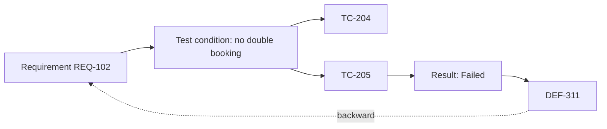

## Beginner-friendly explanation

Imagine a wedding planner with a checklist from the couple: flowers, music, cake, photographer. Next to each item the planner writes who is handling it and whether it is confirmed. One glance shows that the cake has no supplier yet. And if a bill arrives for fireworks, the planner can see it matches nothing on the list and ask why.

A **traceability matrix** is that checklist for testing. Each requirement sits in a row, with the tests that check it, their results and any defects. Gaps jump out in both directions.

## Technical explanation

ISTQB describes **traceability** as the ability to establish relationships between work products, such as between test basis items (requirements, user stories), test conditions, test cases, test results and defects.

- **Forward traceability**: requirement → tests. Finds requirements with no tests.
- **Backward traceability**: test or defect → requirement. Finds orphan tests and undocumented behaviour.
- **Bidirectional traceability**: both. Needed for **impact analysis** when a requirement changes.

A **requirements traceability matrix (RTM)** is the table (or tool report) that holds these links. Typical columns: requirement ID, description, priority or risk, test case IDs, latest execution status, defect IDs.

### Coverage calculations

Common definitions (organisations may define them differently, so always state the formula you use):

```text
Requirements coverage (%) = requirements with ≥1 linked test ÷ total requirements × 100
Requirements passed (%)   = requirements whose linked tests all passed ÷ total requirements × 100
Test execution (%)        = tests executed ÷ tests planned × 100
```

### Traceability in agile teams

Agile teams rarely maintain a separate spreadsheet. Instead, the user story is the requirement, and test cases, exploratory session notes, automated test results and defects are **linked to the story** in the issue tracker or test management tool. The "matrix" is then a generated report or dashboard filtered by release or epic. The principle is unchanged: every story should show which tests verified it and with what result, and every defect should point back to the behaviour it violates. Lightweight does not mean absent.

## Real-world example

A healthcare scheduling app is releasing an appointment-booking module. The RTM, exported from the test management tool, looks like this on the day before sign-off:

| Req ID | Requirement | Risk | Test cases | Status | Defects |
|---|---|---|---|---|---|
| REQ-101 | Patient books an available slot | High | TC-201, TC-202, TC-203 | Passed | none |
| REQ-102 | Double booking of a slot is prevented | High | TC-204, TC-205 | Failed | DEF-311 (High, open) |
| REQ-103 | Confirmation email sent within 5 minutes | Medium | TC-206 | Passed | none |
| REQ-104 | Patient cancels up to 24 hours before | Medium | TC-207, TC-208 | Blocked | DEF-315 (env) |
| REQ-105 | Clinic admin can block holidays | Medium | none | Not covered | none |
| REQ-106 | Slots shown in patient's time zone | High | TC-209 | Not run | none |
| none | (orphan) | n/a | TC-230 "Export to calendar" | Passed | none |

Reading it:

- **Coverage** = 5 of 6 requirements have tests = **83.3%**. REQ-105 has no tests: a gap to fix or to accept explicitly as a risk.
- **Requirements passed** = REQ-101 and REQ-103 = 2 of 6 = **33.3%**.
- REQ-102 is a **High-risk failure**; it should block sign-off unless the product owner accepts the risk.
- TC-230 is an **orphan**. Investigation showed "export to calendar" was built but never written down; the product owner added REQ-107.

That last point is why backward traceability matters: it found an undocumented feature that nobody would otherwise have included in the release notes or the regression suite.



## Step-by-step walkthrough

1. **Give every requirement a stable ID** (story key or requirement number).
2. **Link each test case** to the requirement(s) it verifies when you write it, not at the end.
3. **Add risk or priority** to each requirement so gaps can be prioritised.
4. **Link defects** to the failing test and requirement.
5. **Review forward gaps** (requirements without tests) and **backward gaps** (tests without requirements) before execution starts.
6. **Refresh status** during execution and use the RTM in progress and closure reports.
7. **On a requirement change**, filter the RTM by that ID to find every test and defect affected.

## Common mistakes

- **Building the RTM at the end** for an audit. It is then copied from memory and is unreliable.
- **Reporting coverage as quality.** "100% covered" with one happy-path test per requirement is shallow.
- **Counting tests instead of requirements.** Ten tests on one requirement do not cover the other nine.
- **Ignoring non-functional and implicit requirements** (performance, accessibility, security) because they are not in the story list.
- **Manual spreadsheets nobody updates.** Use the links in your test management or issue-tracking tool where possible.
- **Hiding "not covered" rows.** Gaps must be visible so someone can accept or fix them.

## Troubleshooting

- **Requirements have no IDs.** Agree a numbering scheme with the business analyst or use story keys.
- **One test covers many requirements.** That is fine; link it to all of them, but check each requirement also has focused tests.
- **The RTM is too big to read.** Summarise by feature and risk level, and show detail only for gaps and failures.

## Key takeaways summary

The RTM links requirements to tests, results and defects in both directions. Use it to find gaps early, analyse the impact of changes and report status per requirement, and always state that coverage measures breadth, not thoroughness.
