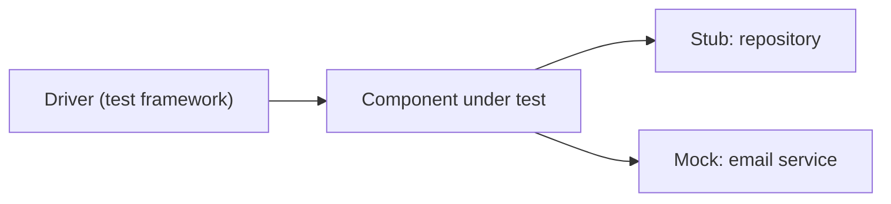

## Beginner-friendly explanation

Think about building a bicycle. Before you bolt everything together, you would spin each wheel to check it runs true, squeeze each brake lever and look at the pads, and check that the gears click. If the finished bike wobbles, you want to have already ruled out the wheel.

**Component testing** (also called **unit testing**) is that first check. Software is made of small building blocks: a function that calculates tax, a class that validates an email address, a module that formats dates. Each block is tested on its own, before it is combined with others. When a test fails here, you know almost exactly where the problem is, and fixing it takes minutes rather than days.

## Technical explanation

ISTQB CTFL v4.0 lists five test levels: **component testing**, **component integration testing**, **system testing**, **system integration testing** and **acceptance testing**. Component testing (unit testing) is the first and focuses on components that can be tested separately.

| Aspect | Component testing |
|---|---|
| Test objects | Functions, methods, classes, modules, database procedures |
| Test basis | Detailed design, component specification, code, user story acceptance criteria |
| Typical defects | Incorrect logic, off-by-one errors, wrong calculations, unhandled nulls and exceptions, incorrect data flow inside the component |
| Who usually tests | Developers, often with tester input |
| Environment | Developer machine or CI, using a unit test framework |

### Isolation: stubs, drivers and mocks

A component usually depends on others. To test it alone you replace those dependencies with **test doubles**:

- **Stub**: replaces a component that is *called by* the component under test and returns predefined answers.
- **Driver**: replaces a component that *calls* the component under test, feeding it inputs. A unit test framework such as JUnit is effectively a driver.
- **Mock**: a stub that also records and verifies how it was called (for example "the email service was called once").



Component tests can be black-box (derived from the specification) or white-box (derived from the code structure, measured by statement and branch coverage). In practice they are both: you design cases from behaviour, then use coverage to see which branches nobody exercised.

### Test-first approaches

In **test-driven development (TDD)**, the developer writes a failing component test, writes just enough code to pass it, then refactors. TDD produces a large, fast regression suite as a side effect, but it does not replace testing at higher levels.

## Real-world example

A team building an insurance quote engine had a `PremiumCalculator` class with rules for age bands, no-claims discounts and regional loading. Testers reviewed the developer's unit tests against the pricing specification and noticed every test used a driver aged 30 to 50. Using boundary value analysis they suggested tests at the age-band edges (24, 25, 64, 65) and a zero-claims-history case.

Two of the new tests failed: the band for drivers aged exactly 25 used the younger driver's loading. Because the failure was in an isolated component test with stubbed rate tables, the developer found and fixed the comparison in a few minutes. Had the same defect surfaced in system testing, someone would first have had to work out whether the UI, the rate data or the calculation was wrong.

## Step-by-step walkthrough

1. **Identify the component and its responsibility.** One clear sentence: "Calculates the discount for an order total."
2. **List inputs, outputs and dependencies.** Which other components does it call? Those become stubs or mocks.
3. **Design test cases with black-box techniques.** Equivalence partitions, boundaries, decision tables for rule combinations, and invalid inputs.
4. **Write each test in Arrange, Act, Assert form.** Set up data and doubles, call the component once, check the result.
5. **Run and read coverage.** Look for untested branches, especially error-handling paths.
6. **Add tests for any uncovered risky branch**, then keep the suite in CI so it runs on every change.

## Code examples

A JUnit 5 component test for the discount rule from the quiz, with boundaries chosen deliberately:

```java
class DiscountCalculatorTest {

    private final DiscountCalculator calc = new DiscountCalculator();

    @ParameterizedTest
    @CsvSource({
        "999.99, 0.00",    // just below the threshold
        "1000.00, 100.00", // exactly on the threshold
        "1500.00, 150.00"  // typical value in the discount partition
    })
    void appliesTenPercentFromOneThousand(double total, double expected) {
        assertEquals(expected, calc.discount(total), 0.001);
    }
}
```

## Expected output

Against the buggy `total > 1000` implementation, the runner reports one failing case and two passes:

```text
appliesTenPercentFromOneThousand(double, double)
  [1] 999.99, 0.00     PASSED
  [2] 1000.00, 100.00  FAILED  expected: <100.0> but was: <0.0>
  [3] 1500.00, 150.00  PASSED
```

## Common mistakes

- **Only testing the happy path.** Error handling, nulls and boundaries are where component defects hide.
- **Treating coverage as a quality score.** A test with no assertions still increases coverage.
- **Testing through real dependencies.** Calling a real database or network makes tests slow and flaky, and failures stop pointing at the component.
- **Over-mocking.** Mocking every internal call ties tests to implementation details, so harmless refactoring breaks them.
- **Assuming unit tests make higher levels unnecessary.** Components that each work can still fail together; see [integration testing](/learn/manual-testing/integration-testing).

## Troubleshooting

- **A test passes alone but fails in the full suite.** Tests share state (static variables, a shared clock, files). Reset state in setup and avoid ordering dependencies.
- **A component is hard to test in isolation.** It probably creates its dependencies internally. Suggest dependency injection so doubles can be passed in.
- **Tests break after every refactor.** They are checking *how* the code works rather than *what* it returns. Assert on outputs and observable behaviour.

## Key takeaways summary

Component testing is the first and cheapest test level. Isolate the component with stubs, drivers and mocks, design cases with proper techniques rather than only happy paths, and read coverage as a pointer to gaps, not as proof of quality. Then rely on higher levels for what isolated tests cannot see.
