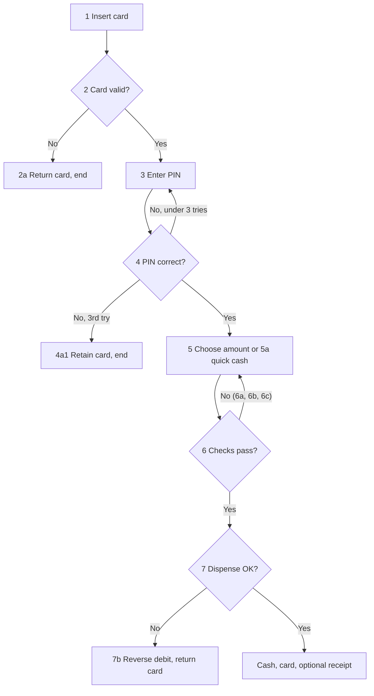

## Beginner-friendly explanation

Think of a recipe. The main recipe tells you the normal way to bake a cake. Good recipes also have notes: "if you have no buttermilk, use milk and lemon juice" (another way to succeed) and "if the cake sinks, the oven was opened too early" (what to do when something goes wrong).

A **use case** is a recipe for how a person uses a system to get something done, such as withdrawing cash. **Use-case testing** means following the main recipe, then every "another way" note and every "if it goes wrong" note, and checking that the result is right each time.

## Technical explanation

A use case describes interactions between an **actor** (a user or external system) and the **subject** (the system under test) that achieve a **goal**. A typical structure:

| Element | Meaning |
|---|---|
| Primary actor | Who initiates the interaction |
| Preconditions | What must be true before it starts |
| Main success scenario | The numbered steps of the normal path |
| Alternate flows (extensions) | Other successful paths, numbered against a step (e.g. 5a) |
| Exception flows | Error handling that recovers or ends the use case |
| Postconditions | What must be true afterwards, on success and on failure |

Tests are derived so that each **behaviour** (the main scenario, each alternate flow and each exception flow) is exercised at least once. **Coverage** = behaviours tested ÷ total behaviours × 100%.

On the syllabus: use-case testing was a named black-box technique in **ISTQB CTFL v3.1**. **CTFL v4.0** no longer lists it among Foundation techniques. It covers user stories, acceptance criteria and ATDD in its collaboration-based approaches instead. ISO/IEC/IEEE 29119-4 describes **scenario testing**, which use-case-based testing is a common form of. The technique is still standard practice for system and acceptance testing.

### Worked example: withdraw cash from an ATM

**Actor:** account holder. **Preconditions:** ATM online and stocked with cash; customer has a valid card. **Success postcondition:** account debited by the amount, cash dispensed, card returned.

**Main success scenario**

1. Customer inserts card.
2. System validates the card and asks for the PIN.
3. Customer enters the PIN.
4. System verifies the PIN and shows the menu.
5. Customer selects Withdraw and types an amount.
6. System checks the amount against balance, daily limit, note denominations and ATM cash.
7. System debits the account, returns the card and dispenses the cash.

**Alternate flows**

- **5a** Customer chooses a quick-cash amount. Rejoin at step 6.
- **7a** Customer requests a receipt. System prints it after dispensing.

**Exception flows**

- **2a** Card expired or unreadable. Card returned with a message; use case ends.
- **4a** Wrong PIN. System re-prompts. **4a1** Third consecutive wrong PIN: card retained; use case ends.
- **6a** Insufficient balance. Message shown; return to step 5.
- **6b** Amount not a multiple of ₹100. Message shown; return to step 5.
- **6c** Amount exceeds the daily limit. Message shown; return to step 5.
- **7b** Dispenser fails after the debit. Debit reversed; incident logged; card returned.



**Derived test cases**

| Test | Flow | Key data | Expected result and postcondition |
|---|---|---|---|
| UC-01 | Main | Balance ₹20,000, withdraw ₹5,000 | ₹5,000 dispensed; balance ₹15,000; card returned |
| UC-02 | 5a | Quick cash ₹2,000 | ₹2,000 dispensed; balance reduced by ₹2,000 |
| UC-03 | 7a | Withdraw ₹1,000 with receipt | Receipt shows amount and new balance |
| UC-04 | 2a | Expired card | Card returned; no PIN prompt |
| UC-05 | 4a | Wrong PIN once, then correct | Re-prompt, then menu; counter reset |
| UC-06 | 4a1 | Wrong PIN three times | Card retained; account flagged per policy |
| UC-07 | 6a | Balance ₹500, withdraw ₹1,000 | "Insufficient funds"; back to amount entry; no debit |
| UC-08 | 6b | Withdraw ₹250 | Denomination message; no debit |
| UC-09 | 6c | Amount above daily limit | Limit message; no debit |
| UC-10 | 7b | Simulated dispenser fault | Debit reversed; balance unchanged; incident logged |

Ten tests cover 10 of 10 behaviours (100% use-case coverage). Within steps, apply [boundary value analysis](/learn/manual-testing/boundary-value-analysis) to the amount and daily limit.

## Real-world example

A food-delivery team tested "place order" thoroughly along the main path. When they rewrote the user story as a use case, they had to number what happens if **payment succeeds but the restaurant rejects the order**. The flow existed in the code but had never been tested. Running it showed the order was cancelled but the refund was never triggered. The partial-failure exception flow, which is exactly what use-case analysis forces you to write down, held the defect.

## Step-by-step walkthrough

1. **Collect or write the use case**, numbering every step and extension.
2. **List behaviours** in a coverage table: main, each alternate, each exception.
3. **Ask "what can fail?"** at every system step, including partial failures, timeouts and external errors. Add missing extensions and confirm them with the product owner.
4. **Define preconditions and test data** for each behaviour, using EP and BVA for values.
5. **Write expected results as postconditions**, covering data, state and messages.
6. **Execute and record** which behaviours passed. Report coverage as behaviours tested ÷ total.

## Code examples

Use-case flows map naturally to Gherkin scenarios, one per behaviour:

```gherkin
Feature: Withdraw cash

  Background:
    Given an ATM that is online and stocked
    And a customer with a valid card and PIN

  Scenario: UC-01 Main success scenario
    Given the account balance is 20000
    When the customer withdraws 5000
    Then 5000 is dispensed
    And the account balance is 15000
    And the card is returned

  Scenario: UC-10 Dispenser fails after debit
    Given the account balance is 20000
    And the cash dispenser will fail
    When the customer withdraws 5000
    Then the debit is reversed
    And the account balance is 20000
```

## Expected output

With step definitions bound to a test ATM simulator, Cucumber reports `2 scenarios (2 passed)`. If the reversal were missing, UC-10 would fail on `And the account balance is 20000`, pointing at the 7b postcondition.

## Common mistakes

- **Testing only the main scenario.** Most defects sit in extensions.
- **Checking the message, not the postcondition.** "Transaction failed" means nothing if the balance was still debited.
- **Writing use cases full of UI detail**, which makes tests brittle and hides the goal.
- **Ignoring loops**, such as returning to step 5 after an error, and then succeeding. Test the recovery too.
- **Forgetting secondary actors**, such as the bank's core system, whose failures create exception flows.

## Troubleshooting

- **No use cases exist.** Write a lightweight one from the user story and acceptance criteria, then review it with the team.
- **An exception is hard to trigger.** Ask for a simulator, stub or fault-injection hook, and record the method in the test case.
- **Too many combinations within one flow.** Keep the use-case test focused on the flow and move data combinations to [decision table](/learn/manual-testing/decision-table-testing) or pairwise tests.

## Key takeaways summary

Use-case testing turns goal-oriented descriptions into end-to-end tests. Cover the main scenario, every alternate and every exception flow, verify postconditions on real data, and report coverage by behaviour. Pay special attention to partial failures.
