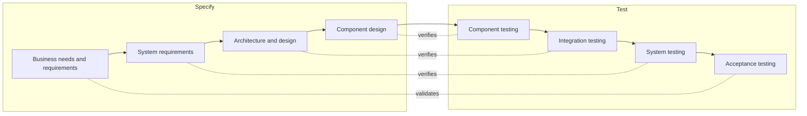

## Beginner-friendly explanation

Imagine you hire a builder to make a garden shed and give them a drawing: 2 metres by 3 metres, one door, one window.

- When the shed is finished, you measure it. It is exactly 2 by 3 metres, with one door and one window. It matches the drawing perfectly. That check is **verification**: *did they build it the way the plan said?*
- Then you try to put your lawnmower inside, and it does not fit through the door. The shed matches the plan, but it does not do the job you needed. Discovering that is **validation**: *is this actually what I needed?*

The builder did nothing wrong against the drawing. The drawing was wrong. Good testing checks both: that the product matches the plan, and that the plan, and the product, meet the real need.

## Technical explanation

The ISTQB syllabus states that testing involves both verification and validation. The ISTQB glossary defines:

- **Verification**: confirmation by examination and through provision of objective evidence that specified requirements have been fulfilled.
- **Validation**: confirmation by examination and through provision of objective evidence that the requirements for a specific intended use or application have been fulfilled.

In plain terms, the syllabus describes verification as checking whether the system meets specified requirements, and validation as checking whether the system meets users' and other stakeholders' needs in its operational environment.

| | Verification | Validation |
|---|---|---|
| Compared against | Specifications, requirements, standards | Stakeholder needs and intended use |
| Common short form | "Are we building the product right?" | "Are we building the right product?" |
| Typical static examples | Reviewing design against requirements, code review, static analysis | Reviewing user stories or prototypes with real users |
| Typical dynamic examples | Component, integration and system tests derived from specifications | User acceptance testing, operational acceptance, alpha and beta testing, usability sessions |
| Found problems | Product differs from the specification | Specification, and therefore product, differs from the real need |

Two important points:

1. **Static and dynamic are a separate axis.** Both verification and validation can be done statically (reviews) or dynamically (executing the software). What differs is the reference you compare against.
2. **Most activities lean one way, but the line is not absolute.** A system test can reveal a usability issue (validation), and an acceptance test can be written straight from a specification (verification).

### Verification and validation in the V-model

The V-model pairs each development activity with a test level. The lower levels mostly verify against technical specifications; acceptance testing mostly validates against business and user needs.

See [SDLC and STLC](/learn/manual-testing/sdlc-and-stlc) for how this model compares with iterative and agile approaches.

## Real-world example

A generic scenario: a council commissions an online parking-permit service. The specification says residents can apply by uploading a utility bill as proof of address.

- **Verification** finds that PDF uploads above a certain size are rejected even though the specification allows them. The team fixes the defect. The product now matches the specification.
- **Validation** happens in a pilot with real residents. Many younger residents do not receive paper utility bills; many older residents struggle to scan documents. Both groups abandon the application. The specification was met, but it described the wrong solution. The council adds other proof-of-address options, such as a bank statement or a council tax reference.

Without the pilot, the service would have passed every test and still failed many of the people it was built for.

## Step-by-step walkthrough

For any feature, plan both kinds of checking:

1. **Identify the specification**: requirements, acceptance criteria, API contracts, designs.
2. **Design verification tests** that compare the product against each specified item.
3. **Identify the real stakeholders and their goals**: who uses it, where, under what conditions?
4. **Plan validation activities** early: prototype reviews, demos, usability sessions, pilots, beta releases.
5. **Feed validation findings back into the requirements**, not only into defect reports, so the specification improves.
6. **Report both**: "matches the spec" and "meets the need" are separate claims.

## Common mistakes

- **Assuming that "all requirement tests passed" means "users will be happy".** That is verification only.
- **Leaving validation until the end.** Showing users a prototype early is far cheaper than discovering the wrong product at acceptance.
- **Thinking verification means static and validation means dynamic.** Either can be performed either way.
- **Treating validation findings as "not bugs".** A product that does not meet real needs is a problem even if the specification is satisfied; raise it as a requirements issue.
- **Validating with the wrong people.** Internal staff are not a substitute for real users in their real environment.

## Troubleshooting

- **You cannot get access to real users.** Use the closest available proxies, such as support staff who hear customer complaints or a product owner who has observed users, and record that validation was done with proxies as a limitation.
- **A validation finding is rejected as "not in the requirements".** Raise it as a requirements question rather than a defect, describe the user impact, and let the product owner decide whether to change the requirement.
- **Acceptance criteria are too vague to verify against.** Ask for concrete examples of inputs and expected outcomes during refinement. If they are still missing, write down your assumption in the test case and get it confirmed.

## Key takeaways summary

Verification asks whether the product matches its specification; validation asks whether it meets the real needs of its users and stakeholders where it will actually be used. You need both, because a perfect match to a flawed specification is still a failure. Plan validation early and treat its findings as input to the requirements.
