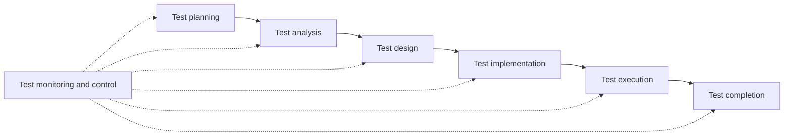

## Beginner-friendly explanation

Think about a new restaurant getting ready for opening night. The chef does not just cook a dish and serve it to the first customer. Someone reads the menu to check the descriptions make sense and the prices are right. Someone tastes each dish. Someone checks that the kitchen can handle twenty orders at once. Someone asks, "If a guest says they are allergic to nuts, do the waiters know which dishes are safe?"

All of that checking is the restaurant's version of **testing**. Some of it involves cooking and tasting (running the thing). Some of it is just reading and thinking (checking the menu before anything is cooked). The goal is not only to find problems but to be confident that opening night will go well, and to tell the owner honestly if it will not.

Software testing works the same way. It is everything we do to find problems in software and to understand how good it really is, so that people can make sensible decisions about releasing it.

## Technical explanation

The ISTQB Foundation Level syllabus (v4.0) describes **software testing** as a set of activities to discover defects and evaluate the quality of software artefacts. Those artefacts, called **test objects** when they are being tested, include not only running code but also requirements, user stories, designs and other work products.

Three ideas in that definition matter:

1. **Testing is a set of activities, not one action.** Running tests is only one part.
2. **Testing evaluates quality, not only defects.** It produces information about how well the product meets its requirements and stakeholder needs.
3. **Testing covers non-executable work products.** You can test a requirement before a single line of code exists.

### Static and dynamic testing

- **Static testing** examines work products without executing them, through reviews and static analysis. See [static and dynamic testing](/learn/manual-testing/static-vs-dynamic-testing).
- **Dynamic testing** executes the software and compares actual results with expected results.

### Verification and validation

Testing involves **verification** (checking that the system meets specified requirements) and **validation** (checking that it meets users' and other stakeholders' needs in its operational environment). The difference is covered in [verification versus validation](/learn/manual-testing/verification-vs-validation).

### The test process

ISTQB groups test work into a set of activities. They are often performed iteratively or in parallel rather than strictly in order:

| Activity | Key question it answers |
|---|---|
| Test planning | What are the objectives, scope and approach? |
| Test monitoring and control | Are we on track, and what do we adjust if not? |
| Test analysis | What should we test? (test conditions) |
| Test design | How will we test it? (test cases, test data needs) |
| Test implementation | Is everything ready to run? (test procedures, data, environment) |
| Test execution | What actually happened? (run tests, compare, log anomalies) |
| Test completion | What did we learn, and what do we hand over? |

### Testing versus debugging

These are different activities, often done by different people:

- **Testing** triggers failures caused by defects (dynamic testing) or finds defects directly (static testing).
- **Debugging** is concerned with finding the causes of failures (defects), analysing them and eliminating them. It typically involves reproducing the failure, diagnosing it and fixing the cause.

After a fix, testers run **confirmation testing** to check the fix worked and **regression testing** to check that the change has not broken anything else.

## Real-world example

A team at an online grocery service is adding a "deliver to a different address" option. Here is what testing looks like across the work, not just at the end:

- **During refinement**, a tester reviews the user story and asks: "Can the second address be in a region we do not deliver to?" The story did not say. That question is static testing, and it finds a gap before any code is written.
- **During design**, the tester identifies test conditions: valid address, unsupported region, missing postcode, address changed after the order is placed.
- **During execution**, the tester runs the cases and finds that changing the address after ordering leaves the old delivery slot attached. They log a defect with steps, expected and actual results.
- **The developer debugs** it, finds that the slot is cached by the original postcode, and fixes it.
- **The tester confirms** the fix and re-runs the existing delivery regression set.
- **At completion**, the tester reports what was covered, what was found and what risks remain, so the product owner can decide whether to release.

Notice how much of that work happened without running the software at all.

## Step-by-step walkthrough

When you first meet a new feature to test, walk through these questions:

1. **What is the test object?** A screen, an API, a user story, a document?
2. **What are the objectives?** Find defects, confirm requirements, build confidence, check compliance?
3. **What is the test basis?** The requirements, designs or other sources that tell you what "correct" means.
4. **What can be checked statically?** Review the story or specification before testing anything dynamically.
5. **What test conditions exist?** List what needs testing before deciding how.
6. **What will you report, and to whom?** Testing is only useful if the right people get clear information.

## Common mistakes

- **Treating testing as "the phase at the end".** Testing activities start as soon as there is something to examine, such as a draft requirement.
- **Equating testing with execution.** Planning, analysis, design and reviews are all testing.
- **Thinking a passing test run proves the software is correct.** Testing reduces uncertainty; it never proves the absence of defects.
- **Confusing testing with debugging.** Testers find and report failures; developers usually diagnose and fix the defects behind them.
- **Reporting only bugs.** Stakeholders also need to know what was covered, what was not, and what risks remain.

## Key takeaways summary

Software testing is a broad set of activities that discover defects and evaluate quality. It includes static testing of documents and code as well as dynamic testing of running software, and it follows a process from planning to completion. Testing tells people about quality so they can make decisions; debugging is the separate activity of finding and fixing what testing reveals.
