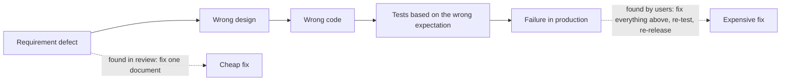

## Beginner-friendly explanation

Imagine writing an important email to a hundred customers. You are careful and you know the subject well. Would you still read it once more before pressing Send? Most people would, because everyone makes small slips: a wrong date, a missing word, a link to the wrong page. Once the email is sent, fixing a mistake means a second, embarrassing email to everyone.

Software is the same, only much bigger. A single app can contain thousands of decisions made by dozens of people. Each person can misunderstand something or slip up. Testing is the "read it again before you send it" step, done carefully and systematically, and done as early as possible so mistakes are caught while they are still cheap to fix.

## Technical explanation

### Why defects exist

The ISTQB syllabus explains that people make **errors** (mistakes), which produce **defects** in work products, which may cause **failures** when the software runs. Errors become more likely when there is:

- time pressure,
- complex code, infrastructure or business rules,
- ambiguous or changing requirements,
- unfamiliar technologies or domains,
- misunderstandings between people and teams.

The details of this chain are covered in [error, defect, bug, failure and root cause](/learn/manual-testing/error-defect-bug-failure).

### How testing contributes to success

ISTQB describes testing as a cost-effective way of detecting defects that can then be removed by debugging. Testing contributes by:

| Contribution | What it means in practice |
|---|---|
| Finding defects | Failures and defects are found and fixed before users meet them |
| Evaluating quality | Evidence about how well the product meets requirements and needs |
| Supporting decisions | Information to decide whether to release, delay or reduce scope |
| Representing users | Checking real user needs, since users cannot be involved in every step |
| Meeting obligations | Evidence for contractual, legal or regulatory requirements |

Testing is also closely tied to **risk**: the likelihood of a problem and the impact if it happens. Testing does not remove risk, but it reduces the level of risk of inadequate quality and tells stakeholders what risk remains.

### Why early testing saves money

One of the [seven testing principles](/learn/manual-testing/seven-testing-principles) is that **early testing saves time and money**. A defect in a requirement flows into everything built on it:

The later the defect is found, the more artefacts must change and the more re-testing is needed. In production there are extra costs: support calls, incident handling, refunds, emergency releases and damage to trust. The syllabus does not give a fixed multiplier, and neither should you; the point is the direction, not a number.

## Real-world example

A generic scenario: a ticketing team builds a feature that lets users transfer tickets to friends. The user story says "a ticket can be transferred to another account".

- In a **story review**, a tester asks whether a ticket can be transferred *after* it has been scanned at the venue. Nobody had considered it. The product owner adds a rule: scanned tickets cannot be transferred. That question cost a few minutes.
- Had the gap been found **in production**, scanned tickets could have been resold and reused, causing entry disputes at the venue, refunds and a hurried fix.

The same defect, the same rule, but very different costs depending on when it was found.

## Step-by-step walkthrough

Use these steps to justify testing for any feature:

1. **Name the stakeholders**: users, the business, operations, regulators.
2. **List what could go wrong** for each: wrong data, lost money, unavailable service, breached law.
3. **Estimate impact and likelihood** in simple terms (high, medium, low).
4. **Map tests to the highest risks** so the effort is clearly justified.
5. **Identify early checks**, such as story reviews, that can find problems before code exists.
6. **Agree what evidence stakeholders need** to make the release decision.

## Common mistakes

- **Saying "testing ensures quality".** Testing measures and reports quality and finds defects; quality is built in by the whole team.
- **Promising zero defects.** Testing reduces risk but cannot prove software is defect-free.
- **Starting testing only when code is ready.** This throws away the cheapest opportunity to find defects.
- **Justifying testing with invented numbers.** Use your own project's data or reason about risk; do not quote unsourced cost multipliers.
- **Testing everything equally.** Without risk-based prioritisation, effort goes to low-impact areas while high-risk ones are under-tested.

## Troubleshooting

- **Stakeholders see testing only as a cost.** Show which risks each test area covers and what the impact would be if those risks occurred. Use your own project's incident and defect history rather than industry numbers you cannot source.
- **You are not invited to early discussions.** Ask to join refinement or design reviews with a concrete offer, such as "I will bring a list of questions and edge cases for each story". Early, useful questions quickly earn a permanent seat.
- **There is not enough time to test everything.** That is expected, because exhaustive testing is impossible. Agree priorities with the product owner based on risk, test the highest risks first and report clearly what was left untested.
- **Defects keep escaping to production in the same area.** Treat it as evidence for more testing focus there, and raise it in a retrospective so the underlying cause, not just each defect, gets fixed.

## Key takeaways summary

Testing is necessary because people make mistakes and software is complex. It finds defects, evaluates quality, informs release decisions, represents users and supports compliance. The earlier testing starts, the less each defect costs to fix, so good testers get involved from the very first requirement.
