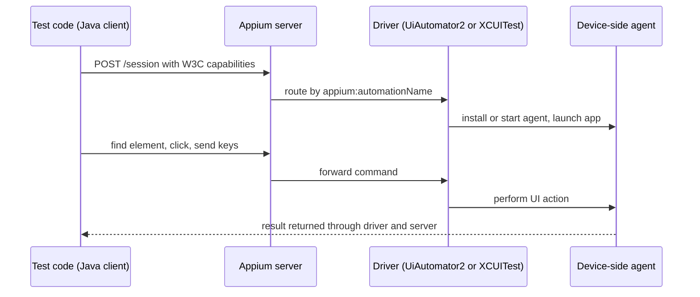

## Beginner-friendly explanation

Think of ordering food in a foreign restaurant through an interpreter. You speak your language (the test code). The interpreter (Appium) understands a standard way of ordering. Behind the counter there are specialist chefs: one who cooks Android dishes and one who cooks iOS dishes (the drivers). The interpreter passes your order to the right chef, who prepares it in their own kitchen (the phone).

That is why one Appium test style can work on both Android and iOS: your test always speaks the same standard language, and the right specialist does the platform-specific work.

## Technical explanation

### Architecture



- **Client libraries** (Java, Python, JavaScript, Ruby, .NET) send W3C WebDriver commands over HTTP.
- **The Appium server** is a Node.js application. It listens on port 4723 by default, creates sessions and routes them to drivers.
- **Drivers** implement automation for a platform. The **UiAutomator2** driver puts a small server on the Android device that uses Google's UI Automator; the **XCUITest** driver runs **WebDriverAgent** on the iOS device or simulator, which uses XCTest. Other drivers exist, for example Espresso, Mac2 and Windows.
- **Plugins** extend server behaviour, for example adding image-based element finding.

### What Appium 2 changed

| Topic | Appium 1 | Appium 2 |
|---|---|---|
| Drivers | Bundled with the server | Installed separately with `appium driver install` |
| Protocol | JSON Wire Protocol and W3C | W3C WebDriver only |
| Capabilities | Unprefixed `desiredCapabilities` accepted | Vendor capabilities need the `appium:` prefix |
| Default base path | `/wd/hub` | `/` (configurable with `--base-path`) |
| Gestures | TouchAction and MultiAction | W3C Actions or driver `mobile:` commands |

This lesson follows the Appium 2 model, which later major versions keep. Check the documentation for the exact Node.js and driver versions your release requires.

### Prerequisites per platform

- **Android:** a JDK with `JAVA_HOME`, the Android SDK with `ANDROID_HOME` set, platform-tools (`adb`) on the path, and an emulator or a device with USB debugging enabled.
- **iOS:** macOS with Xcode and its command-line tools; for real devices, WebDriverAgent must be signed with a valid team and provisioning profile.

## Real-world example

A QA team moved its Android suite to a new CI image. Every test failed at session creation, although the same code worked on laptops. The laptops had been set up months earlier with `appium driver install uiautomator2`; the CI image only ran `npm install -g appium`. Adding the driver install step, pinned to a known driver version, fixed the pipeline. The team also added `appium driver list --installed` to the job log so the next mismatch would be obvious.

## Step-by-step walkthrough

1. **Install Node.js** in a version supported by your Appium release.
2. **Install the server** and the drivers you need.
3. **Check the environment** with the driver's doctor command where available.
4. **Start an emulator** or connect a device, and confirm it with `adb devices`.
5. **Start the server** and leave it running.
6. **Write capabilities** and create a session from your test.
7. **Always quit** the session in teardown so the device is released.

## Code examples

```bash
npm install -g appium
appium driver install uiautomator2
appium driver install xcuitest        # macOS only
appium driver list --installed
appium driver doctor uiautomator2     # environment checks, in recent Appium 2 releases
appium                                # starts the server on http://127.0.0.1:4723
```

W3C capabilities for an Android session:

```json
{
  "platformName": "Android",
  "appium:automationName": "UiAutomator2",
  "appium:deviceName": "Pixel_7_API_34",
  "appium:app": "/builds/app-debug.apk",
  "appium:noReset": false
}
```

The same session from Java with the Appium java-client. The option class sets `platformName` and `appium:automationName` for you and adds the prefix to everything else:

```java
import io.appium.java_client.AppiumBy;
import io.appium.java_client.android.AndroidDriver;
import io.appium.java_client.android.options.UiAutomator2Options;
import java.net.URI;
import java.time.Duration;

public class FirstSession {
    public static void main(String[] args) throws Exception {
        UiAutomator2Options options = new UiAutomator2Options()
            .setDeviceName("Pixel_7_API_34")
            .setApp("/builds/app-debug.apk")
            .setNewCommandTimeout(Duration.ofSeconds(60));

        AndroidDriver driver = new AndroidDriver(
            URI.create("http://127.0.0.1:4723").toURL(), options);
        try {
            driver.findElement(AppiumBy.accessibilityId("Login")).click();
            System.out.println("Session: " + driver.getSessionId());
        } finally {
            driver.quit();
        }
    }
}
```

For iOS, the equivalents are `IOSDriver` and `XCUITestOptions`, with capabilities such as `appium:platformVersion`, `appium:deviceName` and either `appium:app` or `appium:bundleId`.

## Expected output

The server log shows the session being created by the UiAutomator2 driver, and the program prints a session id:

```text
[Appium] Welcome to Appium v2.x
[Appium] Available drivers:
[Appium]   - uiautomator2@x.y.z (automationName 'UiAutomator2')
...
Session: 3f1c9a2e-...
```

Exact version numbers and log wording vary between releases.

## Common mistakes

- **Expecting drivers to be bundled.** A fresh Appium 2 install has none.
- **Unprefixed vendor capabilities**, or prefixing standard ones like `platformName`.
- **Old server URLs ending in `/wd/hub`** against a default Appium 2 server, which returns 404 unless the server was started with that base path.
- **Using removed APIs** such as `TouchAction` or `MobileElement` from old tutorials.
- **Not quitting the driver**, which leaves sessions running and devices locked.
- **Debugging the test when the environment is broken.** Run the doctor and `adb devices` first.

## Troubleshooting

- **"Could not find a driver for automationName".** Install the driver or fix the spelling of the automation name.
- **"ANDROID_HOME is not set" or adb not found.** Set the SDK environment variables for the shell that starts Appium, then restart it.
- **iOS real device fails while building WebDriverAgent.** It is almost always signing; configure the development team and provisioning as described in the XCUITest driver documentation.
- **Session starts but the app does not launch.** Check the app path, the package and activity, or the bundle id.

## Key takeaways summary

Appium is a W3C WebDriver server that hands each session to a platform driver. In Appium 2 you install drivers yourself, write vendor capabilities with the `appium:` prefix and use modern client classes like `AndroidDriver` with `UiAutomator2Options`. When a session will not start, check the environment before the test code.
