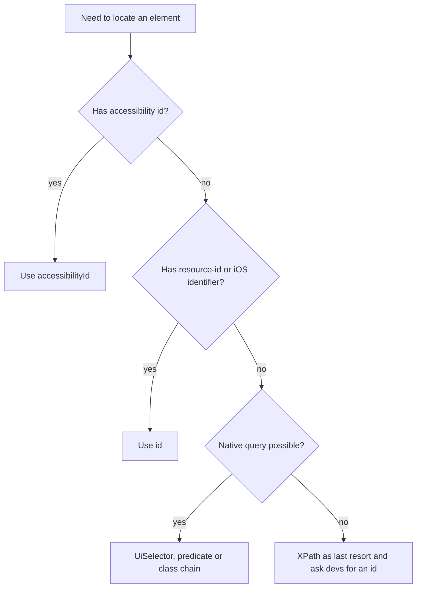

## Beginner-friendly explanation

Imagine directing a friend to a book in a library. "The third book on the second shelf of the fourth bookcase" works until someone rearranges the shelves. "The book titled *Testing Basics*" keeps working wherever it moves. Good locators are like titles, not shelf positions.

Gestures are the second half of mobile automation. Phones are used with fingers: tapping, swiping, holding and scrolling. Automation has to imitate those finger movements, and do it in a way that works on small and large screens alike.

## Technical explanation

### Locator strategies

| Strategy (Java `AppiumBy`) | Android matches | iOS matches | Stability and speed |
|---|---|---|---|
| `accessibilityId` | content-desc | accessibility identifier | Best; often cross-platform |
| `id` | resource-id | name or identifier | Very good |
| `androidUIAutomator` | UiSelector expression | not available | Good; native and fast |
| `iOSNsPredicateString` | not available | NSPredicate query | Good; native and fast |
| `iOSClassChain` | not available | Class chain query | Good; faster than XPath |
| `className` | widget class | element type | Weak; usually matches many |
| `xpath` | page source XML | page source XML | Slowest and most brittle |

**Appium Inspector** is a separate desktop or web application that connects to an Appium server, shows a screenshot alongside the element tree and suggests locators. Use it to discover attributes, then choose the most stable option, not just the first suggestion.

### Gestures

Gestures are expressed in two ways.

1. **W3C Actions.** The standard WebDriver Actions API describes input sources (pointer, key) and timed sequences of actions. A touch pointer performs `pointerMove`, `pointerDown`, `pause`, `pointerMove` and `pointerUp`. Combining two pointer sequences gives multi-touch gestures such as pinch.
2. **Driver mobile commands**, called through `executeScript`. UiAutomator2 offers commands such as `mobile: clickGesture`, `mobile: longClickGesture`, `mobile: swipeGesture` and `mobile: scrollGesture`; XCUITest offers commands such as `mobile: swipe`, `mobile: scroll` and `mobile: touchAndHold`. Arguments differ by driver, so check the driver documentation.

The legacy `TouchAction` and `MultiAction` classes were removed along with the JSON Wire Protocol; do not copy them from old tutorials.



## Real-world example

A news app's Android suite took a long time per run and failed often after UI updates. Almost every locator was an absolute XPath generated by a recording tool. The team agreed with developers to add accessibility identifiers to interactive elements, which also improved screen reader labels. The rewritten locators used accessibility id, and the swipe-based carousel tests switched from fixed pixel coordinates to `mobile: swipeGesture` on the carousel element. Runs became noticeably faster and layout changes stopped breaking tests that had nothing to do with them.

## Step-by-step walkthrough

1. **Start a session** in Appium Inspector with the same capabilities your tests use.
2. **Select the element** and read its attributes: content-desc, resource-id, name, label, text.
3. **Pick the most stable strategy** using the table above. Test it in Inspector's search.
4. **Wrap the locator** in a page object method, not inline in tests.
5. **For gestures**, decide between a driver command (simpler) and W3C Actions (portable, precise control).
6. **Compute coordinates** from the element rectangle or window size.
7. **Wait explicitly** for the expected result after each gesture.

## Code examples

```java
// Locators
driver.findElement(AppiumBy.accessibilityId("Login")).click();
driver.findElement(AppiumBy.id("com.example.shop:id/search_box")).sendKeys("shoes");
driver.findElement(AppiumBy.androidUIAutomator(
    "new UiScrollable(new UiSelector().scrollable(true))"
    + ".scrollIntoView(new UiSelector().text(\"Privacy policy\"))"));
// iOS equivalent query
// driver.findElement(AppiumBy.iOSNsPredicateString("label == 'Privacy policy'"));

// Swipe up by 60% of the screen height using W3C Actions
Dimension size = driver.manage().window().getSize();
int x = size.width / 2;
int startY = (int) (size.height * 0.8);
int endY = (int) (size.height * 0.2);

PointerInput finger = new PointerInput(PointerInput.Kind.TOUCH, "finger");
Sequence swipe = new Sequence(finger, 1)
    .addAction(finger.createPointerMove(Duration.ZERO, PointerInput.Origin.viewport(), x, startY))
    .addAction(finger.createPointerDown(PointerInput.MouseButton.LEFT.asArg()))
    .addAction(finger.createPointerMove(Duration.ofMillis(600), PointerInput.Origin.viewport(), x, endY))
    .addAction(finger.createPointerUp(PointerInput.MouseButton.LEFT.asArg()));
driver.perform(List.of(swipe));

// Same intent with a UiAutomator2 mobile command scoped to an element
WebElement list = driver.findElement(AppiumBy.id("com.example.shop:id/results"));
driver.executeScript("mobile: swipeGesture", Map.of(
    "elementId", ((RemoteWebElement) list).getId(),
    "direction", "up",
    "percent", 0.75));
```

## Expected output

After the swipe, the list shows later results. A follow-up assertion makes the outcome explicit:

```java
new WebDriverWait(driver, Duration.ofSeconds(10))
    .until(ExpectedConditions.visibilityOfElementLocated(AppiumBy.accessibilityId("Load more")));
```

If the element never appears, the wait fails with a `TimeoutException` naming the locator, which is a far clearer failure than a later `NoSuchElementException`.

## Common mistakes

- **Accepting the first XPath** a recorder or Inspector suggests.
- **Hard-coded pixel coordinates** that only work on one screen size.
- **Swiping without waiting** for scrolling animation to settle before the next action.
- **Locating by visible text** in a localised app, so tests fail in other languages.
- **Copying `TouchAction` code** from outdated articles.
- **Using the same locator for both platforms** without checking that the identifier really exists on each.

## Troubleshooting

- **Element found in Inspector but not in the test.** It may be off screen or not yet rendered; scroll to it and use an explicit wait.
- **Swipe does nothing.** Start point may be on a non-scrollable area or too close to the screen edge where the system gesture area is; move the start point inwards or swipe on the element.
- **Gesture works on Android but not iOS.** Mobile commands are driver-specific; use the XCUITest equivalent or W3C Actions.
- **Page source is huge and slow.** Avoid XPath on that screen and use native queries.

## Key takeaways summary

Stable mobile automation rests on stable locators and screen-independent gestures. Use accessibility ids and native queries, keep XPath for emergencies, perform gestures with W3C Actions or driver mobile commands rather than the removed TouchAction, and confirm each gesture's effect with an explicit wait.
