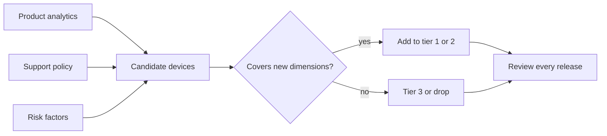

## Beginner-friendly explanation

Imagine you are a chef asked to make sure a new recipe tastes good to "everyone in the city". You cannot cook for millions of people. Instead you invite a small panel chosen carefully: someone who likes spicy food, someone who does not, a child, an older person, a vegetarian. If they are all happy, you are fairly confident.

A device coverage strategy does the same for phones. There are thousands of device models and many OS versions. You cannot test them all, so you choose a small panel that represents your real users and the riskiest combinations, and you test deeply on those.

## Technical explanation

A **device and OS coverage strategy** defines which device, OS and configuration combinations will be tested, at what depth, and on which kind of environment. It is a form of [risk-based testing](/learn/manual-testing/risk-based-testing) applied to the environment.

### Inputs

1. **Product analytics.** The distribution of your own users across OS versions, models, manufacturers and screen sizes. Public market data is a fallback for brand-new products only.
2. **Support policy.** The minimum supported OS version on each platform and any officially supported tablets or foldables.
3. **Risk factors.** Low memory, small screens, older GPUs, vendor customisations, new OS releases, devices that appear often in crash reports.
4. **Feature needs.** Camera, NFC, biometrics, Bluetooth or other hardware your app depends on.

### Dimensions to cover

| Dimension | Example values |
|---|---|
| OS major version | Minimum supported, most used, latest, beta |
| Screen | Smallest supported, typical, large, tablet, foldable |
| Hardware class | Low RAM and slow CPU, mid-range, high-end |
| Manufacturer (Android) | At least two vendors plus a near-stock build |
| Accessibility settings | Large text, dark mode, reduced motion |
| Locale | Default plus a right-to-left or long-text locale |

Choose devices that combine several dimensions. One low-end phone on the minimum OS with the smallest screen covers three risk dimensions in a single device.

### Tiers and environments

| Tier | Purpose | Environment | Tests run |
|---|---|---|---|
| Tier 1 | Highest-usage and highest-risk configurations | Local real devices | Full regression and exploratory testing |
| Tier 2 | Next band of usage and remaining risk dimensions | Real devices or device cloud | Smoke and critical journeys |
| Tier 3 | Long tail | Emulators, simulators or device cloud | Automated sanity checks |

Emulators and simulators are ideal for automated runs in CI on every commit. Real devices, whether local or in a cloud device farm, provide hardware truth and are used before release.

## Real-world example

A retail app team tested on the four phones in their office: three recent flagships and one tablet. Their analytics, which nobody had checked, showed a large share of users on older mid-range Android phones with little RAM. After a release that added a high-resolution product carousel, those users saw the app killed when returning from the camera to scan a barcode, and lost their basket.

The team rebuilt the matrix from analytics, added two low-memory devices on the minimum OS version to tier one, and added a "return from camera" lifecycle test. The defect class never recurred in their release testing.

## Step-by-step walkthrough

1. **Export usage data** for the last few months: OS versions, models, screen sizes, manufacturers.
2. **Mark mandatory configurations**: minimum OS, latest OS, smallest screen, supported tablets.
3. **Add risk configurations**: low-end hardware, vendor customisations, devices frequent in crash reports.
4. **Collapse the list** by choosing devices that cover several dimensions each.
5. **Assign tiers** and the depth of testing per tier.
6. **Map environments**: local devices, device cloud or emulators.
7. **Schedule reviews**, at least each release and whenever a major OS version ships.

### Worked example: a compact Android tier-one set

| Device profile | OS | Dimensions covered |
|---|---|---|
| Low-end, 3 GB RAM, small screen, vendor A | Minimum supported | Old OS, low memory, small screen |
| Mid-range, vendor B | Most used | Typical user, second manufacturer |
| Current flagship, near-stock | Latest | New OS behaviour, high density |
| Foldable or tablet | Recent | Large and changing screen size |

## Common mistakes

- **Testing on the devices in the office** instead of the devices users own.
- **Covering only the latest OS.** The minimum supported version is often where defects hide.
- **Listing popular models that all share the same dimensions**, which adds cost without adding coverage.
- **Never revisiting the matrix**, so it drifts away from reality.
- **Ignoring settings as a dimension.** Large text, dark mode and battery saver change behaviour without changing the device.

## Troubleshooting

- **No analytics yet (new app).** Use the support policy and public platform data as a starting point, then replace it with your own data after launch.
- **Budget too small for real devices.** Keep one or two local tier-one devices and rent breadth from a device cloud before release.
- **A defect appears only on one vendor's phones.** Add a device from that vendor to tier two and note the customisation in the matrix.

## Key takeaways summary

You cannot test every phone, so test the right ones. Build the matrix from your users' data and from risk, pick devices that cover many dimensions each, tier the depth of testing, mix emulators with real devices, and review the matrix whenever the platform landscape moves.
