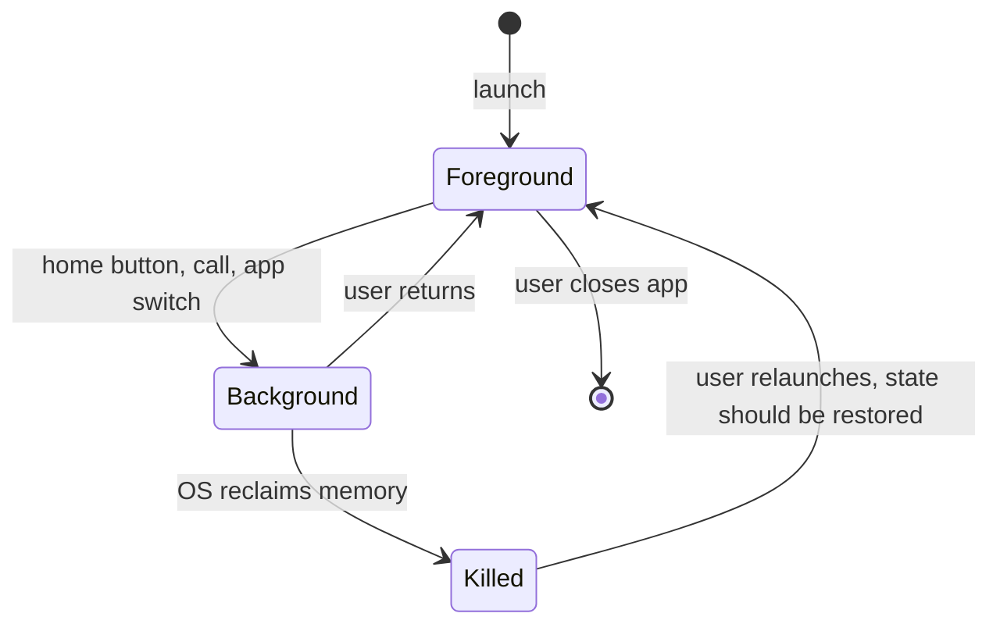

## Beginner-friendly explanation

Testing a website is a bit like inspecting a car in a quiet garage. Testing a mobile app is like inspecting the same car while someone drives it through rain, tunnels and traffic, with the phone ringing and the fuel light on.

A mobile app runs in the user's pocket, not on a stable desktop. The screen is small and can rotate. The network drops in a lift. The battery saver kicks in. A phone call arrives right in the middle of a payment. The operating system decides, without asking, to close the app to free memory.

Mobile testing means checking that the app still does the right thing under all of those everyday disruptions, not only on a perfect afternoon on office Wi-Fi.

## Technical explanation

### Types of mobile application

| Type | Built with | Testing implication |
|---|---|---|
| Native | Platform SDKs (Kotlin/Java for Android, Swift/Objective-C for iOS) | Native UI tools: Espresso, XCUITest, or Appium with a native driver |
| Hybrid | Web content inside a native WebView container | Tests may switch between native and web contexts |
| Mobile web | Runs in the device browser | Responsive web testing plus touch and mobile browser quirks |

Cross-platform frameworks render either native controls or their own drawn UI; check which before choosing locators and tools.

### Mobile-specific risk areas

- **Lifecycle.** Apps move between foreground, background and stopped states. Android can destroy and recreate an activity on rotation, and either OS may kill a background process. State must survive.
- **Interruptions.** Calls, alarms, notifications, permission dialogs, low-battery warnings and switching apps.
- **Connectivity.** Offline, slow, high-latency, lossy and switching networks. Requests may be cut off half-way.
- **Permissions.** Location, camera, notifications and contacts can be granted, denied, granted only once or revoked later in settings.
- **Device fragmentation.** Screen sizes, densities, notches, OS versions and manufacturer customisations.
- **Resources.** Limited memory, storage and battery; background work restrictions.
- **Distribution.** Fresh install, upgrade from an older version with existing data, and uninstall.
- **Input.** Touch gestures, on-screen keyboards that cover fields, and accessibility settings like large text.

### Lifecycle at a glance

### Emulators, simulators and real devices

An Android **emulator** emulates device hardware and runs a real Android system image. The iOS **Simulator** runs an iOS environment built for the Mac; it simulates the device rather than emulating its hardware. Both are fast, free and scriptable, which suits CI. Neither reproduces real battery, thermal, camera, radio or vendor-specific behaviour, so a sensible strategy mixes them with real devices.

## Real-world example

A food-delivery team tested ordering thoroughly on office Wi-Fi with flagship phones. After release, support tickets reported duplicate orders. The pattern: users on trains tapped **Place order**, the request reached the server, the connection dropped before the response arrived, the app showed a generic error, and the user tapped again.

The team added connectivity tests that cut the network after the request was sent, and found the client retried without an idempotency key. The fix combined a server-side idempotency key with a client screen that checked order status after reconnecting.

## Step-by-step walkthrough

1. **Identify the app type** (native, hybrid, mobile web). It decides your tools and locator strategy.
2. **List core user journeys** such as sign-in, browse, purchase and settings.
3. **Overlay mobile conditions** on each journey: interruptions, rotation, backgrounding, network changes, permission states.
4. **Add install and upgrade paths**: fresh install, upgrade with existing data, reinstall.
5. **Pick the environment per test**: emulator or simulator for fast functional checks, real devices for hardware and performance.
6. **Record device, OS version, build and network condition** in every result and defect report.

### Worked example: interruption matrix for checkout

| Step in checkout | Interruption | Expected result |
|---|---|---|
| Card details half entered | Incoming call, then return | Entered fields still present; card number masked |
| Payment submitted | Network lost before response | App checks order status on reconnect; no duplicate charge |
| 3-D Secure page open | App backgrounded for 5 minutes | Session either resumes or shows a clear retry message |
| Order confirmation | Device rotated | Confirmation stays visible; no re-submission |

## Common mistakes

- **Testing only on Wi-Fi with a flagship phone.** Many users have older, slower devices and weaker networks.
- **Ignoring process death.** Backgrounding briefly is not the same as the OS killing the app; test both.
- **Assuming permissions are always granted.** Test deny, deny permanently, and revoke from settings.
- **Skipping upgrade testing.** A fresh install hides migration bugs in local databases and cached data.
- **Treating the emulator as the final word.** It is a fast feedback tool, not a substitute for real hardware.
- **Defect reports without environment details.** A bug without device model, OS version and build number is hard to reproduce.

## Troubleshooting

- **Cannot reproduce a crash reported by users.** Check the device model and OS version in the crash report, then try low memory, background restoration and the exact network condition.
- **Behaviour differs between two phones on the same OS version.** Manufacturer customisations, screen density and battery-optimisation settings are common causes.
- **Hard to simulate a bad network.** Use the emulator's network settings, developer options on devices, or a network-conditioning proxy in your test lab.

## Key takeaways summary

Mobile testing is functional testing plus the environment: lifecycle, interruptions, connectivity, permissions, fragmentation and upgrades. Build those conditions into your scenarios on purpose, use emulators for speed and real devices for truth, and always record the environment with your results.
