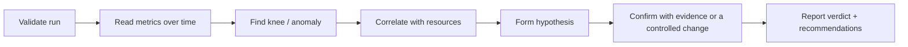

## Beginner-friendly explanation

Imagine you're a doctor with a patient's test results: temperature, blood pressure, blood tests. A list of numbers is not a diagnosis. First you check the tests were done properly (was the sample contaminated?). Then you look at which values are abnormal, how they relate to each other, and what single cause would explain them. Finally you confirm it, and write a clear note for the next doctor.

Analysing a performance test is the same. JMeter gives you numbers and graphs. Your job is to check the test was valid, find what is abnormal, connect it to what the servers were doing, identify the most likely cause, prove it, and explain it clearly.

## Technical explanation

### Step 1: Validate the run

| Check | Why |
|---|---|
| Planned vs actual load (threads, throughput, duration) | A test that didn't reach its target load proves nothing about that load |
| Error breakdown (codes, messages, assertion failures) | Script errors (correlation, data) invalidate results |
| Load generator health (CPU, heap, GC, network) | A saturated generator inflates response times |
| Environment (deployments, other tests, config) | Unexpected changes break comparisons |
| Data (unique, sufficient, realistic) | Reused data inflates cache hits |

### Step 2: Read the key metrics together

See [throughput, latency and percentiles](/learn/performance/throughput-latency-and-percentiles). For each transaction, during **steady state**:

- **Percentiles** (p50, p90, p95, p99) and max — not just averages.
- **Throughput** — achieved versus target.
- **Error rate** — and its types.
- **Over time**, not only as totals. Trends (gradual rise = leak or growing queue), periodic spikes (scheduled jobs, GC) and sudden steps (saturation, failover) each suggest different causes.

Use [Little's Law](/learn/performance/littles-law) as a consistency check: with a closed workload, users ≈ throughput × (response time + think time). A mismatch hints at hidden delays or a test problem.

### Step 3: Find the knee and correlate

In a stepped test, the **knee** is the load at which throughput stops increasing and latency rises steeply. At the knee, look across tiers for the first resource that saturates using the USE method — see [resource utilization and bottlenecks](/learn/performance/resource-utilization-and-bottlenecks).

### Step 4: Hypothesis, then proof

| Symptom | Possible causes | Evidence to confirm |
|---|---|---|
| Throughput plateau + latency up, low CPU | Pool or lock limit, slow dependency | Pool waiters, thread dumps, downstream latency |
| Gradual latency rise over hours | Memory leak, growing table, log growth | Post-GC heap trend, table sizes |
| Periodic spikes | GC, scheduled jobs, cache expiry | GC logs, job schedules, cache metrics |
| Errors only above N users | Connection limits, timeouts | Error messages, server limits |
| One transaction slow, others fine | Specific query or endpoint | Slow-query log, profiler, traces |

A root cause is confirmed when changing **one** factor (in a test environment) changes the result as predicted.

## Real-world example

A ticketing team's test showed p95 for "Reserve seat" at 4.2 s against a 1 s target; other transactions were fine. The run was valid: target throughput reached, errors under 0.1%, generator healthy. Over time, latency was fine up to 250 users, then rose steeply while throughput flattened. App CPU was 40%, but the database showed growing **lock waits** on the `seats` table. Thread dumps showed request threads blocked on the database. Hypothesis: the reservation transaction locked a whole row range while calling a slow payment pre-check. The developers moved the external call outside the transaction; a rerun with nothing else changed met the target up to 600 users. That before/after comparison is the proof.

## Step-by-step walkthrough

1. **Validate** using the checklist above. If invalid, fix and rerun — don't analyse.
2. **Trim** ramp-up and ramp-down; define the steady-state window.
3. **Summarise per transaction:** p50/p90/p95/p99, throughput, error %, compared with acceptance criteria.
4. **Plot over time** with active threads on the same chart; find the knee or anomalies.
5. **Correlate** each anomaly with resource and application metrics at the same timestamps.
6. **Write hypotheses** and the evidence that would confirm or reject each.
7. **Confirm** with additional data or a single controlled change and rerun.
8. **Report:** verdict first, then evidence, bottlenecks, risks and recommendations.

### Example summary table

| Transaction | Target p95 | Actual p95 | Throughput (target / actual) | Errors | Verdict |
|---|---|---|---|---|---|
| Search | 800 ms | 610 ms | 50 / 50 per s | 0.02% | Pass |
| Reserve seat | 1,000 ms | 4,200 ms | 20 / 14 per s | 0.08% | Fail |
| Pay | 1,500 ms | 1,180 ms | 14 / 14 per s | 0.05% | Pass |

(Illustrative figures for the scenario above.)

## Common mistakes

- **Analysing an invalid run** — script errors or a saturated generator.
- **Reporting averages** instead of percentiles.
- **Including ramp-up** in steady-state numbers.
- **Stopping at the symptom** ("the database is slow") without a confirmed cause.
- **Calling a correlation a cause** without further evidence.
- **Changing several things before rerunning**, so you can't tell what helped.
- **Reports that are a dump of graphs** with no verdict or recommendations. See [HTML dashboard report](/learn/jmeter/jmeter-html-dashboard-report) and [analysing JMeter results](/learn/jmeter/jmeter-analyzing-results) for the JMeter side.

## Key takeaways summary

Validate first, then analyse the steady state with percentiles, throughput and errors over time. Find the knee, correlate with resources, form a hypothesis and prove it with a controlled change. Report a clear verdict against the criteria, backed by evidence.
