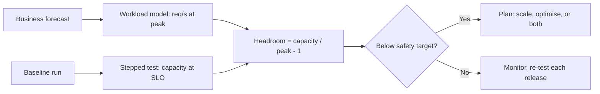

## Beginner-friendly explanation

Imagine a stadium. Before a big match, the organisers need to know three things. **How many people fit comfortably?** That's capacity — and "comfortably" matters: the stands might physically hold more, but then the exits jam. **How many come to a normal match?** That's the baseline. **What crowd size triggers extra stewards and gates?** Those are thresholds. And if attendance grows 10% every season, they need to know **when** to build more seats.

Software works the same way. A **baseline** tells you how the system normally performs. **Thresholds** turn goals into pass/fail checks. **Capacity planning** tells you how much load the system can take while still meeting its goals, and when you'll need more.

## Technical explanation

### SLA, SLO, SLI

| Term | Meaning | Example |
|---|---|---|
| SLI (indicator) | A measured quantity | p95 latency of Place order |
| SLO (objective) | Internal target for an SLI | p95 ≤ 800 ms over 30 days |
| SLA (agreement) | External contract, often with penalties | 99.9% monthly availability |

The Google SRE books describe SLIs and SLOs in depth. Load-test thresholds are derived from SLOs (or requirements when SLOs don't exist yet).

### Thresholds

A good threshold names: **transaction, metric and percentile, limit, load level, duration, error budget.**

> At 200 checkouts/s for 30 minutes of steady state, Place order p95 ≤ 800 ms, p99 ≤ 1,500 ms, error rate < 0.5%.

In JMeter, thresholds can be checked with assertions (for example a Duration Assertion for individual samples) and, more usefully for percentiles, by a post-run check on the results in CI (see [JMeter in CI/CD](/learn/jmeter/jmeter-ci-cd)).

### Baselines

A baseline is a **controlled reference run**: fixed build, environment, workload, data and duration. Run it several times to learn normal **variation** — if p95 varies ±8% between identical runs, a 5% change is not a regression. Compare future runs against it only when one thing has changed.

### Capacity and headroom

From a stepped load test ([performance testing types](/learn/performance/performance-testing-types)):

- **Capacity** = highest load that still meets the SLO (not the crash point).
- **Utilization of capacity** = current peak ÷ capacity.
- **Headroom** = capacity ÷ current peak − 1.

**Worked example.** Capacity at SLO = 500 req/s. Current peak = 200 req/s.

| Quantity | Calculation | Result |
|---|---|---|
| Utilization at peak | 200 ÷ 500 | 40% |
| Headroom | 500 ÷ 200 − 1 | 150% more traffic |
| Safe limit at 70% target | 0.7 × 500 | 350 req/s |
| Peak after 10% monthly growth for 6 months | 200 × 1.1⁶ | ≈ 354 req/s |

So at 10% monthly growth, peak crosses the 70% safety line in about six months. The assumptions (growth rate, peak shape, the 70% target) must be written next to the result.

Two cautions:

1. **Scaling is rarely linear.** Doubling servers doesn't double capacity if the database is the bottleneck. Find the bottleneck first ([resource utilization and bottlenecks](/learn/performance/resource-utilization-and-bottlenecks)).
2. **Test environments are often smaller than production.** Extrapolating is risky; state the difference and confidence level.

Use [Little's Law](/learn/performance/littles-law) and [workload modelling](/learn/performance/workload-modeling) to convert business forecasts (orders per day, peak hour share) into request rates and concurrent users.

## Real-world example

An online exam platform expected a big jump in students at the start of term. Their baseline (release 3.2) showed "Submit answer" at 320 ms p95 at 150 submissions/s. A stepped test found the SLO (p95 ≤ 1 s) held up to 420/s, with the database's write I/O as the bottleneck. The forecast peak was 480/s at exam start, because every student clicks "Start" at once.

The team had headroom for normal days but not for exam peaks. They batched answer autosaves and moved the database to faster storage; a rerun showed capacity at SLO of 900/s. They added the stepped test to each release, comparing against the new baseline, so a later ORM upgrade that cut capacity by 30% was caught before deployment.

## Step-by-step walkthrough

1. **Collect objectives:** SLOs, SLAs or requirements per critical transaction.
2. **Write measurable thresholds** for each.
3. **Fix the baseline conditions:** build, environment, data, workload, duration. Document them.
4. **Run the baseline 3+ times;** record the mean and spread of key metrics.
5. **Run a stepped test** to find capacity at SLO and the bottleneck.
6. **Calculate utilization and headroom** against current and forecast peaks.
7. **Recommend:** scale, optimise, or both, with dates based on growth assumptions.
8. **Automate:** run a smaller regression test per release, compare with the baseline, and fail the build on threshold breaches.
9. **Re-baseline** when the architecture or environment changes significantly.

## Common mistakes

- **Using the crash point as capacity.**
- **Vague thresholds** that can't be measured.
- **One-off baselines** with no idea of normal variation.
- **Comparing runs where several things changed.**
- **Assuming linear scaling** from more servers.
- **Extrapolating from a small test environment** without saying so.
- **Load testing shared or third-party systems** without authorisation.

## Key takeaways summary

Record a controlled, repeatable baseline; turn SLOs into measurable thresholds; find capacity as the highest load that still meets them; and compute headroom against forecast peaks with written assumptions. Re-test every release so regressions are caught early.
