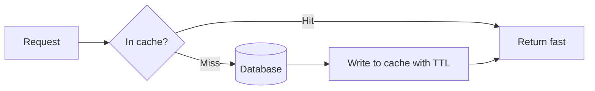

## Beginner-friendly explanation

Think of a library. The **database** is the main archive in the basement: it holds everything, but each trip down takes time. If the books aren't in order (**no index**), the librarian has to search every shelf. If someone asks for 50 books one trip at a time instead of with one list (**N+1**), the librarian spends all day on the stairs. If two people want to edit the same book at once, one must wait (**locks**).

A **cache** is the small shelf at the front desk holding popular books. Most visitors get their book instantly. But the shelf only helps if people ask for popular books, and someone has to replace a book on the shelf when the archive copy changes — otherwise visitors get an old edition (**stale data**).

## Technical explanation

### Common database bottlenecks

| Bottleneck | Symptom under load | How to find it |
|---|---|---|
| Missing/unused index | One query's time grows with table size; high DB CPU or disk reads | Execution plan (`EXPLAIN`/`EXPLAIN ANALYZE`) shows full/sequential scans |
| N+1 queries | Many tiny queries per request; DB round trips dominate | Query count per request in logs or APM traces |
| Lock contention | Latency spikes on writes to hot rows; deadlock errors | Lock wait statistics, deadlock logs |
| Connection-pool exhaustion | App waits for connections; DB not busy | Pool active = max, waiters, acquire timeouts |
| Large result sets | Memory and network spikes | Response sizes, missing pagination |
| DB server saturation | High CPU, I/O wait, memory pressure on the DB host | USE method on the DB host |

Most databases offer a **slow-query log** (queries above a time threshold) and statistics views (for example PostgreSQL's `pg_stat_statements` extension) that rank queries by total time. Fixing the top few queries often fixes most of the problem.

### Caching

Caches exist at several layers: browser and CDN (HTTP caching headers), application in-memory caches, and distributed caches such as Redis or Memcached. A common pattern is **cache-aside**: check the cache; on a miss, read the database and store the result with a **TTL** (time to live).

| Concept | Meaning | Why testers care |
|---|---|---|
| Hit ratio | hits ÷ (hits + misses) | Unrealistic test data inflates it |
| TTL / expiry | How long an entry lives | Determines staleness window |
| Invalidation | Removing entries when data changes | Missing invalidation = stale data defects |
| Cold vs warm cache | Empty vs populated cache | After deploys or restarts, every request misses |
| Stampede | Many requests miss together and hit the DB at once | Load spikes when popular keys expire |



## Real-world example

A retail site prepared for a sale. Load tests showed product pages at 80 ms p95 — excellent. But the test used 20 product IDs; with Redis caching, almost every request was a hit. On sale day, a new catalogue of thousands of items was published, the cache was cold, and every request missed. The database, sized for the cached load, saturated within minutes.

The re-designed test used a CSV of 50,000 product IDs weighted like real traffic, included a cold-cache start, and measured the database during the first ten minutes. It revealed a missing index on `products(category_id, published_at)` that only mattered on cache misses.

## Step-by-step walkthrough

1. **Use production-like data volumes** in the test database (anonymised or generated). Indexes only matter at scale.
2. **Monitor the database:** CPU, I/O, connections, lock waits, slow-query log, top queries by total time.
3. **Monitor the pool** in the application: active, idle, waiting, acquire time.
4. **Design test data for caching:** many keys, realistic distribution (some popular, many rare) via [CSV Data Set Config](/learn/jmeter/jmeter-csv-data-set-config).
5. **Run scenarios:** warm-cache steady state, cold-cache start, and a cache flush during load.
6. **Measure hit ratio** from the cache's own statistics (Redis `INFO stats` reports `keyspace_hits` and `keyspace_misses`).
7. **Test freshness:** update data, then read it repeatedly; confirm it changes within the agreed TTL or immediately if invalidation is promised.
8. **Find the top queries**, inspect their plans, and hand developers the evidence.

## Code examples

Inspecting a query plan in PostgreSQL:

```sql
EXPLAIN ANALYZE
SELECT id, total_amount, created_at
FROM orders
WHERE customer_id = 48213
ORDER BY created_at DESC
LIMIT 20;
```

## Expected output

Before an index, the plan includes a line like `Seq Scan on orders` with a large number of rows removed by the filter. After `CREATE INDEX ON orders (customer_id, created_at);` the plan shows an `Index Scan` and execution time drops. Exact output varies by PostgreSQL version and data; compare the plan type and the actual time, not exact numbers.

## Common mistakes

- **Tiny test databases** that hide missing indexes and N+1 costs.
- **Reusing the same few IDs**, so every request hits the cache.
- **Only testing warm cache** and never the restart or deploy case.
- **Increasing the pool size blindly** — a bigger pool can overload the database further.
- **Ignoring staleness** as "a functional issue". Caching changes correctness too.
- **Running heavy queries against shared or production databases** without approval.

## Key takeaways summary

Databases fail under load through slow queries, missing indexes, N+1 patterns, locks and pool limits — all visible with the right monitoring. Caches hide that load, so test with realistic data distributions, both warm and cold, and verify both hit ratio and freshness.
