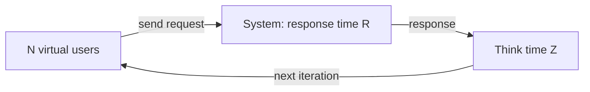

## Beginner-friendly explanation

Picture a restaurant. On average, 20 guests arrive every hour and each guest stays for 1.5 hours. How many guests are inside at any moment, on average? 20 × 1.5 = **30**. You did not need to know how meals are cooked, how many waiters there are or whether guests arrive in groups. You only needed the arrival rate and the time spent inside.

That simple multiplication is **Little's Law**. It works for restaurants, supermarket queues, web servers, database connection pools and load tests, and it is the most useful formula in performance testing.

## Technical explanation

**L = λW**

| Symbol | Meaning | Performance example |
|---|---|---|
| L | Average number of items in the system | Requests in flight, busy threads, active users |
| λ (lambda) | Average arrival rate; equals throughput X when the system is stable | Requests per second |
| W | Average time each item spends in the system | Response time (plus think time, if users are the items) |

Conditions:

- It describes **long-run averages** over a window where the system is **stable**: what goes in comes out, and queues are not growing without bound. Do not apply it to ramp-up.
- It is **distribution-free**: no assumption about Poisson arrivals or service times.
- The **system boundary** must be the same for all three numbers. "Requests inside the app server" and "time inside the whole platform" cannot be mixed.

### Open systems: concurrency from rate and time

API at 120 requests per second, average response time 0.25 s: **L = 120 × 0.25 = 30** requests in flight on average.

### Closed systems: sizing virtual users

In a **closed workload** a fixed population of N users loops: send a request, wait for the response (R), think (Z), repeat. Draw the boundary around *the user* and each user is always either waiting or thinking, so:

**N = X × (R + Z)**, equivalently **X = N / (R + Z)**

| Scenario | Calculation | Result |
|---|---|---|
| Target 25 checkouts/s, R = 0.8 s, Z = 9.2 s | N = 25 × 10 | 250 users |
| 400 users, R = 1 s, Z = 7 s | X = 400 / 8 | 50 per second |
| Same 400 users, R degrades to 3 s | X = 400 / 10 | 40 per second |
| 100 threads, R = 0.5 s, no think time | X = 100 / 0.5 | 200 per second |

The third row is important: in a closed model, when the system slows down, users send work more slowly, so the load **eases off by itself**. Real public traffic (an open model) does not do that. See [workload modelling](/learn/performance/workload-modeling).



### Little's Law as a result validator

Before trusting any load test report, check that threads, throughput and time are consistent. If 100 threads with no think time and 0.5 s response time produce only 40 requests per second instead of about 200, then something else is consuming time: hidden timers, slow pre-processors, threads still ramping, threads that finished early, or a saturated load generator.

## Real-world example

A team was asked to prove that a booking service could handle 60 bookings per second. Analytics showed each booking journey contained about 4 seconds of server response time in total and roughly 26 seconds of user reading and typing. Their first test used 60 virtual users "because the target is 60 per second" and achieved only about 2 bookings per second: 60 / (4 + 26) = 2. Applying Little's Law, they needed 60 × 30 = **1,800** virtual users, and they also checked the load generators could sustain that many threads. The corrected test exposed a lock contention problem that the undersized test never reached.

## Step-by-step walkthrough

1. **Define the system boundary** (whole journey per user, one service, one pool).
2. **Get the target throughput X** from the workload model.
3. **Estimate R** from a baseline run and **Z** from analytics or agreed assumptions.
4. **Calculate N = X × (R + Z)**, then add headroom because response time will rise under load.
5. **Run the test** and re-check: does measured throughput ≈ N / (measured R + Z)?
6. **Investigate any mismatch** before reporting results.

## Code examples

A small helper used during test planning:

```python
def users_needed(throughput_per_s, response_s, think_s):
    return throughput_per_s * (response_s + think_s)

def throughput(users, response_s, think_s):
    return users / (response_s + think_s)

print(users_needed(25, 0.8, 9.2))      # checkout sizing
print(throughput(400, 1.0, 7.0))       # healthy
print(throughput(400, 3.0, 7.0))       # degraded
print(120 * 0.250)                     # open model: requests in flight
```

## Expected output

```text
250.0
50.0
40.0
30.0
```

## Common mistakes

- **Equating users with requests per second.** 100 users do not mean 100 requests per second unless R + Z = 1 s.
- **Forgetting think time** when sizing closed workloads.
- **Mixing units** (milliseconds with seconds, per minute with per second).
- **Applying it during ramp-up** or when queues are growing; the law needs a stable window.
- **Treating the average as the peak.** L is an average; pools and capacity need headroom for variance.

## Troubleshooting

- **Measured throughput is below N / (R + Z).** Look for extra delays in the script, threads that ended early, or a saturated load generator.
- **Measured throughput is above the target.** Think time or pacing may be missing or misconfigured.
- **Numbers never stabilise.** The system may be overloaded, with queues growing; reduce load to find the stable region.

## Key takeaways summary

L = λW connects how many, how fast and how long. Use N = X × (R + Z) to size closed tests, use L = λW to estimate concurrency in open systems and pools, and use both to check that a test report is internally consistent.
