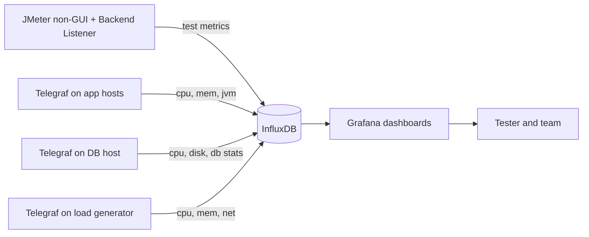

## Beginner-friendly explanation

Think of a hospital patient monitor. It shows heart rate, blood pressure and oxygen on one screen, updated every second, with a history line. If heart rate jumps, the nurse glances at the other lines **at the same moment** to see what changed.

A performance test needs the same thing. Your load test is the "activity", and your servers are the "patient". **InfluxDB** is the memory that stores every reading with its timestamp. **Grafana** is the screen that draws them as charts. With both on one screen, when response time jumps you can see what happened to CPU, memory or the database at that exact second.

## Technical explanation

### Time-series data

A **time series** is a sequence of values with timestamps. InfluxDB organises each data point as:

| Part | Meaning | Example |
|---|---|---|
| Measurement | Like a table name | `jmeter`, `cpu` |
| Tags | Indexed metadata for filtering/grouping | `host=app-01`, `transaction=Login` |
| Fields | The measured values | `pct95.0=420`, `usage_user=63.2` |
| Timestamp | When it was measured | `2026-10-30T10:15:05Z` |

Keep tags **low-cardinality** (a bounded set of values). InfluxData's documentation warns that high series cardinality hurts performance.

InfluxDB versions differ: 1.x uses databases and InfluxQL; 2.x uses organisations, buckets, tokens and Flux (with InfluxQL compatibility); 3.x changes the storage engine and favours SQL/InfluxQL. Check the docs for the version your team runs.

### Getting data in

- **Test metrics:** JMeter's Backend Listener with the InfluxDB client sends aggregated metrics (throughput, errors, percentiles per transaction) every few seconds. Setup is covered in detail in [Backend Listener, InfluxDB and Grafana](/learn/jmeter/jmeter-backend-listener-grafana).
- **Server metrics:** **Telegraf**, InfluxData's agent, runs on each host and uses input plugins (cpu, mem, disk, diskio, net, plus plugins for databases, JVMs via Jolokia, Docker, and more) to write to InfluxDB.
- **Application metrics:** many frameworks expose pool sizes, GC and request metrics that Telegraf or other agents can scrape. Some teams use Prometheus instead of InfluxDB; Grafana works with both.

### Grafana

Grafana connects to **data sources** (InfluxDB, Prometheus, Elasticsearch, many others) and draws **panels** on **dashboards**. Useful features for load testing:

- **Variables** (drop-downs for host, transaction, run ID)
- **Annotations** to mark test start, ramp stages and incidents
- **Shared time range** so every panel lines up
- **Alerts** for error rate or resource thresholds during long runs



### A useful dashboard layout

Google's SRE book describes four **golden signals**: latency, traffic, errors and saturation. Build rows around them:

| Row | Panels |
|---|---|
| Load | Active threads, requests per second |
| Latency | p50, p95, p99 per transaction (not just average) |
| Errors | Error rate %, errors by response code |
| App resources | CPU, memory/heap, GC pause time, thread and connection pool usage |
| DB resources | CPU, disk I/O and latency, connections, slow queries |
| Load generator | CPU, memory, network — to prove it isn't the bottleneck |

## Real-world example

During a 2-hour soak test, a payments team's dashboard showed p99 latency spiking every 15 minutes, while averages stayed flat. Lining up panels showed each spike matched a sharp rise in database disk I/O and a drop in cache hit ratio. An annotation added by the operations team revealed a scheduled reporting job that ran every 15 minutes against the same database. Without time-aligned panels, the spikes would have been dismissed as noise.

## Step-by-step walkthrough

1. **Run the stack** in your own lab (Docker Compose with InfluxDB and Grafana is the easiest start).
2. **Point JMeter's Backend Listener** at InfluxDB, and add a tag such as a test run ID.
3. **Install Telegraf** on each host you can access; enable cpu, mem, disk, diskio, net and relevant service plugins.
4. **Synchronise clocks** on all hosts (NTP).
5. **Add InfluxDB as a Grafana data source** matching your version's query language.
6. **Build the dashboard** using the rows above; import a community JMeter dashboard as a starting point if you like, then adapt it.
7. **Annotate** test start, each load step and any incident.
8. **Watch live**, stop early if errors or risk demand it, and save a dashboard snapshot or link with the results.

## Code examples

A minimal Telegraf configuration writing host metrics to InfluxDB 1.x (2.x uses the `outputs.influxdb_v2` plugin with organisation, bucket and token):

```toml
[agent]
  interval = "5s"

[[outputs.influxdb]]
  urls = ["http://localhost:8086"]
  database = "telegraf"

[[inputs.cpu]]
  percpu = true
  totalcpu = true

[[inputs.mem]]
[[inputs.disk]]
[[inputs.diskio]]
[[inputs.net]]
```

An InfluxQL query for a Grafana panel showing JMeter p95 per transaction (field names depend on the Backend Listener's configured percentiles):

```sql
SELECT mean("pct95.0") FROM "jmeter"
WHERE "statut" = 'all' AND $timeFilter
GROUP BY time($__interval), "transaction"
```

`statut` (French for "status") is the tag name the JMeter InfluxDB client uses for ok/ko/all.

## Common mistakes

- **Only plotting averages**, which hide tail latency.
- **Monitoring the app but not the database or load generator.**
- **High-cardinality tags** such as per-request IDs.
- **Unsynchronised clocks**, which misalign cause and effect.
- **Treating live dashboards as the report.** Keep the JTL and HTML report for detailed analysis ([HTML dashboard report](/learn/jmeter/jmeter-html-dashboard-report)).
- **Exposing Grafana or InfluxDB publicly with default credentials.**

## Key takeaways summary

Store test and server metrics as time series in InfluxDB, collect host metrics with Telegraf, and visualise everything on one aligned Grafana timeline built around latency, traffic, errors and saturation. That turns "it got slow" into "it got slow when this resource saturated".
