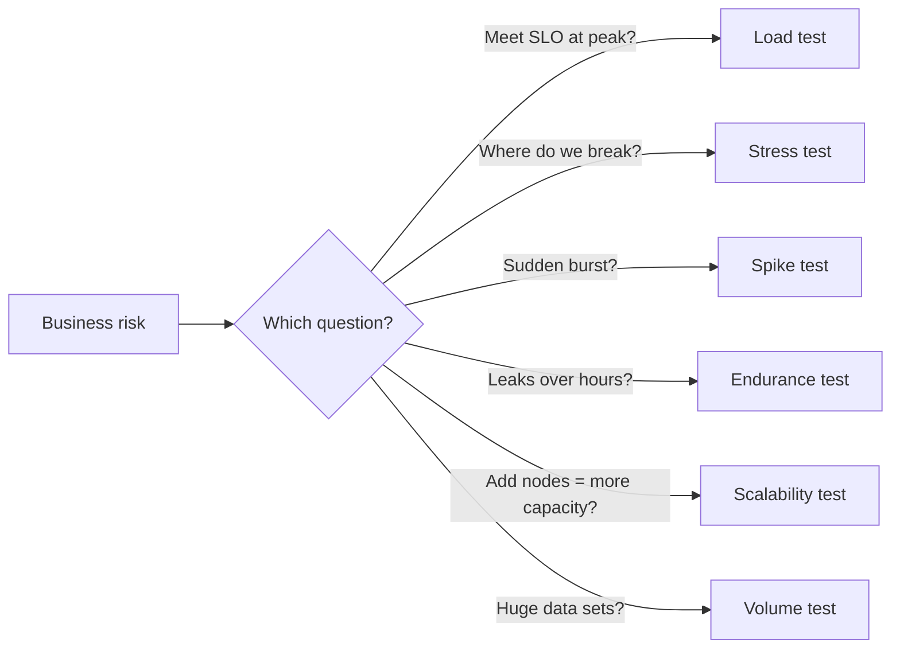

## Beginner-friendly explanation

Think about a bridge. Engineers do not ask one question about it; they ask several. Can it carry normal rush-hour traffic? What happens if far more trucks than planned drive onto it? Can it cope when a marathon suddenly crosses it? Does the steel weaken after years of constant use? Would a wider bridge carry twice the traffic? What if the trucks are much heavier than usual?

Software performance testing works the same way. "Is it fast?" is too vague. Instead we run a **family of tests**, each with its own load shape and its own question. Choosing the right test is the first and most important design decision.

## Technical explanation

All performance tests apply a **workload** (a mix of transactions at a rate or concurrency) and measure **response time**, **throughput**, **error rate** and **resource utilization**. They differ in the shape and size of that workload.

| Test type | Question it answers | Typical load profile |
|---|---|---|
| **Load test** | Do we meet our objectives at expected normal and peak load? | Ramp up to target, hold steady, ramp down |
| **Stress test** | Where is the breaking point, how do we fail, and do we recover? | Increase load in steps beyond the expected peak (or reduce resources) |
| **Spike test** | Do we survive a sudden burst and recover afterwards? | Normal load, near-instant jump, short hold, drop back |
| **Endurance (soak) test** | Does behaviour degrade over a long period? | Realistic steady load for hours |
| **Scalability test** | How does capacity change when we add resources? | Same stepped test at 1, 2, 4 nodes (or CPU sizes) |
| **Volume test** | Does it cope with large amounts of data? | Normal load, but production-sized or larger data sets |

A few precise points:

- **Load testing** verifies requirements such as "p95 under 800 ms at 200 transactions per second with under 0.1% errors". It is pass/fail against objectives. See [capacity planning and baselines](/learn/performance/capacity-planning-and-baselines).
- **Stress testing** is exploratory about limits. Good failure behaviour means fast, clear errors (for example HTTP 503 with retry hints), no data corruption, and automatic recovery when load falls.
- **Spike testing** focuses on elasticity and queues: autoscaling lag, cold caches, connection storms and how long recovery takes.
- **Endurance testing** looks for slow trends: memory and handle leaks, growing queues, log or disk growth, and response times that creep up.
- **Scalability testing** compares capacity across sizes. Near-linear gain means the added resource was the limit; little gain means a shared component (often the database) is the real bottleneck.
- **Volume testing** changes data, not traffic: table sizes, file sizes, message sizes, result-set sizes.

Two related terms you will hear: **capacity testing** finds the maximum load that still meets objectives, and **smoke performance tests** run a tiny load to prove the script and environment work before a long run.



### Ethics and environment

Only run load against systems you own or have **explicit written authorization** to test. Load against a third-party API, a payment provider sandbox or a shared SaaS service without permission can look like a denial-of-service attack and may breach terms of service or law. Use a production-like environment, stub external dependencies you are not allowed to load, and tell the operations team before every run.

## Real-world example

An online exam platform runs its exams at fixed times. A team planned a single load test at "average traffic" and passed it comfortably. Thinking more carefully about the risk, they realised three different questions mattered:

1. **Spike:** thousands of students press "Start" within the same minute. The spike test showed login requests queuing behind a token service with a small connection pool.
2. **Load:** during the exam, answers auto-save every 30 seconds. A load test at the expected peak save rate verified the p95 objective.
3. **Volume:** the results export at the end ran against a table holding several years of answers. A volume test showed the export query doing a full table scan.

None of these would have been found by a single "average load" test.

## Step-by-step walkthrough

1. **Name the risk** in business terms ("sale-time burst", "overnight batch overlaps daytime traffic").
2. **Pick the test type** from the table above. Most releases need a load test; add others based on risk.
3. **Define the workload** (transaction mix and rate) using [workload modelling](/learn/performance/workload-modeling).
4. **Define the profile:** ramp-up, steady state, duration, ramp-down. Soak tests run for hours; spikes may last minutes.
5. **Define pass criteria** before running: percentile response times, throughput, error rate, resource limits.
6. **Get written authorization** and agree a time window with system owners.
7. **Run, monitor and analyse**, then repeat after fixes using the same profile so results are comparable.

## Code examples

A stepped stress profile expressed as data, which a script or a throughput-shaping tool can consume:

```yaml
# Stress test: steps of 50 req/s beyond the expected peak of 200 req/s
steps:
  - { rate_per_sec: 100, hold_minutes: 5 }   # warm-up
  - { rate_per_sec: 200, hold_minutes: 10 }  # expected peak (load test level)
  - { rate_per_sec: 250, hold_minutes: 10 }
  - { rate_per_sec: 300, hold_minutes: 10 }
  - { rate_per_sec: 350, hold_minutes: 10 }  # continue until objectives break
  - { rate_per_sec: 100, hold_minutes: 10 }  # recovery check
```

## Expected output

A stress test report should state the last step that met objectives, the first step that did not, what broke first and whether the system recovered:

```text
Step 200 req/s: p95 610 ms, errors 0.02%  -> meets objectives
Step 250 req/s: p95 790 ms, errors 0.05%  -> meets objectives (little headroom)
Step 300 req/s: p95 2.9 s,  errors 3.1%   -> fails; DB connection waits observed
Recovery 100 req/s: p95 back to baseline within 2 minutes
```

The numbers above are an illustrative report format, not measurements from a real system.

## Common mistakes

- **Running only one test type** and calling the system "performance tested".
- **Calling every test a stress test.** If you never exceed the expected load, it is a load test.
- **Soak tests that are too short.** A 20-minute run cannot reveal a leak that takes hours to matter.
- **Volume tests on tiny databases.** Test data must be production-sized, and realistically distributed, to expose slow queries.
- **No recovery check** after stress or spike tests.
- **Testing without authorization** or against shared third-party services.

## Troubleshooting

- **The system collapses before reaching the target load.** Confirm the load generator itself is not saturated (CPU, network) before blaming the system under test.
- **Results vary wildly between runs.** Check for noisy neighbours, shared environments, cold caches and inconsistent test data.
- **Spike test passes but production still struggles.** Compare your spike's rise time and size with real traffic data.

## Key takeaways summary

Performance testing is a set of tools, not a single test. Match the test type to the risk: load for objectives, stress for limits, spike for bursts, soak for slow degradation, scalability for growth and volume for data size. Always test with authorization in a production-like environment.
