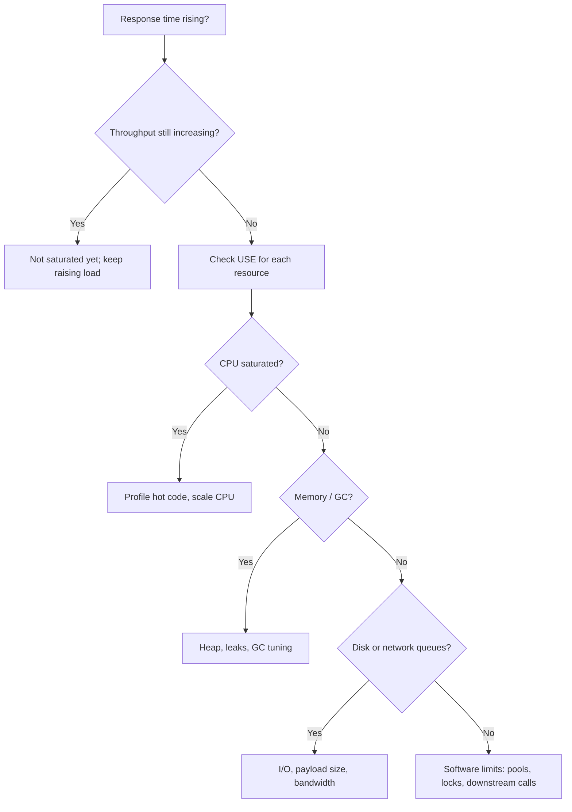

## Beginner-friendly explanation

Think of a busy restaurant. There are cooks (CPU), counter space for ingredients (memory), a storeroom you fetch things from (disk), and waiters carrying plates (network). If dinner service gets slow, it is usually because **one** of these is overloaded: maybe there are plenty of waiters, but only two cooks, so orders pile up in the kitchen.

That overloaded part is the **bottleneck**. Adding more waiters won't help; you need to find the kitchen queue. In performance testing, response times tell you the restaurant is slow. **Resource metrics** tell you which part of the restaurant is the problem.

## Technical explanation

Brendan Gregg's **USE method** checks every resource for:

- **Utilization** — the percentage of time the resource was busy.
- **Saturation** — extra work that can't be served and is waiting (queues).
- **Errors** — error events (failed I/O, dropped packets, out-of-memory kills).

| Resource | Utilization | Saturation | Errors |
|---|---|---|---|
| CPU | % busy, per core and per process | Run-queue length; load average vs core count; CPU throttling in containers | — |
| Memory | Used vs available; JVM heap after GC | Swapping, paging; long or frequent GC pauses | Out-of-memory errors, OOM-killed containers |
| Disk | % busy, IOPS, throughput (MB/s) | Queue length, I/O wait, rising I/O latency | I/O errors |
| Network | Bandwidth used vs link capacity | Retransmits, socket backlogs | Dropped packets, connection resets |
| Software (pools, locks) | Active threads/connections vs max | Waiters for a pool or lock | Pool timeouts, rejected tasks |

Why this matters: as load approaches a resource's capacity, **queueing** makes response time rise sharply rather than linearly. Throughput then plateaus — see [throughput, latency and percentiles](/learn/performance/throughput-latency-and-percentiles) and [Little's Law](/learn/performance/littles-law).

**Common bottleneck signatures:**

- **CPU-bound:** CPU near 100%, run queue grows; response time scales with load.
- **Memory / GC:** heap after GC creeps up (leak) or GC pauses spike; latency has periodic jumps.
- **Disk-bound:** high I/O wait, disk latency rises; common for databases and logging.
- **Network-bound:** link near capacity, often from large payloads or uncompressed responses.
- **Pool or lock-bound:** low hardware use but many threads waiting — see [thread and connection pools](/learn/performance/thread-and-connection-pools).

**Don't forget the load generator.** If the JMeter machine is saturated, the test measures JMeter, not your app. Use non-GUI mode and light listeners ([non-GUI and distributed testing](/learn/jmeter/jmeter-non-gui-and-distributed)).

## Real-world example

A team load-tested an order API. At 300 requests per second the 95th percentile jumped from 200 ms to 2 s, but application servers showed CPU at 35%. The tester walked through USE: memory fine, network fine, app disk fine. The **database** server, which nobody had been monitoring, showed disk queue length climbing and high I/O wait — every order wrote a verbose audit row to a slow volume with synchronous commits. Moving audit writes to an asynchronous queue and faster storage moved the knee past 900 requests per second. The lesson: monitor every tier, not just the app server.

## Step-by-step walkthrough

1. **List every component** in the request path: load balancer, app servers, cache, database, queues, external calls, and the load generator.
2. **Set up monitoring** for each before the test (OS metrics, JVM metrics, database metrics). See [monitoring with InfluxDB and Grafana](/learn/performance/monitoring-with-influxdb-grafana).
3. **Run a step-load test**, increasing load in stages and holding each stage long enough to stabilise.
4. **Find the knee:** the stage where throughput stops rising and latency jumps.
5. **At the knee, apply USE** to each resource; look for the first one saturating.
6. **Confirm the hypothesis:** relieve that bottleneck (in a test environment) and rerun; the knee should move.
7. **Record** metrics, timestamps and conclusions with the test results.

### Example findings table

| Load (req/s) | p95 (ms) | Throughput (req/s) | App CPU | DB disk queue | Notes |
|---|---|---|---|---|---|
| 100 | 180 | 100 | 15% | 0.2 | Healthy |
| 200 | 210 | 199 | 25% | 0.8 | Healthy |
| 300 | 2,100 | 240 | 35% | 12 | DB disk saturated |

(Illustrative values for the scenario above, not benchmarks.)

## Common mistakes

- **Monitoring only the application server.** Bottlenecks often live in the database, cache or load generator.
- **Looking only at utilization**, missing saturation such as queues and waiters.
- **Trusting averages** — one hot core, short spikes and per-container limits disappear in averages.
- **Ignoring GC** in JVM or .NET services.
- **Changing several things at once** after finding a suspect, so you can't prove the cause.
- **Running load tests against systems you are not authorised to test.**

## Key takeaways summary

Response times say "slow"; resources say "why". Monitor every tier, find the knee, and for each resource check utilization, saturation and errors. The first resource to saturate is your bottleneck — prove it by relieving it and watching the knee move.
