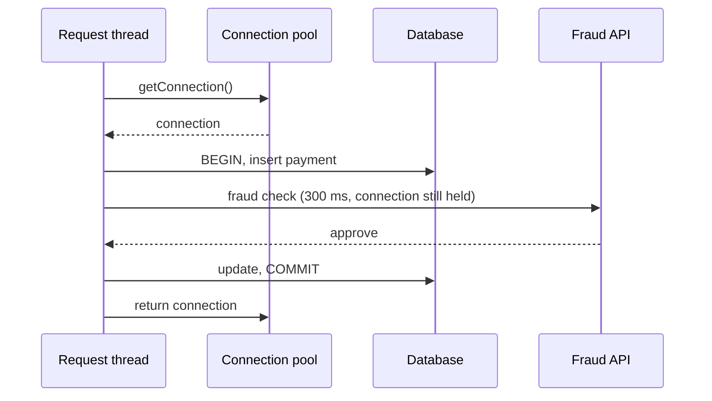

## Beginner-friendly explanation

Picture a car-rental desk with ten cars. Customers arrive, take a car, use it and return it. While cars are available, nobody waits. When all ten are out, new customers queue at the desk, however fast the staff are. If customers keep cars much longer than planned, say because they wait in the car for a phone call, the queue grows even with the same number of customers.

Software uses pools the same way. A **thread pool** limits how many requests a server processes at once. A **connection pool** limits how many database connections exist. Pools protect resources from overload, but when a pool is empty, requests silently wait. That waiting often looks like a "slow server" even though the CPUs are mostly idle.

## Technical explanation

### Thread pools

Servers such as Tomcat accept requests and hand them to worker threads from a pool (Tomcat's `maxThreads`, whose documented default is 200; defaults vary by server and version). When all workers are busy, new connections wait in an accept queue; when that is full, they are refused. Executors in application code (`ThreadPoolExecutor` in Java) behave similarly: busy threads, a task queue, and a rejection policy when both are full.

### Connection pools

A connection pool (for example HikariCP in Java applications) keeps a set of open database connections. A request borrows one, uses it and returns it. Key settings: maximum pool size, minimum idle connections and the **acquisition timeout**, the time a thread waits for a connection before failing (HikariCP's default `connectionTimeout` is 30 seconds).

### Exhaustion symptoms

| Signal | What you see |
|---|---|
| Pool metrics | Active connections = maximum; pending/waiting threads > 0 and rising |
| Latency | p95 and p99 jump, often clustering near the acquisition timeout |
| CPU | Application and database CPU moderate or low |
| Errors | Acquisition timeout exceptions, HTTP 500/503 after a fixed delay |
| Thread dump | Many request threads `WAITING`/`TIMED_WAITING` inside the pool's get-connection method |

This is the USE method applied to a software resource: utilization (active/max), saturation (waiters), errors (timeouts).

### Sizing with Little's Law

**Average connections in use = rate × average hold time.** Add headroom for bursts and variance, and check the downstream limit: **pool max × instances ≤ connections the database can serve well**. More connections than the database can process concurrently increases contention rather than throughput.



## Real-world example

**Illustrative scenario (not data from a real system):** a payment service runs on 4 instances, each with a connection pool maximum of 10. The target is 200 payments per second, 50 per instance. A load test shows p95 rising from about 400 ms at 120 TPS to over 5 s at 200 TPS, with an error rate of about 2%, mostly acquisition timeouts. Application CPU is around 40% and database CPU around 35%.

Analysis:

1. **Hold time.** Tracing shows each payment opens a transaction, inserts a record, then calls an external fraud-check service *while holding the connection*, then commits. Average hold time is about 250 ms.
2. **Little's Law.** Per instance: 50 × 0.25 = **12.5** connections needed on average, but the pool maximum is **10**. At 120 TPS (30 per instance) the need is 7.5, which fits, which is why lower load steps passed.
3. **Fix options.** Enlarging pools to 20 would mean up to 80 connections to the database and does not address the cause. Moving the fraud check *before* the transaction cuts hold time to roughly 50 ms: 50 × 0.05 = **2.5** connections per instance, leaving ample headroom.
4. **Verify.** Re-run the same test and confirm pool waiters stay near zero and p95 meets the objective.

## Step-by-step walkthrough

1. **Expose pool metrics** (active, idle, pending, timeouts) for thread and connection pools.
2. **Run a stepped load test** and plot pool metrics against throughput and p95.
3. **Look for the step** where waiters appear and latency bends upward.
4. **Measure hold time** from traces or pool metrics.
5. **Calculate** required connections with Little's Law at the target rate.
6. **Prefer reducing hold time**; resize only after checking the downstream limit.
7. **Re-test** with identical workload and compare.

## Code examples

Capturing evidence during a slow step (Java service):

```bash
# three thread dumps 10 seconds apart
for i in 1 2 3; do jstack <pid> > dump-$i.txt; sleep 10; done
grep -c "getConnection" dump-*.txt
```

Sizing helper:

```python
def connections_needed(rate_per_s, hold_s, headroom=1.5):
    avg = rate_per_s * hold_s
    return avg, avg * headroom

print(connections_needed(50, 0.25))   # before fix
print(connections_needed(50, 0.05))   # after moving the fraud call
```

## Expected output

```text
(12.5, 18.75)
(2.5, 3.75)
```

In the thread dumps, exhaustion looks like dozens of request threads with the same stack, parked in the pool's connection-acquisition method, across all three dumps.

## Common mistakes

- **Raising pool sizes blindly**, moving the queue into the database.
- **Forgetting the instance multiplier** when scaling out.
- **Holding connections during remote calls** or long computations.
- **Watching only active connections** instead of waiters and acquisition time.
- **Very long acquisition timeouts**, which turn exhaustion into extreme latency instead of fast, visible failures.
- **Leaked connections** never returned on error paths, slowly emptying the pool during soak tests.

## Troubleshooting

- **Pool active count slowly climbs during a soak test and never drops.** Suspect a connection leak; enable the pool's leak detection in a test environment.
- **Thread pool full but CPU idle.** Threads are blocked on I/O or locks; take thread dumps to see where.
- **Database refuses connections after scale-out.** Total pool maximums exceed the database limit; reduce per-instance pools or add a pooling proxy.

## Key takeaways summary

Pools turn overload into waiting. Recognise exhaustion by full pools, growing waiters, timeouts and low CPU; size pools with Little's Law and the database's real limit; and fix the root cause by shortening how long each request holds the resource.
