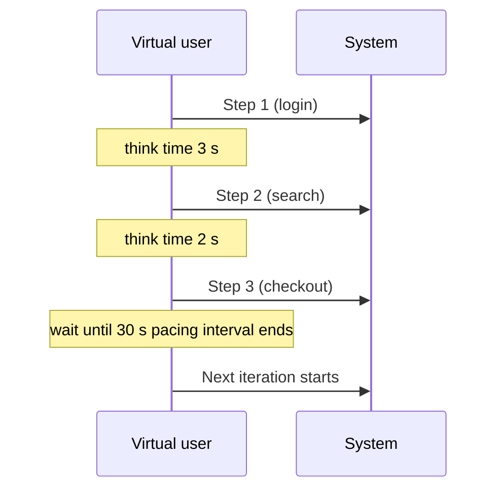

## Beginner-friendly explanation

Imagine rehearsing for opening day at a new supermarket. If you send 100 friends to the checkout all at once and nobody browses, you have learnt about checkouts, but nothing about the bakery, the aisles or the car park. A good rehearsal copies how real shoppers behave: most browse, some compare prices, fewer buy, and they pause to read labels.

A **workload model** is that rehearsal plan for software: which actions happen, how often, in what order and with what pauses. If the model is wrong, the load test measures the wrong thing, no matter how good the tooling is.

## Technical explanation

A workload model specifies:

| Element | Example |
|---|---|
| Business event and window | Peak hour on the busiest day of the season |
| Transaction mix | 60% browse, 25% search, 10% add to cart, 5% checkout |
| Target rates | Per transaction, per second, at the peak |
| User journeys | Ordered steps such as login, search, view, add, pay |
| Think time | Human delays between steps, often a range or distribution |
| Pacing | How often each user starts a new iteration |
| Model type | Open or closed |
| Data | Number of users, products and orders; uniqueness rules |
| Profile | Ramp-up, steady-state duration, ramp-down |

### Worked example: from logs to rates

A peak hour of 180,000 page views (illustrative numbers):

| Transaction | Share | Per hour | Per second |
|---|---|---|---|
| Browse | 60% | 108,000 | 30 |
| Search | 25% | 45,000 | 12.5 |
| Add to cart | 10% | 18,000 | 5 |
| Checkout | 5% | 9,000 | 2.5 |
| Total | 100% | 180,000 | 50 |

An hourly average hides peaks within the hour, so also check the busiest minute and decide whether to design for it.

### Open versus closed

- **Closed model:** a fixed population of users loop; each waits for a response before continuing. Arrival rate = N / (R + Z), so it falls when response time rises. It fits systems with a bounded user base, such as an internal tool used by a fixed number of agents.
- **Open model:** arrivals are driven externally at rate λ, independent of response time. It fits public websites and APIs. When the system slows, requests still arrive and queues grow, which is the behaviour you need to see.

JMeter's standard Thread Group is naturally closed. To approximate an open model you can drive arrivals by rate: the built-in Precise Throughput Timer or Constant Throughput Timer (as long as enough threads are available), or the **Arrivals Thread Group** from the third-party JMeter Plugins project. See [timers and throughput shaping](/learn/performance/jmeter-timers-and-throughput-shaping).

### Think time versus pacing

- **Think time** is the pause *between steps* inside an iteration (reading a page, filling a form). It controls realism and per-user request rate.
- **Pacing** is the interval *between iteration starts* for a user. If pacing is 30 s and the iteration finishes in 6 s, the user waits 24 s before starting again. If the iteration takes longer than the pacing interval, the target rate cannot be met.

With pacing P, each user produces 1/P iterations per second, so **N = X × P**. For 10 iterations per second at P = 30 s you need 300 users.



## Real-world example

A retail team load-tested checkout at 100 requests per second with no think time and 20 threads. Everything passed. In production, the season's peak produced many more simultaneous sessions, each holding a cart in a session store. Because the test used only 20 threads, the session store held only 20 sessions and its memory limit was never approached. Rebuilding the model from access logs, with realistic think time and thousands of concurrent users, reproduced the session store evictions that had caused carts to empty.

## Step-by-step walkthrough

1. **Choose the business event** (normal peak, sale day, month-end).
2. **Extract evidence** from logs, analytics or APM for that window; never invent rates.
3. **Calculate mix and per-second rates**, then check the busiest minute.
4. **Define journeys and think times** from observed session behaviour.
5. **Pick open or closed** based on who generates the traffic.
6. **Size users** with [Little's Law](/learn/performance/littles-law) and set pacing where you need fixed rates.
7. **Define data and profile**, then review the model with product and operations before scripting.

## Code examples

Pacing logic in plain Python, showing why iterations must fit inside the interval:

```python
import time

PACING_S = 30

def run_user(iterations, do_iteration):
    for _ in range(iterations):
        started = time.monotonic()
        do_iteration()                       # steps plus think times
        elapsed = time.monotonic() - started
        remaining = PACING_S - elapsed
        if remaining > 0:
            time.sleep(remaining)            # wait for the next slot
        else:
            print(f"pacing missed by {-remaining:.1f} s")
```

## Expected output

When iterations take about 6 s, the loop sleeps about 24 s and prints nothing. If the system slows so an iteration takes 34 s, it prints:

```text
pacing missed by 4.0 s
```

That message means the per-user rate has fallen below 1/30 per second and the test is no longer delivering the planned throughput.

## Common mistakes

- **Using averages over a whole day** instead of the peak window.
- **Testing one transaction in isolation** when the real risk is the mix competing for shared resources.
- **Zero think time** described as "realistic".
- **Pacing shorter than the iteration**, so the rate silently drops.
- **Closed model for public traffic**, which hides overload.
- **Too little test data**, so every user hits the same cached record.

## Troubleshooting

- **Throughput below target although user count looks right.** Recalculate with the measured response time; add users or shorten think time within realistic limits.
- **No production data exists.** Use business forecasts, document every assumption and revisit after launch.
- **The mix drifts during the test.** Use a throughput controller or separate thread groups per journey so each rate is controlled explicitly.

## Key takeaways summary

Model the workload from evidence, decide whether it is open or closed, use think time for realism and pacing for predictable rates, and size users with Little's Law. A precise model turns a load test into a meaningful prediction.
