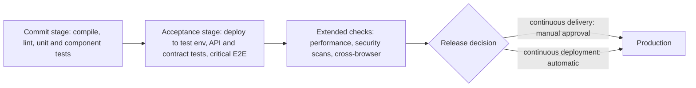

## Beginner-friendly explanation

Picture a busy restaurant kitchen. If every cook prepared their part of a dish alone all week and only combined everything on Friday night, the plates would be a disaster and nobody would know whose ingredient caused the problem. Good kitchens taste and combine continuously: each component is checked the moment it is ready, and the head chef will not send a plate out until it passes a final look.

**Continuous integration and delivery (CI/CD)** brings that habit to software. Every small change is combined with everyone else's work straight away and checked automatically by a sequence of steps called a **pipeline**. As a test engineer, you decide which checks run, in what order, and which ones are allowed to stop a plate leaving the kitchen.

## Technical explanation

Three terms are often blurred together. Use them precisely:

| Practice | What it means | Who triggers production release |
|---|---|---|
| **Continuous integration (CI)** | Developers merge small changes into the main branch frequently; each merge is verified by an automated build and tests | Not about release |
| **Continuous delivery** | Every change that passes the pipeline is kept in a releasable state and can be deployed at any time | A person, as a business decision |
| **Continuous deployment** | Every change that passes the pipeline is deployed to production automatically | The pipeline itself |

A **pipeline** is an ordered set of **stages**. Each stage runs commands and the CI server reads their **exit codes**: zero means success, anything else means failure. A failed stage stops the build artifact from being **promoted** to the next stage. That is what makes each stage a **quality gate**: an automated pass or fail decision based on agreed criteria, such as "all unit tests pass" or "no new critical static-analysis findings".

A good pipeline builds the artifact **once** and promotes the same artifact through every stage. Rebuilding for each environment means you test one binary and ship another.

### Placing tests in stages



The governing principle is **fast feedback**. The commit stage should return results while the developer still has the change in their head; Martin Fowler's article on CI describes aiming for a build of around ten minutes as a common rule of thumb. Slower suites move later, run in parallel, or run on a schedule, but they still need an owner who acts on failures.

| Stage | Typical tests | Goal |
|---|---|---|
| Commit | Unit, component, static analysis | Minutes; catch most logic errors cheaply |
| Acceptance | API, contract, integration, a few E2E journeys | Prove the deployed system works together |
| Extended | Load, security, accessibility, broad browser matrix | Non-functional confidence before release |
| Post-deploy | Smoke tests, synthetic monitoring | Confirm production health; trigger rollback |

## Real-world example

A retail team released once a month after a two-week manual regression phase. Their pipeline only compiled the code. A test engineer led the change in steps: unit and component tests were added to a commit stage that ran on every pull request; the team's most valuable checkout journeys were automated at API level and ran after each deploy to a shared test environment; and a handful of browser tests covered only what the API tests could not, such as the payment iframe hand-off.

Because the main branch was now verified on every merge, defects were found on the day they were introduced and fixed by the person who wrote them. The team moved to continuous delivery: they still pressed a button to release, but any green build could be shipped. They did not adopt continuous deployment until monitoring and automated rollback were in place.

## Step-by-step walkthrough

1. **Map the current flow** from commit to production, including manual steps and waiting time.
2. **Make the build reproducible** from a clean checkout with one command.
3. **Ensure every test runner exits non-zero on failure** and publishes machine-readable results (JUnit XML is widely supported).
4. **Create the commit stage** with the fastest, most reliable tests and make it block merges.
5. **Build the artifact once**, store it, and deploy that same artifact to later environments.
6. **Add acceptance and extended stages**, parallelising where suites are independent.
7. **Publish reports and artifacts** (logs, screenshots, traces) so failures can be diagnosed without re-running.
8. **Track pipeline health**: duration, failure causes and flaky tests.

## Code examples

Pipelines trust exit codes, so check what your runner returns. This shell snippet runs Maven tests and preserves the failure status even when output is piped to a log file:

```bash
#!/usr/bin/env bash
set -euo pipefail          # stop on errors, unset variables and failures inside pipes

mvn -B test | tee test.log
echo "Tests passed"
```

## Expected output

When a test fails, Maven prints a failure summary and exits non-zero. Because `pipefail` is set, the script stops before the final `echo` and the CI stage is marked as failed:

```text
[ERROR] Tests run: 12, Failures: 1, Errors: 0, Skipped: 0
[ERROR] BUILD FAILURE
Error: Process completed with exit code 1.
```

Without `set -o pipefail` the script would report the exit status of `tee`, which succeeds, and the failing build would show green.

## Common mistakes

- **Using CI, continuous delivery and continuous deployment as synonyms.** Interviewers notice; the difference is who decides to release.
- **Putting every test in one giant stage.** One slow suite delays all feedback, and developers start ignoring the pipeline.
- **Rebuilding per environment** instead of promoting one artifact.
- **Swallowing exit codes** with pipes, `|| true` or wrapper scripts, so failures look green.
- **Auto-retrying flaky tests forever** without tracking them. The gate becomes noise.
- **No artifacts on failure.** Without logs, screenshots or reports, every red build needs a manual re-run to diagnose.

## Troubleshooting

- **Passes locally, fails in CI.** Compare tool versions, time zone, locale, environment variables and test data. Running the build inside the same container image in both places removes most differences (see [Docker for testers](/learn/sdet/docker-for-testers)).
- **Pipeline is too slow.** Measure per stage first, then cache dependencies, parallelise and push tests down the pyramid.
- **Random red builds.** Identify flaky tests from history, quarantine them visibly with an owner, and fix the cause (usually waits, shared data or ordering).

## Key takeaways summary

CI/CD is how modern teams turn testing into a continuous, automated safety net. Know the three definitions precisely, order stages for fast feedback, make every stage an honest quality gate based on exit codes, and keep the signal trustworthy by treating flaky tests and missing reports as defects in the pipeline itself.
