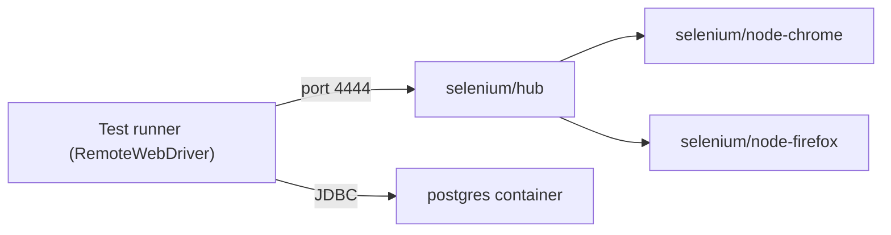

## Beginner-friendly explanation

Think of a **shipping container**. Whatever is inside, it has the same shape, so any ship, train or truck can carry it. You can load one, use it and throw it away.

**Docker** does the same for software. It packages an application or tool together with everything it needs to run into a standard box. For a tester that means: "the database version my tests expect", "a Chrome browser exactly like the one in CI" or "the whole test suite with its Java version" can be started anywhere in seconds, used, and thrown away. No more "it works on my machine".

## Technical explanation

| Term | Meaning |
|---|---|
| **Image** | A read-only, layered template (file system plus default command), identified by `name:tag` |
| **Container** | A running or stopped instance of an image, with its own writable layer |
| **Dockerfile** | Instructions (`FROM`, `COPY`, `RUN`, `CMD`) used by `docker build` to create an image |
| **Registry** | A store of images, such as Docker Hub |
| **Port publishing** | `-p HOST:CONTAINER` exposes a container port on the host |
| **Volume** | Storage that outlives a container, or a host folder mounted into it |
| **Compose** | `docker compose` reads a `compose.yaml` and starts several containers on a shared network |

Containers share the host's kernel, so they start faster and use fewer resources than full virtual machines, but they are not a security boundary as strong as a VM.

### Where testers use Docker

1. **Running the test suite in a fixed toolchain.** A Dockerfile pins the language and browser versions so local and CI runs match.
2. **Test dependencies.** Databases, caches, message brokers and mock servers declared in Compose, started fresh per run.
3. **Browsers.** The Selenium project publishes official images: `selenium/standalone-chrome`, `selenium/standalone-firefox` and others for a single browser, or `selenium/hub` with `selenium/node-chrome` and similar nodes for a grid. The grid listens on port 4444 and the images include a noVNC viewer (port 7900) for watching sessions.
4. **Testcontainers.** A library (available for Java, .NET, Go, Node.js, Python and other languages) that starts throwaway containers from inside test code and removes them afterwards.



## Real-world example

A team's integration tests relied on a shared test database that several pipelines and people used at once. Tests failed when someone else's data collided with theirs, and nobody could reproduce failures. They moved the database into a Compose file with a pinned PostgreSQL image, an init script for schema and seed data, and a health check. Every CI run started a fresh database and destroyed it afterwards. The data collisions disappeared, and anyone could reproduce a CI failure locally with one command.

## Step-by-step walkthrough

1. Install Docker and confirm with `docker version`.
2. Run a dependency directly: `docker run -d --name db -e POSTGRES_PASSWORD=test -p 5432:5432 postgres:16`.
3. Move it into `compose.yaml` with a health check.
4. Add browsers from the official selenium images if you run UI tests.
5. Start everything with `docker compose up -d --wait` (the `--wait` flag waits for services to be running or healthy).
6. Run tests against `localhost` ports, then tear down with `docker compose down -v` to remove containers and volumes.

## Code examples

A Compose file for a database and a small Selenium Grid. Pin the selenium tags to a specific release in real projects; check the docker-selenium repository for current tags.

```yaml
# compose.yaml
services:
  db:
    image: postgres:16
    environment:
      POSTGRES_PASSWORD: test
      POSTGRES_DB: shop_test
    ports:
      - "5432:5432"
    healthcheck:
      test: ["CMD-SHELL", "pg_isready -U postgres"]
      interval: 2s
      retries: 30

  selenium-hub:
    image: selenium/hub:latest
    ports:
      - "4444:4444"

  chrome:
    image: selenium/node-chrome:latest
    shm_size: 2gb
    depends_on:
      - selenium-hub
    environment:
      SE_EVENT_BUS_HOST: selenium-hub
      SE_EVENT_BUS_PUBLISH_PORT: "4442"
      SE_EVENT_BUS_SUBSCRIBE_PORT: "4443"
```

A Dockerfile that runs a Maven test suite in a fixed toolchain:

```dockerfile
FROM maven:3.9-eclipse-temurin-21
WORKDIR /tests
COPY pom.xml .
RUN mvn -B dependency:go-offline
COPY src ./src
CMD ["mvn", "-B", "test"]
```

Copying `pom.xml` first means the dependency layer is cached and only rebuilt when dependencies change.

A Testcontainers (Java, JUnit 5) test that gets its own PostgreSQL:

```java
@Testcontainers
class OrderRepositoryIT {

    @Container
    static PostgreSQLContainer<?> postgres = new PostgreSQLContainer<>("postgres:16");

    @Test
    void savesAndLoadsAnOrder() {
        OrderRepository repo = new OrderRepository(
            postgres.getJdbcUrl(), postgres.getUsername(), postgres.getPassword());
        repo.save(new Order("A-1", 2));
        assertEquals(2, repo.find("A-1").quantity());
    }
}
```

## Expected output

After `docker compose up -d --wait`, `docker compose ps` lists each service with a running status, and the database shows as healthy:

```text
NAME                  SERVICE        STATUS
shop-db-1             db             Up 12 seconds (healthy)
shop-selenium-hub-1   selenium-hub   Up 12 seconds
shop-chrome-1         chrome         Up 11 seconds
```

The exact column layout varies by Docker version, and names are prefixed with your project folder name. Opening `http://localhost:4444` shows the Grid UI with one Chrome node registered.

## Common mistakes

- **Using `latest` tags in CI**, so the environment changes silently between runs.
- **`sleep` instead of health checks**, which is slow and still flaky.
- **Forgetting shared memory for browsers.** Chrome in a container can crash with the small default `/dev/shm`; set `shm_size: 2gb` as the Selenium images' documentation recommends.
- **Connecting to `localhost` from inside another container.** Inside the Compose network, use the service name (`db`, `selenium-hub`).
- **Leaving volumes behind**, so "fresh" databases still contain old data. Use `down -v`.
- **Baking secrets into images.** Pass them at runtime through environment variables or secret stores.

## Troubleshooting

- **Port already in use.** Another process or container holds the host port; stop it or map a different host port.
- **Container exits immediately.** Run `docker compose logs <service>` to see why; often a missing required environment variable.
- **Grid shows no nodes.** Check the event bus variables on the node and that both services share the Compose network.
- **Testcontainers cannot find Docker in CI.** The runner needs access to a Docker daemon; check the CI provider's documentation for Docker support.

## Key takeaways summary

Docker turns environments into code. Pin images, declare dependencies in Compose with health checks, use the official selenium images for browsers, and use Testcontainers when each test needs its own real dependency. The payoff is reproducible runs and failures you can recreate with one command.
