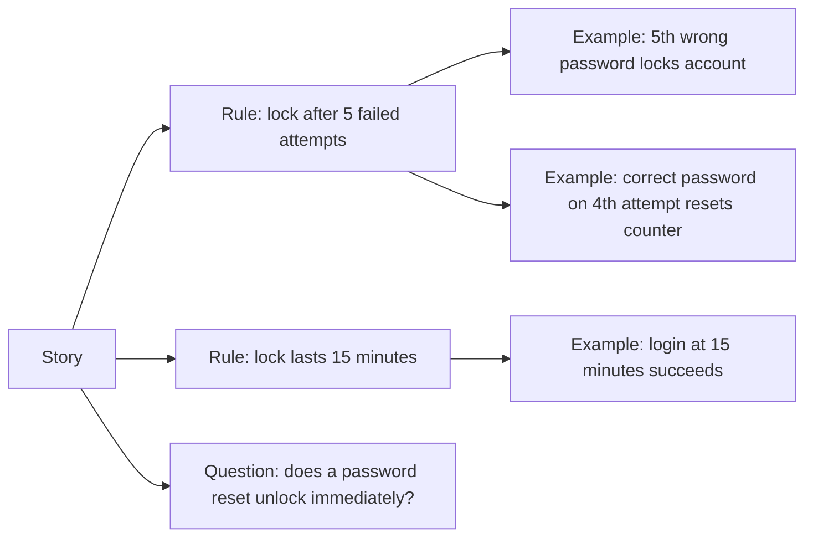

## Beginner-friendly explanation

Imagine a friend asks you to "pick up some snacks for the party". You return with crisps, but they wanted fruit, for twelve people, and nothing with nuts because a guest has an allergy. Nobody did anything wrong; the request was simply unclear.

Software requirements fail in the same way. **Requirements analysis** is asking the right questions **before** anyone starts building: how many, what exactly, what if, who is allowed. A tester who spots "snacks" and asks "which, how many, any allergies?" prevents defects that would otherwise be found weeks later.

## Technical explanation

Reviewing a requirement, user story or design is **static testing**: you look for defects without running code. Defects found here are usually the cheapest to fix, because nothing has been built on top of the misunderstanding yet.

### What to look for

| Category | Questions to ask | Red-flag words or patterns |
|---|---|---|
| **Ambiguity** | Could two readers interpret this differently? | fast, easy, user-friendly, appropriate, etc., some, usually |
| **Completeness** | What about errors, empty states, limits, permissions, time zones, concurrency? | Only the happy path is described |
| **Consistency** | Does it contradict another story, the UI design or a regulation? | Different names for the same thing |
| **Testability** | Can pass or fail be decided objectively? | No measurable threshold |
| **Assumptions** | What is being taken for granted? | "As usual", "the standard flow" |
| **Boundaries** | Inclusive or exclusive? Which unit? | "Up to", "within", "under" |

### INVEST

User stories are often checked against **INVEST**:

| Letter | Meaning | Tester's angle |
|---|---|---|
| I | Independent | Can it be tested without waiting for another story? |
| N | Negotiable | Is the detail still open for discussion with the team? |
| V | Valuable | Is the user value clear enough to test for? |
| E | Estimable | Are there unknowns that make it impossible to size? |
| S | Small | Is it small enough that its rules and edge cases can be listed? |
| T | Testable | Are there objective acceptance criteria? |

### Acceptance criteria and examples

Good acceptance criteria are **specific, measurable, and expressed through examples**. The Given/When/Then format used in Gherkin is one useful structure, not the only one. **Example mapping** is a short workshop technique, described in the Cucumber documentation, where the team writes the story, its rules, a concrete example for each rule, and open questions on separate cards. Too many rules suggest the story is too big; too many questions suggest it is not ready.



## Real-world example

A team received the story: "As a customer, I want my account locked after too many failed logins so that it is protected." A tester reviewed it and asked: how many is too many? Is the count consecutive or per time window? How long is the lock? Is the user told? Does a successful login reset the counter? Can support unlock it? Does a password reset unlock it? Are attempts counted per account or per device?

Each answer became a rule with an example. Two of the questions exposed a conflict with an existing support process, which was resolved before development rather than found during a release. The final acceptance criteria were short, measurable and directly automatable.

## Step-by-step walkthrough

1. **Read for understanding** first; summarise the goal in one sentence.
2. **Highlight vague words** and undefined terms.
3. **List inputs, outputs, states and actors**, then ask what happens at each boundary and error.
4. **Check INVEST**, especially Small and Testable.
5. **Write questions with proposed answers** ("Should the limit be inclusive? I'd suggest 10,485,760 bytes inclusive.") so discussion is quick.
6. **Agree examples** in a three-amigos or example-mapping session.
7. **Update the acceptance criteria** in the story itself, and trace tests to them.

## Code examples

Agreed examples written as Gherkin acceptance criteria:

```gherkin
Feature: Account lockout

  Rule: An account is locked after 5 consecutive failed login attempts

    Scenario: Fifth consecutive failure locks the account
      Given a customer with 4 consecutive failed login attempts
      When they log in with a wrong password
      Then the account is locked
      And they see "Your account is locked. Try again in 15 minutes."

    Scenario: A successful login resets the counter
      Given a customer with 4 consecutive failed login attempts
      When they log in with the correct password
      Then they are logged in
      And their failed-attempt count is 0
```

## Expected output

Once step definitions exist, a Cucumber run reports each scenario separately, so the acceptance criteria double as an executable checklist. A run against an implementation that forgets to reset the counter would show the first scenario passing and the second failing on the last step:

```text
2 scenarios (1 failed, 1 passed)
8 steps (1 failed, 7 passed)
```

## Common mistakes

- **Waiting for the build to start testing.** The cheapest defects are in the text.
- **Accepting vague words** like "fast" or "secure" without numbers or standards.
- **Only reviewing the happy path**; most questions are about errors, limits and permissions.
- **Asking open-ended questions with no proposal**, which slows the conversation.
- **Leaving answers in chat** instead of updating the story.
- **Treating Gherkin as the goal.** The conversation and shared understanding are the goal; the format is a record.

## Troubleshooting

- **Product owner has no time.** Batch questions, propose answers, and bring them to refinement.
- **Answers keep changing.** The story is probably not ready; flag it against the definition of ready.
- **Non-functional needs are missing.** Ask directly about performance, security, accessibility and data retention for every significant story.

## Key takeaways summary

Requirements analysis is the earliest and cheapest testing you can do. Read critically for ambiguity, gaps and testability, check stories against INVEST, and turn rules into concrete examples the whole team agrees on. Clear acceptance criteria make every later test easier to design and automate.
