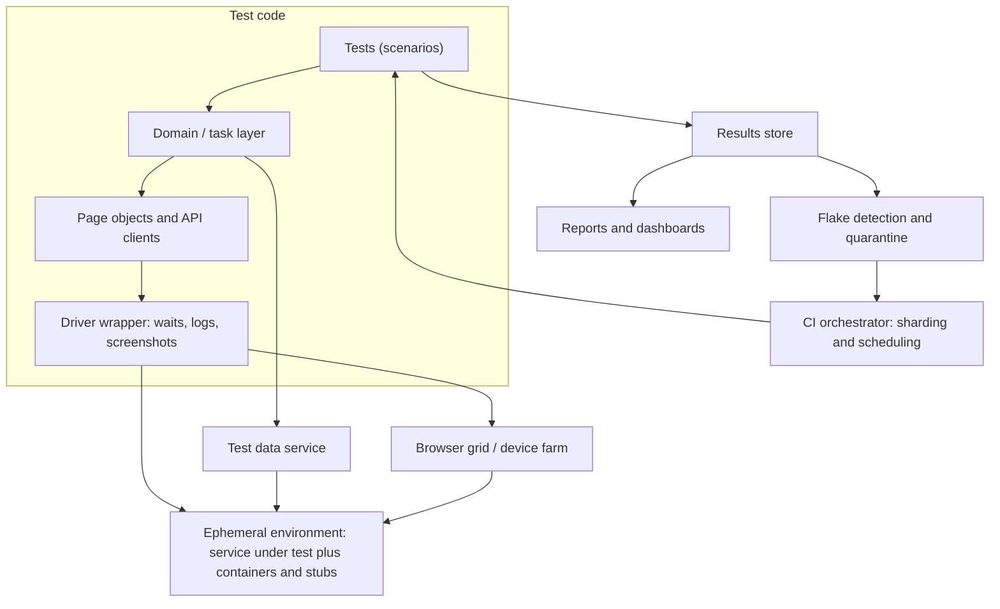

## Beginner-friendly explanation

Writing one test is like cooking one meal at home. Running thousands of tests for many teams, many times a day, is like running a restaurant chain. You now need standard recipes, a supply chain for ingredients, kitchens that can be cleaned and reused, enough stoves to cook in parallel, and a way to find out which dish keeps getting sent back.

**Test architecture** is designing that restaurant chain for tests. It is the step from "I can automate a test" to "I can build the system that lets everyone test well".

## Technical explanation

A test platform has several concerns. Naming them is half of a good system-design answer.

| Concern | Responsibility | Typical building blocks |
|---|---|---|
| **Test code layers** | Readable tests, reusable actions, stable interactions | Tests, domain/task layer, page objects or API clients, driver wrapper |
| **Test data** | Isolated, realistic data on demand | Builders, factories, a test data API, synthetic data, cleanup jobs |
| **Environments** | Somewhere consistent to run | Containers, ephemeral per-PR environments, stubs and service virtualisation |
| **Execution** | Run fast and in parallel | CI orchestration, sharding, runner pools, browser or device grid |
| **Results** | Durable record of every result | JUnit XML or similar ingested into a results store |
| **Reporting** | Turn results into decisions | Per-run reports, trends, dashboards, notifications |
| **Reliability** | Keep the signal trustworthy | Flake detection, quarantine, ownership, retry policy |



### Key design decisions

- **Isolation over sharing.** Every test creates the data it needs (through APIs, not the UI) and does not depend on order. This is what makes parallelism safe.
- **Ephemeral versus shared environments.** Ephemeral environments remove contention and drift but cost more compute and setup time; shared environments are cheaper but need locking, data partitioning and strict ownership.
- **Stubs at the edges.** Third-party systems (payment providers, email) are replaced with stubs in most runs; a small, separate suite checks the real integration.
- **Sharding by duration.** Splitting by historical test duration balances shards far better than splitting by file count.
- **Structured results.** Results stored with test id, commit, environment, duration, outcome and attempt number make flake detection and trend reporting possible.
- **Retry policy.** Retries may gather evidence, but a pass after a failure is recorded as a flake, not a clean pass.

## Real-world example

A company's checkout area had grown to several teams, each with its own copy of a UI framework. Fixing a wait helper meant changing five repositories, and every team used the same shared staging accounts, so parallel runs collided. An SDET group extracted a shared core library (driver wrapper, configuration, reporting), introduced a small test data service with endpoints to create customers and orders with unique identifiers, and moved results from per-job HTML reports into a central store. With that history they could list tests whose outcome changed without a code change, quarantine them visibly, and give each one an owning team. The work was mostly infrastructure; very few tests were rewritten.

This is a generic scenario illustrating a common pattern, not a specific organisation.

## Step-by-step walkthrough

How to answer "Design a test platform for..." in an interview:

1. **Clarify requirements.** Number of teams and tests, feedback-time target, test types, platforms (web, mobile, API), constraints (budget, compliance).
2. **State quality goals** for the platform itself: fast, isolated, reliable, observable, easy to adopt.
3. **Draw the layers** of test code and the shared services around them.
4. **Explain data and environment strategy**, including isolation.
5. **Explain execution**: where tests run, how they are sharded, how the grid scales.
6. **Explain results, reporting and flake management.**
7. **Discuss trade-offs and evolution**: what you would build first, what you would buy versus build, and what you would measure.

## Code examples

A minimal test data builder that calls an API so each test gets unique, isolated data (TypeScript with Playwright's request fixture):

```typescript
import { test, expect, APIRequestContext } from "@playwright/test";
import { randomUUID } from "node:crypto";

async function createCustomer(api: APIRequestContext, tier = "GOLD") {
  const email = `qa+${randomUUID()}@example.test`;
  const res = await api.post("/api/test-data/customers", { data: { email, tier } });
  expect(res.ok()).toBeTruthy();
  return (await res.json()) as { id: string; email: string };
}

test("gold customer gets free delivery", async ({ request }) => {
  const customer = await createCustomer(request);
  const quote = await request.get(`/api/delivery-quote?customerId=${customer.id}`);
  expect((await quote.json()).price).toBe(0);
});
```

The `/api/test-data` endpoints are an example of a test-only API exposed in non-production environments; your system will need its own equivalent.

## Expected output

Run with several workers, each test gets a different customer, so there are no collisions:

```text
Running 1 test using 1 worker
  ✓  gold customer gets free delivery (412ms)
  1 passed
```

Timing will vary. If the data endpoint is unavailable, the `expect(res.ok())` assertion fails in the setup helper, which points directly to the data service rather than to the feature under test.

## Common mistakes

- **Designing tools before requirements.** Start from feedback time, scale and risks.
- **Shared mutable test data**, the most common root cause of flaky parallel runs.
- **One giant framework that every test must inherit from**, making change risky. Prefer small composable libraries.
- **Reports with no history.** Without stored results you cannot see trends or flakes.
- **Hiding flakiness with silent retries.**
- **Ignoring cost.** Ephemeral environments and large grids are not free; state the trade-off.

## Troubleshooting

- **Shards finish at very different times.** Balance by recorded duration and isolate slow outliers.
- **Grid sessions queue.** Measure concurrency needs, add nodes or reduce UI test count by pushing coverage down.
- **Teams bypass the shared library.** Make it easier to use than to avoid: good docs, templates and fast support.

## Key takeaways summary

Test architecture is systems thinking applied to quality. Layer the code, isolate the data, make environments reproducible, scale execution horizontally, and store every result so reports and flake management are based on evidence. In interviews, clarify requirements, sketch the layers, and finish with trade-offs.
