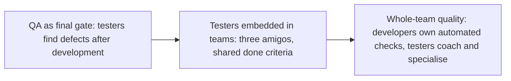

## Beginner-friendly explanation

Think of a football coach. The coach does not score the goals. Their job is to choose a game plan based on the opponent, put the right players in the right positions, keep the club's management informed, help each player improve, and build a team that defends together instead of blaming the goalkeeper for every goal conceded.

A **test lead or manager** does the same for quality: plans where testing effort goes, communicates the state of quality honestly, grows the people on the team, and helps everyone, not just testers, take responsibility for quality.

## Technical explanation

### Planning with risk

A **product risk** is a possible problem with the product, such as incorrect calculations, poor performance or a security weakness. ISTQB describes risk level as a combination of **likelihood** and **impact**. Risk-based planning means the depth, order and technique of testing follow the risk level.

| Area | Likelihood | Impact | Risk | Test approach |
|---|---|---|---|---|
| Refund calculation (new code) | High | High | High | Early, deep: unit, API, exploratory, review |
| Payment provider integration | Medium | High | High | Contract tests, sandbox end-to-end, monitoring |
| Profile photo upload | Medium | Low | Medium | Automated happy path, boundary file sizes |
| Footer links | Low | Low | Low | Existing smoke test only |

A **test plan** records scope, approach, resources, schedule, entry and exit criteria, risks and assumptions. In agile teams it is often lightweight and lives alongside the backlog, but the decisions still need to be made and written down.

### Stakeholder communication

Different audiences need different information:

| Audience | Wants to know | Format |
|---|---|---|
| Executives and product owners | Can we ship, what is the risk, what are the options? | Short written summary with a recommendation |
| Developers | What failed, how to reproduce, what is blocked? | Defect reports, CI results, conversation |
| Testers | Priorities, ownership, where help is needed | Board, stand-ups, pairing |

A useful status structure is **decision, status, risks, recommendation, evidence**. Testers inform the release decision; the accountable owner makes it.

### Coaching and growing people

Leading means multiplying capability: pairing on test design, reviewing test code and charters, giving specific feedback, delegating real ownership, and creating learning paths (for example from manual testing into API automation). Testers increasingly act as **quality coaches** who help developers test well.

### Hiring

Define the competencies first, use structured questions, a realistic **work sample** (review a story, design tests, debug a failing test) and a written **rubric**, and have interviewers score independently before discussing. Distinguish essential skills from nice-to-haves so the bar matches the job.

### Quality culture

Signals of a healthy culture: quality is discussed in refinement, not just at release; defects are treated as learning, not blame; and anyone can stop a release with evidence.

## Real-world example

A new QA lead joined a product group where four teams handed finished stories to a separate QA team. Testing was always the bottleneck and was blamed for late releases. The lead did not reorganise immediately. Over the first month they mapped where stories waited and where escaped defects originated. They then introduced three changes: testers joined refinement to review acceptance criteria, developers took ownership of unit and API tests within the definition of done, and testers paired with developers on test design for risky stories. Release reports switched from "test cases passed" to a short risk summary with a recommendation. Waiting time for testing dropped because testing now happened alongside development, and conversations about releases moved from blame to options.

## Step-by-step walkthrough

1. **Understand context**: product, architecture, team skills, current pain points and data.
2. **Identify and rate risks** with product and development.
3. **Write a proportionate plan**: scope, approach per risk, entry and exit criteria, responsibilities.
4. **Set up communication**: a regular, short quality update for each audience.
5. **Coach**: pair, review and delegate; agree growth goals with each team member.
6. **Hire deliberately** using competencies, structured interviews and work samples.
7. **Evolve the culture**: shift testing earlier, share ownership, and review outcomes with metrics such as escaped defects and lead time.

## Common mistakes

- **Trying to test everything equally** instead of following risk.
- **Reporting pass percentages** as if they expressed release risk.
- **Becoming the bottleneck** by personally approving every change or doing all critical testing.
- **Making release decisions alone** that belong to the accountable product owner, or refusing to give a view at all.
- **Unstructured hiring** based on gut feel or trivia questions.
- **Blame after incidents**, which teaches people to hide problems.

## Troubleshooting

- **Stakeholders ignore your reports.** Shorten them, lead with the decision, and ask what they need.
- **Developers resist writing tests.** Start with pairing on one risky story and show how fast feedback saves them time.
- **The team is overloaded.** Make the trade-off visible: list what will not be tested and the residual risk, and ask the product owner to prioritise.
- **A strong individual contributor struggles as a lead.** Coach them on delegation and communication, which are new skills, not a failure.

## Key takeaways summary

Test leadership is about direction, information and people. Plan around risk, communicate in terms of decisions and impact, coach others so quality does not depend on you, hire with structure, and build a culture where the whole team owns quality.
