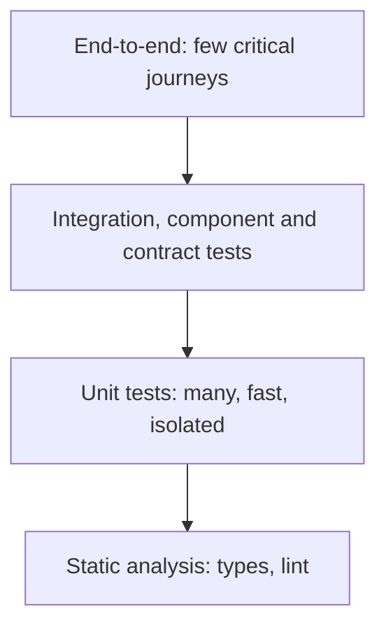

## Beginner-friendly explanation

Imagine checking a new car. You could test every bolt, wire and sensor on a workbench before assembly: quick, cheap, and if something is wrong you know exactly which part. You could also take the finished car for a test drive: realistic and convincing, but slow, and if the car shudders you do not immediately know why.

Good car makers do both, but they do a **lot** of part checks and **a few** test drives. The **test pyramid** is that idea for software: many small, fast checks at the bottom, a few realistic, expensive ones at the top.

## Technical explanation

The **test pyramid**, popularised by Mike Cohn and discussed in depth in Ham Vocke's "The Practical Test Pyramid" on martinfowler.com, has two core rules: write tests at different granularities, and the more high-level and integrated a test is, the fewer of them you should have.

| Level | Scope | Speed | Diagnosis | Confidence about the whole system |
|---|---|---|---|---|
| Unit | One function or class, dependencies replaced | Milliseconds | Precise | Low |
| Component / service | One service through its API, real database in a container, other services stubbed | Seconds | Good | Medium |
| Contract | Agreement between consumer and provider | Seconds | Precise at boundaries | Medium for integration risk |
| Integration | Several real components together | Seconds to minutes | Moderate | Medium to high |
| End-to-end | Whole deployed system through the UI or public API | Minutes | Poor | High |

The **testing trophy**, proposed by Kent C. Dodds for front-end JavaScript, adds **static analysis** (types, linters) as the base and gives integration tests the largest share. Both models agree on a small number of end-to-end tests; they disagree on how much isolation is worth.

The **ice-cream cone** is the anti-pattern: a wide top of manual and UI tests over a thin base of unit tests. Feedback is slow, flaky and expensive to maintain.



### Strategy is about risk, not shape

A **test strategy** decides which risks are covered, at which level, by whom and when. The guiding principle is: **test each risk at the lowest level that can genuinely catch it.**

- Calculation and validation rules: unit tests.
- Database queries, serialisation, configuration: component or integration tests with real dependencies.
- Service-to-service compatibility: contract tests.
- "Can a user actually buy something?": a few end-to-end journeys.
- Usability, new-feature learning, odd interactions: exploratory testing.

Higher levels catch defects that lower levels cannot, such as misconfiguration, wiring errors and browser issues. A pyramid with no top is as risky as an ice-cream cone.

## Real-world example

A travel-booking team had about 600 Selenium tests and few unit tests. The suite took most of a night to run and failed for a different reason every morning. A test engineer analysed what each UI test was really checking. Most verified fare rules and validation messages, which they rewrote as data-driven unit and API tests. Integration between the booking service and the payment service moved to contract tests. Around forty journeys stayed in the browser. Feedback moved from overnight to within the pull request, and when an end-to-end test failed, it usually meant a real wiring problem.

The numbers here describe a hypothetical team; the pattern, not the count, is the point.

## Step-by-step walkthrough

1. **List the risks** for the product: business rules, integrations, data, UI, non-functional.
2. **Map the architecture**: services, UI, data stores, third parties.
3. **For each risk, choose the lowest effective level** and note why.
4. **Choose the few end-to-end journeys** that represent the highest business value.
5. **Decide where each level runs** in the pipeline (see [CI/CD for test engineers](/learn/sdet/ci-cd-for-test-engineers)).
6. **Define ownership**: developers usually own unit tests; testers and developers share the rest.
7. **Review the mix regularly** using escaped defects, flaky rate and pipeline duration.

## Code examples

The same rule, tested at two levels. The unit test checks many combinations in milliseconds; the end-to-end test checks only that the result reaches the user.

```java
// Unit level: many combinations, fast and precise
@ParameterizedTest
@CsvSource({ "GOLD, 100.00, 90.00", "SILVER, 100.00, 95.00", "NONE, 100.00, 100.00" })
void appliesTierDiscount(Tier tier, BigDecimal basket, BigDecimal expected) {
    assertEquals(expected, Pricing.total(tier, basket));
}
```

```typescript
// End-to-end level (Playwright): one journey proves the wiring
test("gold customer sees discounted total at checkout", async ({ page }) => {
  await page.goto("/checkout");
  await expect(page.getByTestId("order-total")).toHaveText("90.00");
});
```

## Expected output

The unit test reports three separate passing cases in well under a second; the Playwright test reports one passing journey after several seconds of browser work. If a developer breaks the GOLD rate, the unit test names the exact tier and values, while the end-to-end test only shows a wrong total on a page.

```text
appliesTierDiscount(Tier, BigDecimal, BigDecimal)
  [1] GOLD, 100.00, 90.00      FAILED  expected: <90.00> but was: <95.00>
  [2] SILVER, 100.00, 95.00    PASSED
  [3] NONE, 100.00, 100.00     PASSED
```

## Common mistakes

- **Treating ratios as targets.** "70/20/10" is folklore, not a requirement.
- **Duplicating the same check at every level**, which multiplies maintenance without adding confidence.
- **Testing business rules through the UI** because "that is how users see it".
- **Dropping end-to-end tests entirely** and missing configuration and wiring defects.
- **Mocking everything in unit tests** so they pass while the integrated system fails.
- **A strategy that only lists tools** instead of risks, levels, owners and exit criteria.

## Troubleshooting

- **Developers do not write unit tests.** Pair on the first few, make them part of the definition of done, and show how fast they run.
- **Contract tests feel heavy.** Start with one high-traffic consumer-provider pair.
- **Leaders want the end-to-end count to grow as a sign of progress.** Report risk coverage and escaped defects instead of test counts.

## Key takeaways summary

The pyramid and trophy are thinking tools. Use them to ask, for every risk, "what is the cheapest test that would catch this?" Keep a solid base, a meaningful middle and a small, valuable top, and revisit the mix with real defect and pipeline data.
