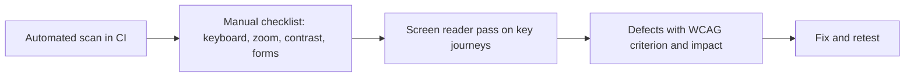

## Beginner-friendly explanation

Picture a building with only a staircase at the entrance. People using wheelchairs, parents with prams and delivery workers with trolleys all struggle. Adding a ramp helps them, and it helps many others too.

Digital products have staircases as well: a button that only works with a mouse, grey text too faint to read, a video without captions, a form that a screen reader announces as "edit, edit, edit" with no labels. **Accessibility testing** finds these barriers so people with visual, hearing, motor, cognitive and other disabilities can use the product, and so everyone benefits from clearer, more robust design.

## Technical explanation

The **Web Content Accessibility Guidelines (WCAG)** are published by the W3C's Web Accessibility Initiative. WCAG 2.2 became a W3C Recommendation in October 2023. It is structured as:

- **4 principles (POUR)**
- **Guidelines** under each principle
- **Testable success criteria**, each at **Level A**, **AA** or **AAA**

| Principle | Meaning | Example success criteria |
|---|---|---|
| Perceivable | Users can perceive the information | 1.1.1 Non-text Content (A), 1.4.3 Contrast (Minimum) (AA), 1.4.10 Reflow (AA) |
| Operable | Users can operate the interface | 2.1.1 Keyboard (A), 2.4.7 Focus Visible (AA), 2.5.8 Target Size (Minimum) (AA) |
| Understandable | Content and behaviour are understandable | 3.3.1 Error Identification (A), 3.3.2 Labels or Instructions (A) |
| Robust | Works with assistive technologies | 4.1.2 Name, Role, Value (A) |

Levels are cumulative: AA conformance means meeting all A and AA criteria. Many laws and procurement policies reference Level AA, but which version and level apply depends on jurisdiction and contract.

### New in WCAG 2.2

WCAG 2.2 added criteria including 2.4.11 Focus Not Obscured (Minimum) (AA), 2.5.7 Dragging Movements (AA), 2.5.8 Target Size (Minimum) (AA, at least 24 by 24 CSS pixels with exceptions), 3.2.6 Consistent Help (A), 3.3.7 Redundant Entry (A) and 3.3.8 Accessible Authentication (Minimum) (AA). It also removed 4.1.1 Parsing as obsolete.

### Automated versus manual testing

| Approach | Good at | Misses |
|---|---|---|
| Automated scanners (axe, browser devtools) | Missing labels and alt attributes, many contrast failures, invalid ARIA, duplicate ids | Meaning, logical order, usability with assistive tech |
| Manual checks | Keyboard flow, focus visibility, zoom and reflow, meaningful text | Slower, needs skill and consistency |
| Assistive technology testing | Real screen reader and voice control experience | Needs practice and device coverage |
| Testing with disabled users | Real barriers and priorities | Requires planning and budget |



## Real-world example

A council services portal passed its automated scan with no violations. During manual testing, a tester using only the keyboard could not complete a booking: the date picker opened on focus but could not be closed or navigated with the keyboard, trapping focus. Screen reader testing also showed the time slots announced as "button" with no names because they were icon-only. Neither issue was flagged by the scanner in that configuration. The team added keyboard support and accessible names, and added the booking journey to their manual accessibility regression.

## Step-by-step walkthrough

1. **Agree the target**, usually WCAG 2.2 Level AA, and the scope: pages, journeys, platforms.
2. **Run an automated scan** with axe or a similar tool on each page state, including open dialogs and error states.
3. **Keyboard pass:** complete each journey using Tab, Shift+Tab, Enter, Space, arrow keys and Escape.
4. **Visual checks:** contrast, use of colour, zoom to 200%, reflow at 320 CSS pixels wide, text spacing.
5. **Forms and errors:** labels, instructions, error identification and suggestions.
6. **Media:** captions, transcripts, audio description where needed, no auto-playing audio without control.
7. **Screen reader pass** on critical journeys (see [screen reader and keyboard testing](/learn/specialist/screen-reader-and-keyboard-testing)).
8. **Report** each defect with the success criterion, user impact, element and steps.

### Worked example: defect report fields

| Field | Example |
|---|---|
| Title | Search button has no accessible name |
| WCAG criterion | 4.1.2 Name, Role, Value (A) |
| Impact | Screen reader users hear "button" and cannot know its purpose |
| Steps | Navigate to header search with NVDA in Chrome; Tab to the magnifier icon |
| Expected | Announced as "Search, button" |
| Actual | Announced as "button" |

## Code examples

A labelled input and an icon button with an accessible name, in HTML:

```html
<label for="email">Email address</label>
<input id="email" type="email" autocomplete="email" aria-describedby="email-hint">
<p id="email-hint">We will send your receipt here.</p>

<button type="submit" aria-label="Search">
  <svg aria-hidden="true" focusable="false"><!-- icon --></svg>
</button>
```

## Expected output

An axe scan of a compliant page reports zero violations for the WCAG tags you selected, but it also reports items needing review. Those "incomplete" results are not passes; they are prompts for manual checks.

## Common mistakes

- **Treating a clean automated scan as compliance.**
- **Testing only with a mouse.**
- **Adding ARIA everywhere** instead of using native HTML elements, which already have roles and keyboard support.
- **Relying on colour alone** to show errors, status or required fields.
- **Writing defects without the success criterion**, making priority and fix unclear.
- **Scanning only the initial page state**, missing modals, menus and error states.

## Troubleshooting

- **Contrast result disputed.** Measure the actual foreground and background colours, including text over images or gradients, at the rendered size and weight.
- **Scanner flags something the team believes is fine.** Check the rule documentation and decide with evidence; record accepted exceptions.
- **Unclear which criterion applies.** Use the WCAG Understanding documents linked from each criterion.

## Key takeaways summary

WCAG 2.2 gives testable success criteria grouped by POUR and graded A, AA and AAA. Automated tools such as axe are a fast first filter, but meaningful accessibility testing needs keyboard, visual and screen reader checks on real journeys, and defects that name the criterion and the human impact.
