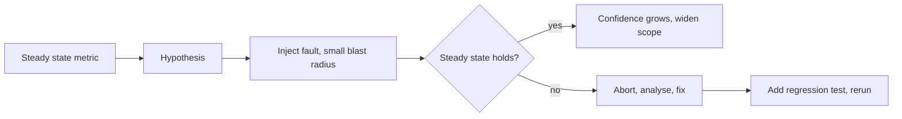

## Beginner-friendly explanation

Fire drills are a good comparison. A school does not wait for a real fire to discover that one exit is locked. It runs a planned drill, with teachers watching, at a time it chooses, and it can stop the drill at any moment. Afterwards it fixes what went wrong.

Chaos engineering is a fire drill for software. You deliberately cause a small, controlled failure, such as switching off one server, and watch whether the system keeps serving users. If it does not, you have learned something before a real failure taught you the hard way.

## Technical explanation

The Principles of Chaos Engineering describe the method:

1. **Define steady state** as measurable output that shows normal behaviour, for example orders per minute or the share of successful requests.
2. **Hypothesise** that steady state will continue in both a control group and an experimental group.
3. **Introduce variables that reflect real-world events**, such as servers crashing, disks filling, network latency or a dependency failing.
4. **Try to disprove the hypothesis** by comparing the control and experimental groups.

Advanced practice adds: run in production when mature, automate experiments to run continuously, and **minimise the blast radius**.



### Common fault types

| Fault | Example | What it reveals |
|---|---|---|
| Instance failure | Stop one container or pod | Load balancing, health checks, restart |
| Latency | Add 500 ms to a dependency | Timeouts, retries, user experience |
| Dependency error | Return HTTP 503 from a service | Fallbacks, circuit breakers |
| Resource exhaustion | Fill disk or use CPU | Alerts, graceful degradation |
| Network partition | Block traffic between zones | Consistency and failover |

### Safety

Chaos experiments are only run with approval from the system owners, during staffed hours, with monitoring, abort conditions and an automatic stop. Begin in test environments. Tools such as Chaos Mesh and LitmusChaos for Kubernetes, and AWS Fault Injection Service, provide controlled fault injection with stop conditions.

## Code examples

A simple local experiment with Docker Compose on a system you own:

```bash
# 1. Measure steady state: successful requests in 30 seconds
for i in $(seq 1 30); do curl -s -o /dev/null -w "%{http_code}\n" http://localhost:8080/products; sleep 1; done | sort | uniq -c

# 2. Inject the fault: stop the cache
docker compose stop redis

# 3. Measure again, then 4. restore
docker compose start redis
```

## Expected output

```text
# Before
     30 200
# During the experiment, if the app degrades gracefully
     30 200
# During the experiment, if it does not
     12 200
     18 500
```

Hypothesis: "Product pages keep returning 200 when the cache is down, only slower." Eighteen 500 responses disprove it: the app has no fallback to the database.

## Real-world example

An online ticketing team believed their service would survive the loss of its cache. In a staging experiment approved by the team lead, they stopped the cache for five minutes during a load test. Response times rose as expected, but the database connection pool was exhausted within a minute and the error rate climbed past the abort threshold, so the experiment was stopped. The fix added a connection limit and a short-lived local cache. A rerun held steady state, and the experiment became part of their monthly reliability checks.

## Common mistakes

- **Breaking things randomly** without a hypothesis or metrics.
- **Starting in production** with a large blast radius.
- **No abort conditions** or nobody watching.
- **Measuring only technical metrics** instead of user-facing outcomes.
- **Not fixing findings**, so the experiment just repeats the same failure.

## Troubleshooting

- **Nothing seems to happen.** Confirm the fault was really injected and that monitoring covers the affected path.
- **Results are noisy.** Compare with a control group and run longer.

## Key takeaways summary

Chaos engineering is careful, scientific fire drilling: define normal, predict, inject a small realistic fault, observe, and fix. It pairs naturally with [microservices testing](/learn/specialist/microservices-testing).
