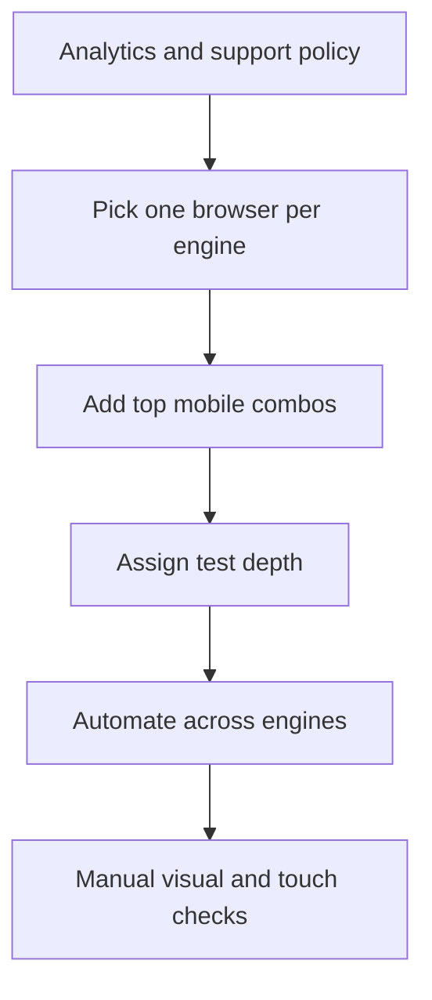

## Beginner-friendly explanation

Imagine three printers that all receive the same document. One prints the margins slightly wider, another substitutes a font, and the third cannot print a particular colour. The document is the same; the printers interpret it differently.

Browsers are like those printers. They read the same HTML, CSS and JavaScript but can show and run them a little differently. Cross-browser testing checks that your users get a working, good-looking page whichever browser they use.

## Technical explanation

### Rendering engines

| Browser | Rendering engine | JavaScript engine |
|---|---|---|
| Chrome, Edge, Opera, Brave | Blink (Chromium) | V8 |
| Firefox | Gecko | SpiderMonkey |
| Safari | WebKit | JavaScriptCore |

On iOS, Apple has historically required all browsers to use WebKit, so Chrome on iPhone behaves much like Safari. Rules have begun to change in some regions, so check the current situation for your market.

### Where differences come from

- **CSS support and defaults:** newer layout features, default margins on form controls, scrollbar styles.
- **JavaScript and Web APIs:** a feature available in one engine but not yet in another.
- **Form controls:** date pickers, number inputs and autofill look and behave differently.
- **Media:** supported video and audio formats.
- **Privacy features:** limits on third-party cookies and storage, especially in Safari and Firefox.
- **Input:** touch, hover and on-screen keyboards on mobile.

### The browser matrix

A matrix lists the browser, version, operating system and viewport combinations you support and how deeply you test each.

| Combination | Share (from analytics) | Test depth |
|---|---|---|
| Chrome latest, Windows | High | Full regression, automated |
| Safari, iOS latest | High | Full regression, real device for key flows |
| Edge latest, Windows | Medium | Smoke test |
| Firefox latest | Low | Automated smoke on Gecko |

Check whether a feature is safe to use with MDN's compatibility tables or web.dev Baseline.



## Code examples

A Playwright configuration that runs every test in all three engines:

```typescript
// playwright.config.ts
import { defineConfig, devices } from '@playwright/test';

export default defineConfig({
  projects: [
    { name: 'chromium', use: { ...devices['Desktop Chrome'] } },
    { name: 'firefox', use: { ...devices['Desktop Firefox'] } },
    { name: 'webkit', use: { ...devices['Desktop Safari'] } },
    { name: 'mobile-safari', use: { ...devices['iPhone 13'] } },
  ],
});
```

Note that Playwright's WebKit build is close to Safari but is not the Safari app, so confirm important flows on real Apple devices.

## Expected output

```text
Running 8 tests using 4 workers
  ✓ [chromium] › login.spec.ts:3:5 › user can log in
  ✓ [firefox] › login.spec.ts:3:5 › user can log in
  ✘ [webkit] › login.spec.ts:3:5 › user can log in
  ✓ [mobile-safari] › login.spec.ts:3:5 › user can log in
```

A failure in only one engine is a strong hint of a cross-browser defect rather than a broken test.

## Real-world example

A travel booking team built a date field using the native date input. In Chrome it showed a calendar picker, and their automated tests filled it with a typed value. On an older Safari version in their supported matrix, the field behaved as plain text, users typed dates in different formats and searches failed. Analytics had shown a large share of iPhone users, but the team had only tested in Chromium. Adding a WebKit project and a real-device check caught the issue, and the team replaced the input with a consistent date picker.

## Common mistakes

- **Testing several Chromium browsers** and calling it cross-browser coverage.
- **Ignoring mobile Safari**, often the second-largest audience.
- **Choosing browsers by personal preference** instead of analytics.
- **Expecting pixel-identical rendering.** Small font differences are normal; broken layout or function is not.
- **Never revisiting the matrix** as usage changes.

## Troubleshooting

- **Test fails only in one engine.** Reproduce manually there, check the console and MDN compatibility data.
- **Locators behave differently.** Prefer role-based locators over brittle CSS tied to layout.

## Key takeaways summary

Cover each rendering engine, pick combinations from real data, automate across engines and keep real devices for what emulation cannot show. See also [testing multi-browser and network issues](/learn/real-world-scenarios/testing-multi-browser-and-network-issues).
